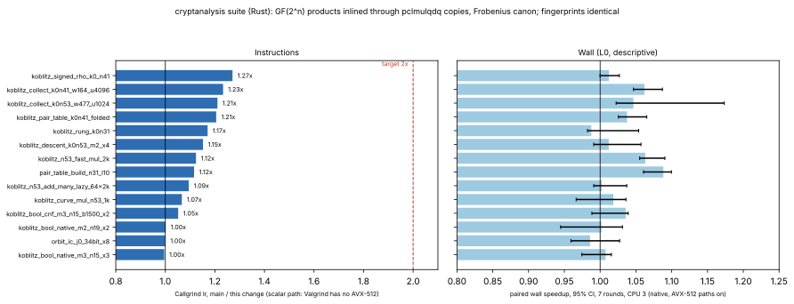

# Rust suite: GF(2^n) products inlined, Frobenius canon tightened

**Date.** 2026-11-03. **Status.** Measured. **Class.** Engineering.

- **Code:** the production Rust crate `suite/`
  (`src/cryptanalysis/semaev_decomp.rs`, `src/cryptanalysis/koblitz_fast.rs`).
- **Results:** every perfindex fingerprint is identical to `main`'s (gate
  valid). The relations, keys, logarithms and the four-lane batch
  inversion are unchanged.
- **Instruments:**
  - Instructions are Callgrind's. Valgrind does not emulate AVX-512, so
    Callgrind measures the scalar paths only.
  - Wall time is the paired perfindex comparison, run natively on this
    AVX-512 + `vpclmulqdq` host with the vector kernels on: descriptive,
    L0, CPU 3 pinned.
- **Target:** half the instructions of the index-calculus code.
  **Outcome:** 1.07–1.27× on the binary-field (Koblitz) index-calculus
  kernels, so not half.



## What changed

- **The carry-less product inlines where it is hot.**
  - `clmul_u64` is a `#[target_feature(enable = "pclmulqdq")]` function.
    The crate is built portably, so a caller compiled without the feature
    cannot inline it, and every field multiplication was a call.
  - `Gf2::batch_inv`, `Gf2::inv` and `FastCurve::add_many_lazy`'s scalar
    body now each have a `pclmulqdq`-enabled copy of the same body. They
    are selected by the run-time detection the field already records.
  - In those copies the product, the byte-table fold and the loop are
    one function. `mul` and `sqr` are `#[inline(always)]`.
- **`FrobeniusCanon::coords`** walks eight byte tables padded with zero
  tables. It is fully unrolled, with immediate shifts, where it used to be
  a loop with variable shifts. A field element has no bytes past
  `⌈n/8⌉`, so the extra tables add zero.
- **`least_rotation`'s zero-run search** advances `rotl^len(zeros)` by one
  constant rotation per step. It used to recompute the rotation from
  `zeros` with a variable shift and a `t == 0` branch. It walks the same
  sequence of words, so it gives the same answer.
  `least_rotation_matches_exhaustive_scan` passes for n = 2..63 on every
  pattern class, as do the orbit tests.
- **New test** `field_products_match_the_reference_fold`: `mul`, `sqr` and
  `dot2` against the reference fold for degrees 2..63.

## Tried and not kept: Barrett reduction by carry-less multiplication

- **The idea:** reduce with `μ = ⌊z^{2n}/f⌋`, which is exact over F₂[z],
  in place of the byte-table fold.
- **Instructions:** it cut much further. Descent 1.46×, collectors
  1.35×/1.28×, signed rho 1.59×
  ([`data/perfindex-instr-barrett-variant.md`](data/perfindex-instr-barrett-variant.md)).
- **Wall time:** slower, because its three carry-less products are one
  dependent chain where the table loads overlap.
  - `koblitz_signed_rho_k0_n41` 0.762× (0.751–0.776).
  - `koblitz_rung_k0n31` 0.902×.
  - `pair_table_build_n31_l10` 0.904×.
  - Index 0.920
    ([`data/perfindex-compare-barrett-variant.md`](data/perfindex-compare-barrett-variant.md)).
- **Dropped.** An instruction count that runs slower is not a speedup.

## Measurements

| kernel | Ir ratio | wall speedup (95% CI) | wall verdict |
|:--|--:|--:|:--|
| `dlp/koblitz_signed_rho_k0_n41` | 1.271 | 1.012 (1.000–1.027) | neutral |
| `relation/koblitz_collect_k0n41_w164_u4096` | 1.233 | 1.062 (1.047–1.087) | neutral |
| `relation/koblitz_collect_k0n53_w477_u1024` | 1.210 | 1.047 (1.022–1.173) | neutral |
| `relation/koblitz_pair_table_k0n41_folded` | 1.205 | 1.038 (1.026–1.065) | neutral |
| `relation/koblitz_rung_k0n31` | 1.171 | 0.988 (0.982–1.054) | neutral |
| `relation/koblitz_descent_k0n53_m2_x4` | 1.152 | 1.012 (0.991–1.057) | neutral |
| `field_ec/koblitz_n53_fast_mul_2k` | 1.124 | 1.063 (1.055–1.090) | faster |
| `pdp/pair_table_build_n31_l10` | 1.116 | 1.088 (1.061–1.100) | faster |
| `field_ec/koblitz_n53_add_many_lazy_64x2k` | 1.094 | 1.002 | neutral |
| `field_ec/koblitz_curve_mul_n53_1k` | 1.067 | 1.018 | neutral |
| `relation/orbit_ic_j0_34bit_x8` | 1.000 | 0.986 | neutral |

The full tables are in `data/` (`perfindex-instr.md`,
`perfindex-compare.md`). Wall index 1.033, both gates valid.

## Why half is not reached, and what would get there

- **Natively the hot Koblitz kernels already run AVX-512.** On this host
  `canon_in_place` and `add_many_lazy` use the existing AVX-512 /
  `vpclmulqdq` kernels, and Callgrind cannot see those. Scalar-path cuts
  therefore show up in wall time only where scalar code remains.
- **Profile of the descent kernel's scalar path, after this change.**
  - `batch_inv`: 22%, about 120 Ir per element.
  - `canon_in_place`: 22%.
  - `add_many_lazy`: 17%.
  - `witnesses_fast_scan`: 13%.
- **The linear-algebra kernels** (`sparse_solve_r45_c4800_w3` 559M Ir,
  `block_wiedemann_r45_n768_w13` 483M) are unchanged.
  - About 45% of each is `CsrMatrix::row_lazy`. Its values are uniform
    45-bit residues, so each entry and lane is one 64×64→128
    multiply-accumulate, already reduced once per lane.
  - About 30–37% is `minimal_approximant_basis`, which updates every
    column's full residual polynomial on every elimination.
- **Next**, each its own change:
  1. A divide-and-conquer (PM-basis) or lazily evaluated residual in the
     approximant basis. The output is the same, at about half the
     multiplications.
  2. GFNI / `vpclmulqdq` batch inversion in the scalar Koblitz collector.

## Reproduce

```sh
python3 scripts/perf/perfindex.py build --ref origin/main --out /tmp/rs-base
python3 scripts/perf/perfindex.py build --current --out /tmp/rs-cand
python3 scripts/perf/perfindex.py instr --base /tmp/rs-base/perfbench --cand /tmp/rs-cand/perfbench --out /tmp/rs-ir --filter koblitz,pair_table,orbit_ic
python3 scripts/perf/perfindex.py compare --base /tmp/rs-base/perfbench --cand /tmp/rs-cand/perfbench --out /tmp/rs-cmp --filter koblitz,pair_table,orbit_ic --rounds 7 --threads 1 --taskset 3
(cd suite && cargo test --release --locked --lib -- field_products_match koblitz_fast batch_inversion)
/tmp/report-venv/bin/python experiments/suite-gf2-clmul-canon-20261103/plot.py
```
