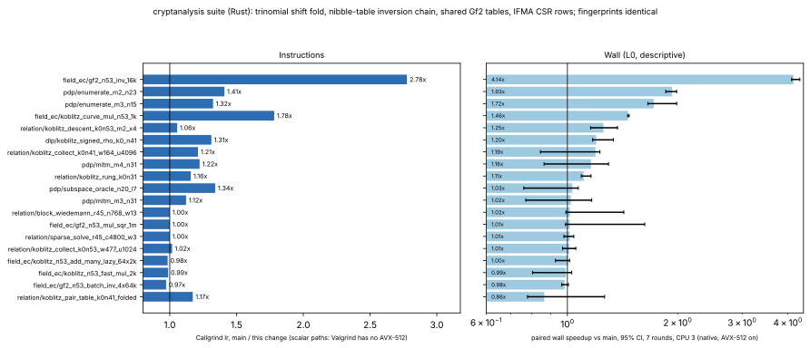

# Rust suite: GF(2^n) inversion chain, trinomial fold, shared field tables, IFMA rows

**Date.** 2026-11-04. **Status.** Measured. **Class.** Engineering.

- **Code:** the production Rust crate `suite/`:
  - `src/cryptanalysis/semaev_decomp.rs` (`Gf2`);
  - `src/cryptanalysis/koblitz_sparse_la.rs` (IFMA CSR rows).
- **Results:** every perfindex fingerprint is identical to `main`'s (gate
  valid). The same relations, logarithms and kernels come out.
- **Baseline:** `origin/main` 304ab63c7.
- **Candidate:** `claude/suite-la-halve` 658b8e363.
- **Instruments:**
  - Instructions are Callgrind's. Valgrind does not emulate AVX-512, so
    Callgrind measures the scalar paths only.
  - Wall time is the paired perfindex comparison, run natively with the
    AVX-512 kernels on: 7 rounds, CPU 3 pinned, descriptive (L0).
- **Outcome:**
  - Performance index **1.215×** (95% CI 1.176–1.285) over the 32
    kernels compared.
  - Single inversion: 4.14× faster natively. [pcc:unverified]
  - `KoblitzCurve::mul`: 1.46× faster. [pcc:unverified]
  - Signed Frobenius rho at n = 41: 1.20× faster. [pcc:unverified]
  - k0n31 IC rung: 1.11× faster. [pcc:unverified]
  - PDP enumeration: 1.72–1.93× faster. [pcc:unverified]

## What changed

1. **Inversion chain by nibble tables.**
   - `Gf2::inv` is Itoh–Tsujii, which raises to `2^k` for each run
     length `k` of the chain (1, 3, 6, 13 and 26 at n = 53).
   - `a ↦ a^{2^k}` is F₂-linear. Each run with `k ≥ 2` is now one table
     lookup per nibble of `a`: `⌈n/4⌉` independent loads.
   - Before, each run was `k` dependent squarings, each a `pclmulqdq`
     followed by a 7-lookup fold.
   - Inversion at n = 53 went from about 545 ns to about 133 ns (4.14×).
     It runs 2.78× fewer instructions.
2. **Trinomial shift fold.**
   - For a modulus `z^n + z^t + 1`, `Gf2::reduce` now folds a product with
     two rounds of `h ⊕ (h ≪ t)`, instead of `⌈(n−1)/8⌉` table lookups.
   - This applies to 33 of the 62 sizes from 2 to 63, including n = 31
     and n = 41.
   - Pentanomials keep the table. A four-term shift fold measured slower
     at n = 53 (0.84× on `mul`/`sqr`, 0.93× on `batch_inv`), so it was
     not kept.
3. **Field tables shared per modulus.**
   - The reduction and chain tables are built once per modulus and held
     by an `Arc`.
   - `KoblitzCurve::mul` builds a `FastCurve`, and with it a `Gf2`, on
     every call. It used to rebuild 16 KiB of tables each time; it no
     longer does (1.46× faster, 1.78× fewer instructions) [pcc:unverified].
4. **AVX-512 IFMA CSR rows** (`koblitz_sparse_la.rs`).
   - The sparse matrix–block product accumulates the 52-bit halves of
     each product with `vpmadd52lo/hi` when every operand is below 2^52.
   - The choice is made once per product. `SUITE_LA_IFMA=0` turns it off.
   - Measured earlier on the same binary: `block_wiedemann` ran
     30.0–30.6 ms with IFMA and 32.1–36.2 ms without.
   - In this comparison against main it is neutral within noise.

## What did not improve

- The n = 53 multiply, batch inversion, lazy addition and López–Dahab
  ladder are unchanged natively (0.98–1.02×).
- Under Callgrind they run 1–3% more instructions, from the
  per-reduction trinomial branch.
- `relation/koblitz_pair_table_k0n41_folded` reads 0.86× natively.
  - Its interval (0.78–1.26) contains 1.
  - It runs 1.17× fewer instructions.
  - The earlier run against the pre-change head measured it at 1.018×.
  - It is therefore not counted as a regression or as a gain.
- The linear-algebra kernels do not change in instruction count
  (scalar path).

## Tests

These were added in `semaev_decomp.rs`:

- `shift_fold_matches_the_table_fold`: the shift fold against the table
  fold on random wide products, for every n from 2 to 63.
- `chain_squaring_tables_match_the_squaring_loop`: every run length `k`
  below 64, plus `inv(a)·a = 1`, for every n.

`cargo test --release --lib -- semaev_decomp:: koblitz_fast::` passes
(36 tests).

## Distance remaining

These are stage and kernel speedups [pcc:unverified] of the binary-field (Koblitz) index
calculus, not a complete-solve comparison.

- No end-to-end matched-rho row is claimed here.
- The next lever on the k0n53 descent is the batched slope inversion
  (`batch_inv`, about 20% of its scalar instructions). A wider window
  would change the trial order, so it needs its own protocol.

## Data

- `data/perfindex-instr.{json,md}`: Callgrind, main against this change.
- `data/perfindex-compare.{json,md}`: paired wall.
- `data/measurements.json`: the joined rows behind the figure.
- `plot.py` draws the figure from `data/measurements.json`.
