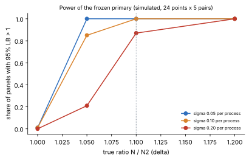

# n = 19 tau6 index calculus end to end in native code: frozen protocol

**Status (2026-10-21): the run is INVALID and gives no verdict.** The protocol
([`protocol.json`](protocol.json)) was frozen at 2026-10-21T01:12:27Z, before any timing, and
is unchanged. The `sage-smoke` job of
[run 39526183111](https://github.com/aburan28/cryptanalysis/actions/runs/39526183111) failed
its Sage smoke gate (8 of 24 gates false) and the `timed` job was skipped, so there is no
timed data. The untimed diagnostic
[run 39522833864](https://github.com/aburan28/cryptanalysis/actions/runs/39522833864) also
failed, so there is no function-level profile of N. Both failures trace to the same
`--lib` option-parsing error in two Sage scripts. See [Results](#results). The workflow is
[`n19-native-loop.yml`](../../.github/workflows/n19-native-loop.yml).

## Question

The current n = 19 row is arm N of
[`volcano-n19-native-tau6-v3-20261020`](../volcano-n19-native-tau6-v3-20261020/README.md)
(PR #1005, run 39387473809). It is Tier 1, with cold CPU B / N = 141.02 [136.75, 144.95] and
cold `S` = 31.42 in that run's rho unit. N is Sage's `tauDlp` running the v3 native
per-shift solve through ctypes.

The question: does a candidate **N2** lower the end-to-end cold CPU of one complete,
verified ECDLP against N? N2 runs the whole pipeline in native code, with no Sage process.
Every target, shift order, shift system, relation, matrix, kernel and log must stay
unchanged.

## Profile of the baseline

; vector:
[figures/profile.svg](figures/profile.svg).](figures/profile.png)

These come from the archived per-process timers of v3 run 39387473809 (140 N processes,
means, in-process CPU). N's cold CPU is 342 ms:

| part of N | ms | share | where it goes |
| --- | ---: | ---: | --- |
| setup | 109.1 | 31.9% | `GF(2^19)`, `TauCurve` (33 V' points: trace, half trace, 29 `lift_x`, then a Frobenius search per point), ctypes load, `generator` |
| native solve (ctypes) | 52.5 | 15.4% | about 5,446 calls at 9.6 µs each, Python call overhead included |
| rest of the relation loop | 161.4 | 47.2% | about 306 targets at about 527 µs each: two Sage scalar multiplications `al P + be Q`, `shuffle`, `fromBits` and base look-ups per solution, the Frobenius image and four sign combinations per candidate, and per-call Python overhead |
| linear algebra | 17.2 | 5.0% | Sage sparse matrix over GF(r), `left_kernel`, the log |
| `tauEigen` + `GF(r)` | 1.9 | 0.6% | before the loop |

The "rest of online" share of 52.7% in the v3 README is the last three rows of this table.

Outside the primary interval, each N process also pays Sage start-up and the source loads.
In run 39387473809 the launcher's child CPU was 1.41 s per N process against a cold
interval of 0.34 s.

A function-level profile of N on the runner is the untimed diagnostic
[`diagnosis/profile_n.sage`](diagnosis/profile_n.sage). It instruments the stages and
checks that the instrumented run reproduces the plain run's counts and digests. It also
runs cProfile, and [`diagnosis/startup_probe.py`](diagnosis/startup_probe.py) records
Sage start-up per launch. It ran as diagnostic run
[39522833864](https://github.com/aburan28/cryptanalysis/actions/runs/39522833864) (phase 1
of the workflow), and the smoke job runs it again on two points; neither is a gate. **Both
crashed before measuring anything** (see [Results](#results)), so the figure above has no
runner panel: the panel needs `profile/timers-*.json`, which was never written. The
diagnostic's output is archived under
[`diagnosis/run_github_39522833864/`](diagnosis/run_github_39522833864/).

## Port scope and exactness

; vector: [figures/design.svg](figures/design.svg).](figures/design.png)

**The largest exact port.** Everything moves to native code
([`native/`](native/), crate `tau6-loop`): setup, the relation loop, the linear algebra
and the log. N2 is one process of the `tau6dlp` binary, and Sage serves only as the oracle.
The per-shift solve is **the v3 source file itself**: `native/src/lib.rs` includes
`../../volcano-n19-native-tau6-v3-20261020/native/src/lib.rs` by path, together with its C
ABI and its tests. Only the work around the solve changes.

| tau.sage step | N2 | why it is the same |
| --- | --- | --- |
| V' base: x = c, 1 ≤ c < 64, Tr(x + 1/x²) = 0, y = x·halfTrace | same arithmetic in GF(2^19) (4-bit comb plus table reduction, tested equal to v3 `gf_mul` on 20,000 products) | unique values |
| orbit representatives: smallest encoding; `E.lift_x(rx)` | `lift_x_all` returns y in ascending encoding | Sage's choice: fixed by the archived relations of all 29 columns (every sign agrees) and by the archived P |
| base table x → (P, column, e, ±1), first e | same search | unique |
| `generator(cur, 'E0')`: `Random('gen:E0')`, `lift_x(x, all=True)[0]`, cofactor 4 | CPython MT19937 port, same draws | equals the archived P (crate test) |
| `tauEigen`: root of t² + t + 2 with λG = τ(G) | Tonelli–Shanks, then the check | unique root |
| targets: `randrange(1, r)` twice, R = al P + be Q, skip zero, `shuffle(shifts)` in place | MT19937 + `_randbelow` + `shuffle` exactly as CPython 3.12 | compared with CPython for every protocol seed (test) |
| per shift: v3 variety in Sage's order, spurious counting, signs (1,1), (1,−1), (−1,1), (−1,−1), first hit | same loop over the v3 `Ctx::solve` | same solve source |
| rows column → Σ sign λ^e (insertion order), rhs (4al, 4be) | same | — |
| `M.left_kernel().basis()`, first vector with B ≠ 0, s = −A/B, s P == Q | reduced echelon basis of the left kernel over GF(r) | the echelon basis of a space is unique; the planted arm compares every vector with Sage's |

**Checks before freezing** (local VM, no Sage; not timing evidence):

- **Crate tests.** `cargo test --release`: 15 of 15 pass. These include the 7 v3 solve
  tests, MT19937 against the reference vector and CPython vectors, SHA-512 and SHA-256, the
  field and the group law, the archived P and λ, archived instance 0 (251 targets, 4,367
  calls, 2 spurious, 39 relations, log 2003), and the kernel being a kernel in reduced
  echelon form.
- **[`tests/test_archived_identity.py`](tests/test_archived_identity.py).** On **all 20 v3
  points**, the binary's counts, log, ordered relations (`relations_raw`), relation digests,
  P and λ equal run 39387473809's **Sage B rows** (PolyBoRi, the unmodified tau.sage). O2
  equals run 38520305068's counts and logs and the v3 O1 relations and digests on all ten
  archived scalars.
- **[`tests/test_pyrand.py`](tests/test_pyrand.py).** The native RNG equals CPython's
  `random` on every protocol seed and on 30 random and non-ASCII seeds. It covers seven
  `randrange` widths, 400 rounds of tauDlp's draw-and-shuffle stream, and shuffles of
  length 1 to 64. CI repeats this test in the Sage image's own Python 3.12.3.
- **[`tests/test_n2x_compare.py`](tests/test_n2x_compare.py).** A pure-Python model of
  tau.sage ([`tests/model_sage.py`](tests/model_sage.py)) has its own independent echelon
  kernel. It is compared with the native trace item by item through the planted arm's own
  comparison code ([`n2x_compare.py`](n2x_compare.py)): equal on the two smoke points and
  archived instance 0. Ten planted corruptions are each caught: a shift order, a relation
  sign, a kernel entry, a representative, a call count, a spurious count, the kernel
  index, a missing target, a missing base entry and λ.
- **[`tests/test_verify_receipt.py`](tests/test_verify_receipt.py).** 20 of 20 pass on
  synthetic receipts. A clean receipt passes, and 19 planted faults fail closed.
- **[`smoke/dryrun_model_sage.py`](smoke/dryrun_model_sage.py).** The real launcher, the
  real binary and the real verifier ran the whole smoke part. A stand-in `sage` answered
  with the model ([`smoke/fake_sage.py`](smoke/fake_sage.py)). Every smoke gate passed
  except `tier1_counters_recorded`, because this VM has no `/proc/schedstat`; GitHub
  runners have it ([`smoke/dryrun_model_sage.json`](smoke/dryrun_model_sage.json)).
- **Local cost split of N2** (cloud VM, a diagnostic, not evidence). A point took 74 ms.
  The v3 solve was about 15.5 µs per call, about 96% of that. The 2 × 306 scalar
  multiplications took about 3 ms and setup 0.15 ms. After this port, N2's cost is the
  unchanged v3 solve.

**The gates in the run.** The full set is in `protocol.json` `gates`.

- **S0.** v3's selftest runs on `libtau6loop.so`'s `tau6_*` solve. On 2,982 systems, Sage's
  variety equals the native one in order, equals the brute force, and equals a direct S3
  evaluation.
- **S0b.** The binary's compiled solve returns Sage's variety, in Sage's order, on the same
  2,982 systems.
- **O1 and O2.** O1 is the baseline on the ten archived scalars. O2 is N2 on them, compared
  with the archived counts and logs and the v3 O1 relations and digests.
- **Field check.** It runs in every native process. Sage arms run v3's `binding_check`, and
  N2X runs it on both libraries. Binary processes record the 256-product sample, and the
  verifier recomputes each product with v3's `pymul` modulo 854355.
- **Per point.** Targets, gb_calls, spurious, relations, log, ordered relations and digests
  are identical across B, N, N2, N2aa, N2X and the warm N2. The representatives are
  identical across the N2 processes and Sage's in N2X.
- **Planted arm N2X.** It runs Sage's path (the v3 N path) alongside N2's pipeline. It
  compares every target (al, be, R, shift order, calls, decomposition), the 29
  representatives, all 33 base entries and λ. It also compares Sage's own
  `M.left_kernel().basis()` vector by vector, its index and the log, and aborts on any
  difference.
- **Smoke only.** On v3 points p00 and p01, every arm equals run 39387473809's archived
  Sage B rows.

## Primary: in-process cold CPU (and why)

- **Primary.** R = Σ cold CPU(N) / Σ cold CPU(N2) over the 120 primary pairs. Cold means
  setup + online, the process CPU clock inside each process: `time.process_time()` in Sage
  and `clock_gettime(CLOCK_PROCESS_CPUTIME_ID)` in tau6dlp, which is the same clock. The
  intervals are N's.
- **Why in-process.**
  1. It is the current row's measure: v3's primary and the ledger's cold `S`. The rho
     unit is in-process CPU too, so the ratchet stays in one unit.
  2. It is **conservative for this candidate**. It leaves out Sage start-up, which only N
     pays (about 1.2 s of child CPU per N process in v3, several times N's whole
     interval), so it can only understate N2's advantage.
  3. Start-up belongs to the interpreter, not to the algorithm.
- **Named process-inclusive secondary, pre-registered.** Child CPU N / N2 (user + system,
  `getrusage` of each launched process: start-up, intervals and post-interval work), over
  the same pairs with the same bootstrap. It gets its own verdict label but never decides.
  Launcher wall is reported beside it. This is the number a user who launches one solve
  would see. The CPU-in-process primary understates it.

## Frozen design

- **Panel.** 24 new scalars ([`inputs/panel.json`](inputs/panel.json), role
  `n19-native-loop-heldout`, seed `volcano-n19-native-loop-20261021:panel`). None is equal
  to, the negative of, or a Frobenius image of an archived scalar, a v1, v2 or v3 panel
  scalar, or another panel scalar. The smoke points are v3 p00 and p01; they are never
  timed.
- **Order.** [`schedule.json`](schedule.json) holds 508 timed processes: S0, S0b, O1, O2,
  then per point (in a seeded shuffled block order):
  - 5 alternating N/N2 pairs with a seeded start;
  - 3 N2/N2aa pairs;
  - 1 N2X/N2 pair;
  - one B, one rho and one warm N2.

  The warm N2 is unpaired, so no paired process does post-interval batch work.
- **Interval.** A two-stage paired bootstrap (points, then pairs within each drawn point),
  10,000 draws, `random.Random(2026102101)`, 95%. Improvement iff the lower bound is above
  1, regression iff the upper bound is below 1.
- **Controls.**
  - A/A: N2/N2aa estimate inside [0.95, 1.05] over 72 pairs.
  - Planted: N2X/N2 lower bound above 1 over 24 pairs.
- **Secondaries.** These never decide:
  - the geometric mean of the pair ratios;
  - online, setup, cold wall, child CPU and launcher wall N/N2;
  - per-point ratios, start order and pair position;
  - `S` per arm and the N2 gap to rho;
  - the chain B / N2;
  - N2's phase shares;
  - warm means.

.](figures/power.png)

- **Power** ([`analysis/power.json`](analysis/power.json)). The model uses per-point N costs
  from v3's N processes and log-normal per-process noise σ = 0.05, 0.10 or 0.20.
  - Power at a true ratio of 1.10 is at least 0.87 (σ = 0.20) and 1.00 for σ ≤ 0.10.
  - The rejection rate with no effect is at most 0.01.
  - The A/A window fails in 0% of panels at σ ≤ 0.10 and 17% at σ = 0.20. v3's A/A was
    1.0003, which points to the low σ.
  - The expected effect is far larger: about 1 / 0.154 ≈ 6.5 if the port cost nothing.
- **Runtime and time guard.**
  - The smoke job takes about 15 min. The timed job takes about 35 min: the gates about
    2 min, then per point about 65 s (B 35–65 s dominates).
  - The worst case, with B at 100 s, is about 50 min. Queueing included, the whole run
    should take about 1 to 1.5 h, inside the 3 h budget.
  - Before each segment, the guard skips it if the elapsed time plus max(its upper
    estimate, 1.1 × the longest point segment so far) exceeds 175 min. A skip makes the
    verdict invalid.
  - The job timeout is 200 min.
- **Tier.** Tier 1: one fresh GitHub-hosted ubuntu-24.04 runner, one pinned exposed CPU
  and one fresh process per run. The image is `sagemath/sagemath:10.10@sha256:310dfe23…`,
  and the three native artifacts are built with Rust 1.99.0. It is CPU-only, has one host
  class and is not replayed. A container affinity mask records placement, not host-wide
  exclusivity.

## Launch

- **Dispatch was tried first and refused.** `workflow_dispatch` through the GitHub
  integration returned 403 "Resource not accessible by integration"; the workflow is not on
  the default branch.
- **The push trigger launched it.** The push of the frozen commit `67bff8998` to
  `claude/n19-native-loop` started
  [run 39526183111](https://github.com/aburan28/cryptanalysis/actions/runs/39526183111),
  through the owner-approved path-limited trigger: first job `sage-smoke`, then job `timed`,
  which needs it. It shares a concurrency group with the phase-1 diagnostic run
  39522833864, so it starts after that one.
- **What does not trigger a run.** README, figures, `make_figures.py`, `report_header.tex`,
  `smoke/`, `diagnosis/` and `run_github_*/`.

## Results

(`invalid`); vector: [figures/result.svg](figures/result.svg).](figures/result.png)

**Verdict: INVALID. No primary, no A/A, no planted bound, no secondaries.** The frozen rule
makes a run invalid if the smoke job or any smoke gate fails, if the timed job or any timed
gate fails, or if the time guard skips segments. The first condition holds, and the timed
job never started. Nothing below is a timing result, and no ratio was computed. The run
neither supports nor refutes N2, and the ledger's n = 19 row is not changed.

**Run.** [Run 39526183111](https://github.com/aburan28/cryptanalysis/actions/runs/39526183111)
(commit `67bff8998`) queued behind the diagnostic from 2026-10-21T01:14Z and started at
04:53Z (it was queued for about 3.5 h).
`sage-smoke` ran 04:53 to 05:00Z and failed at its last step, `Sage smoke gate`; `timed`
was skipped. Archive: [`run_github_39526183111/`](run_github_39526183111/) (the three
native build products are left out; their digests are in `binaries.sha256` and
`smoke/correctness.json`).

**Smoke gates.** 16 of 24 pass, 8 fail:

| gate | state |
| --- | --- |
| `every_scheduled_row_valid` | false: the two N2X rows (serials 9, 16) exited 1 and wrote no row |
| `field_check_every_native_process` | false (the N2X processes ran no field check) |
| `planted_compared_every_item` | false: N2X never ran its comparison |
| `counts_and_log_identical_per_point` | false on v3p00 and v3p01 (N2X missing from the set) |
| `relations_identical_per_point` | false on v3p00 and v3p01 (same) |
| `setup_identical_per_point` | false on v3p00 and v3p01 (same) |
| `generator_equals_archived` | false on v3p00 and v3p01 (same) |
| `smoke_points_equal_v3_archive` | false (same) |

The last five are the per-point identity gates; their failure is consistent with the missing
N2X rows, and I did not separate it from other causes. What passed: S0 (2,982 systems,
Sage's variety equal to the native one, the brute force and the S3 evaluation in every
system), S0b, O1, O2, the host CPU identity, one native-artifact digest, placement, raw
records, relation digests recomputed, rho, schedule order and regeneration, the runner
identity against the frozen files, the Tier 1 counters, and the warm batch. The
crate tests, the verifier's planted corruptions, the pure-Python checks and the Sage
image's RNG check passed in earlier steps.

**Cause.** `arm_n2x.sage` line 107 does `os.path.abspath(opt('--lib'))` and `opt('--lib')`
returned `None` in both smoke N2X launches, so Python raised `TypeError` (the logs are
`smoke/logs/smoke-009.err` and `smoke-016.err`). The command lines did contain `--lib
/rd/lib/libtau6loop.so`. `diagnosis/profile_n.sage` fails the same way at line 264, in the
diagnostic and again in the smoke job. I did not determine why the option is lost between
the launcher and `sys.argv` under `sage <file>.sage`; this is a frozen-source defect and
nothing was re-run or edited.

**What the smoke rows do show (untimed, correctness only, never used for timing).** On
v3p00 (4,780 solver calls, 0 spurious, 39 relations, log 43903) and v3p01 (5,958 calls,
2 spurious, 39 relations, log 99184), the B, N, N2, N2aa and warm N2 rows all report the
same counts and log. That is the same agreement the pre-freeze tests found, now on the
runner for the arms that ran. N2X, the arm that compares N2's pipeline item by item with
Sage's own, did not run, so the planted exactness check is untested on the runner.

**Diagnostic run 39522833864 (profile).** It failed at the profile step: Sage 10.10 started
and `profile_n.sage` died on the same line before any stage timer, cProfile or startup
probe wrote. Only the runner record, the toolchain, the host CPU and the digests were
kept ([`diagnosis/run_github_39522833864/`](diagnosis/run_github_39522833864/)). **There is
no function-level profile of N on the runner.** The smoke job's startup probe did run
([`run_github_39526183111/profile/startup.json`](run_github_39526183111/profile/startup.json),
untimed, no claim): `sage -c pass` cost 0.782 s child CPU (0.814 s wall) per launch,
`sage -python -c pass` 0.033 s, and `sage -python` with `import sage.all` 0.780 s. This
supports, but does not measure, the README's statement that most of N's process-inclusive
cost is Sage start-up. The "load the v3 arm" launch crashed on the same error (1.07 s, not
a load time).

**Reproduction of the verifier.** `verify_receipt.py --part smoke` was re-run on a copy of
the archived `smoke/` directory (Python 3.13, no Sage needed). Its standard output
equals `smoke-verify-stdout.json` and the regenerated `smoke/correctness.json` equals the
archived one, byte for byte (`cmp`). There is no `result.json` or `result_table.md`, because
the timed part never ran.

**Tier 1 isolation.** Not assessable for a timed claim: nothing was timed. For the record,
the smoke job ran on one pinned vCPU (CPU 0) of an AMD EPYC 9V74 VM with a uniform CPU
record, the placement, host identity and Tier 1 counter gates passed, and the Sage image
and Rust toolchain were the pinned ones.

**Pre-registered secondaries.** Setup, online, solve share and linear algebra of N2,
`S` per arm and the gap to the matched rho, per-pair spread and the order effect, the
process-inclusive child CPU and launcher wall ratios were all unmeasured.

**What follows.** A new protocol freeze is needed, because a fix to `arm_n2x.sage` and
`diagnosis/profile_n.sage` changes frozen files (`arm_n2x.sage` is in `FROZEN_LIST`).
Nothing was re-run here.

## Next improvement

After this port the v3 solve is the cost: about 96% of N2 locally. It zero-fills a
`[u32; 65536]` key buffer (256 KB) on every call while it uses at most 4,096 entries, and
it decides all 4,096 (u, w) pairs by enumeration. Sizing the buffer to 2^(2k) and solving
the linear system in w per u should cut it severalfold. S0 already pins down its output
order.

## Files

- **Code.**
  - `native/`: the crate, with `src/bin/tau6dlp.rs` as arm N2;
  - `arm_n2x.sage` (the planted arm) and `n2x_compare.py`;
  - `run_schedule.py`, `verify_receipt.py` and `stats.py`.
- **Frozen inputs.**
  - `make_protocol.py` → `protocol.json`;
  - `make_panel.py` → `inputs/panel.json`;
  - `make_schedule.py` → `schedule.json`;
  - `power_check.py` → `analysis/power.json`.
- **Baseline, unchanged.** `../volcano-n19-native-tau6-v3-20261020/arm.sage` and its
  `native/`.
- **Checks.** `tests/` and `smoke/`.
- **Diagnosis.** `diagnosis/`, with `diagnosis/run_github_39522833864/` (failed).
- **Runs.** `run_github_39526183111/` (invalid; smoke only).
- **Report.** `make_figures.py`, `figures/`, `README.pdf` and `report_header.tex`.
