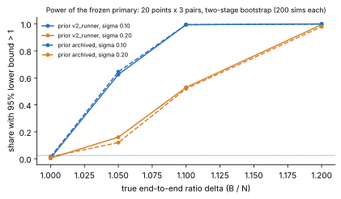

# n = 19 tau6 native per-shift solve, protocol v3

**Status (2026-10-20): frozen before any timing. The run is launched, and
no result exists yet.** v3 replaces
[v2](../volcano-n19-native-tau6-v2-20261019/README.md). v2's Tier 1 run,
[39376405326](https://github.com/aburan28/cryptanalysis/actions/runs/39376405326),
was invalid: S0 on 2,682 systems, O1 and the field check passed, but every
timed IC row (B, N, Naa and NX on all 16 points) crashed after its interval
in `arm.sage`'s `relation_digests`. v1's and v2's protocols and archives are
unchanged. The workflow is
[`n19-native-tau6-v3.yml`](../../.github/workflows/n19-native-tau6-v3.yml).

## Root cause of v2's crash

See [`diagnosis/README.md`](diagnosis/README.md) for the full account. In
short, the Sage preparser turns the literal `0` in
`row.get(col, 0)` into a Sage `Integer`. Every value of the relation-rows
digest was therefore an `Integer`, and `json.dumps` refused it:
`TypeError: Object of type Integer is not JSON serializable`.

- The run's traceback places the failure at `h(rows)`, after the `ordered`
  and `canonical` digests succeeded. This holds in all 64 IC logs.
- A local emulation on v2 point p00
  ([`diagnosis/emulate_preparser.py`](diagnosis/emulate_preparser.py)) runs
  v2's own function. In plain Python it succeeds. With integer literals made
  `Integer`, it fails exactly as on the runner.
- The smoke job reruns v2's `arm.sage` on rows p00-N and p00-B in the pinned
  image ([`diagnosis/digest_repro.sage`](diagnosis/digest_repro.sage)).
- v2's local checks were pure Python, and no Sage check before the timed
  rows ever wrote an IC row.

; vector:
[figures/crash_diagnosis.svg](figures/crash_diagnosis.svg).](figures/crash_diagnosis.png)

## What v3 changes

| | v2 | v3 |
| --- | --- | --- |
| relation digests | in `arm.sage` (preparsed) | [`relation_digest.py`](relation_digest.py), plain Python, `operator.index` on every input; same definitions |
| row serialization | `json.dump(..., default=jplain)`, falls back to `str()` | `relation_digest.plain`, strict: Sage Integer → int, reals → float, anything else raises |
| raw record | row file only | row bytes also on stdout as `raw_b64` + SHA-256; the verifier checks them against the row file and the schedule |
| relations | digests only | each IC row and O1 instance records its raw relations, and the verifier recomputes every digest |
| Sage smoke gate | none (the local smoke ran pure Python) | **job `sage-smoke`, untimed**: S0, O1, and v2 points p00 and p01 through B, N, Naa, NX and rho in the pinned image; 20 gates; the timed job `needs` it and uses its library |
| O1 | counts and logs | also the relation digests of all ten archived ECDLPs (the crashing path, before any timed row), and the archived λ |
| S0 | 7 v1 systems + 300 + 2,375 multi = 2,682 | + v2's 300 re-derived from v2's seed + 300 new (v3 seed) = 2,982; the detail digest is recomputed |
| design | 1 process per arm per point, 16 points | **20 points × (3 alternating B/N pairs + 3 N/Naa pairs + 1 NX/N pair + 1 rho)**, seeded ABAB/BABA starts, shuffled block order |
| interval | one-stage bootstrap over points (numpy) | **two-stage paired bootstrap** (points, then pairs), 10,000 draws, `random.Random(2026102003)` |
| isolation records | affinity only | per run: `Cpus_allowed_list`, the arm's affinity, `/proc/schedstat`, `/proc/stat`, `getrusage`, `isolated_bench` counters and noise, library digest before and after; `host_cpu_record` at start and end |
| verifier | gate names free-form | fixed gate set, equal to `protocol.json` `gates_required`; a missing, unknown or non-boolean gate makes the verdict invalid; 12 planted-corruption tests |
| trigger | dispatch (main); path-limited push (branch) | dispatch, and push limited to branch `claude/n19-native-v3` and this experiment's frozen paths (owner-approved pattern of v2) |

The solve (`native/src/lib.rs`), the binding (`native_binding.py`), the
question, the arms, the intervals (setup, online, cold) and the field check
are v2's, byte for byte where they are code.

## Frozen design

;
vector: [figures/design.svg](figures/design.svg).](figures/design.png)

- **Primary.** R = Σ cold CPU(B) / Σ cold CPU(N) over the 60 primary pairs,
  where cold = setup + online, `time.process_time()` inside each fresh
  pinned Sage process. The interval is a two-stage paired bootstrap at 95%.
  Improvement iff the lower bound is above 1, regression iff the upper bound
  is below 1, otherwise not separated.
- **Controls.**
  - A/A: N/Naa over 60 pairs, estimate inside [0.95, 1.05].
  - Planted: NX/N over 20 pairs, lower bound above 1. NX redoes the Sage
    solve on every shift system and compares it with the native one.
- **Gates.** There are 24 (20 in smoke):
  - schedule identity, raw digests, recomputed relation digests and one
    library digest;
  - pinning, CPU identity and the Tier 1 counters;
  - S0, O1 and the field check in every native process;
  - identical counts, logs, rows, canonical and ordered decompositions
    across every IC process of a point;
  - NX comparing every call, the archived generator, rho 64/64 and the warm
    batch;
  - the smoke gate and complete pairs.

  Every gate is listed in `protocol.json` `gates`.
- **Panel.** 20 new scalars (`inputs/panel.json`, role
  `n19-native-heldout-v3`, seed `volcano-n19-native-tau6-v3-20261020:panel`).
  None is equal to, the negative of, or a Frobenius image of an archived,
  v1 or v2 panel scalar. The order, S0, power and bootstrap seeds are all
  new.
- **Power** ([`analysis/power.json`](analysis/power.json)).
  - Model: per-process log-normal noise σ = 0.10 or 0.20, and per-point
    costs from v2's B processes or from the archived rows.
  - Power at a true ratio of 1.20 is at least 0.98. At 1.10 it is 0.995
    (σ = 0.10) or 0.52 (σ = 0.20).
  - The rejection rate with no effect is at most 0.015.
  - The A/A window fails with no effect in 1–2% of panels at σ = 0.10 and
    18–23% at σ = 0.20. v2's N launcher walls varied from 1.8 to 2.2 s,
    which points to the lower σ.
  - The expected effect is far larger: in v2's run, B processes took 57–99 s
    and N processes 1.8–2.2 s, Sage start-up included.
- **Runtime and time guard.**
  - The smoke job takes about 10 min. The timed job takes about 2 h, and
    about 2.6 h if every B process takes 100 s.
  - Before each segment, the guard skips it if the elapsed time plus
    max(its upper estimate, 1.1 × the longest point segment so far)
    exceeds 175 min. A skip makes the verdict invalid.
  - The job timeout is 200 min.
- **Tier.** Tier 1 as AGENTS.md defines it. The run uses one fresh
  GitHub-hosted ubuntu-24.04 runner and one pinned exposed CPU, and the
  image is `sagemath/sagemath:10.10@sha256:310dfe23…`. It is CPU-only, has
  one host class and is not replayed. A container affinity mask records
  placement, not host-wide exclusivity.

.](figures/power.png)

## Local checks before freezing (cloud-agent VM, no Sage; not timing evidence)

- **`cargo test --release --locked`.** 7 of 7 pass (rustc 1.97.0 locally;
  the runner pins 1.99.0).
- **[`smoke/local_v3.py`](smoke/local_v3.py)** runs a pure-Python tauDlp with
  the v3 binding and digests ([`smoke/local_v3.json`](smoke/local_v3.json)).
  - The ten archived scalars give counts and logs equal to run 38520305068.
  - All logs verify on the two smoke points and the 20 v3 points.
  - On the 20 v3 points, gb_calls average 5,446 (range 3,673 to 7,095); v2's
    panel averaged 5,653.
- **[`diagnosis/emulate_preparser.py`](diagnosis/emulate_preparser.py)**
  reproduces v2's error and shows that v3's digests are equal and type-safe.
- **`tests/test_verify_receipt.py`.** 12 of 12 pass on synthetic receipts:
  - a clean receipt passes;
  - each of these fails closed: a tampered row file, a digest that does not
    recompute, a schedule mismatch, a command mismatch, a raw record of
    another point, an unpinned process, an unknown, missing or non-boolean
    gate, a protocol gate list that differs, a failed A/A, counts that
    differ between arms, a time-guard skip, and a missing smoke receipt.
- **[`smoke/dryrun_fake_sage.py`](smoke/dryrun_fake_sage.py)** checks the
  mechanics of the runner and verifier, with a stand-in `sage` that emits
  synthetic records ([`smoke/dryrun_fake_sage.json`](smoke/dryrun_fake_sage.json)).
  - The real `run_schedule.py` launches every smoke run pinned and records
    the isolation fields. The real verifier passes 19 of 20 smoke gates.
  - The exception is `tier1_counters_recorded`: this VM has no
    `/proc/schedstat`. GitHub runners have it (n = 83 run 39359922687 records
    it).

## Launch

The workflow is
[`.github/workflows/n19-native-tau6-v3.yml`](../../.github/workflows/n19-native-tau6-v3.yml).
Run URL: see the Launch record below.

## Files

- **Code.**
  - `arm.sage` (one row per process), `relation_digest.py`,
    `native_binding.py` and `native/`;
  - `run_schedule.py` (the launcher and Tier 1 records), `verify_receipt.py`
    (fail closed) and `stats.py`.
- **Frozen inputs.**
  - `make_protocol.py` → `protocol.json`;
  - `make_panel.py` → `inputs/panel.json`;
  - `make_schedule.py` → `schedule.json`, with the parts smoke and timed;
  - `power_check.py` → `analysis/power.json`;
  - `inputs/multi_systems.json`, v2's 2,375 multi-solution systems.
- **Checks.** `tests/`, `smoke/` and `diagnosis/`.
- **Report.** `make_figures.py`, `figures/`, `README.pdf` and
  `report_header.tex`.
