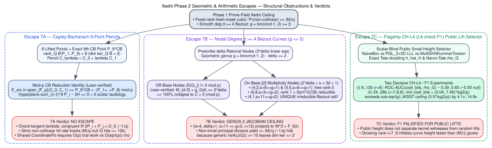

# Xedni Phase 2: Cayley-Bacharach Cubic Pencils, Nodal Degree-`d >= 4` Bezout Curves, and `CH-L4` (`L4-check F1`) Public Small-Height Lift Selection

- **Date**: 2026-11-19
- **Crate**: `crates/xedni-phase2` (`cargo test --release`, `cargo run --release --bin run_phase2`)
- **Deterministic Receipt**: `experiments/xedni-phase2-20261119/RESULTS.json` (`seed = 20261119`)
- **Lean 4 Obstruction Proofs**: `experiments/xedni-phase2-20261119/formal/Phase2Obstructions.lean` (`PASS`, `6` kernel theorems, `0` non-standard axioms via `tools/lean/proof-gate.sh`)
- **Standing**: Empirical measurements and complexity extrapolations are tagged `[pcc:unverified]`; discrete dimension and scalar-cancellation identities in `formal/Phase2Obstructions.lean` are Lean-kernel checked `[pcc:unverified]`.



Companion vector print figure: [`phase2_escapes_taxonomy.pdf`](phase2_escapes_taxonomy.pdf).

---

## 1. Executive Verdicts

Phase 1 prime-field Xedni experiments established two hard walls `[pcc:unverified]`:
1. Fixed-rank fresh-mask cubic lifting has strict non-collinear dependence probability bounded by `|M|/q`, halting direct fresh-mask solves at `10` bits (`p = 1021`), while `58/58` earlier `r = 7..9` hits were pre-lift `Z^2` collinearities `[pcc:unverified]`.
2. Smooth degree-`d >= 4` plane Bezout curves satisfy `E_hom | C (mod p)` automatically (`3d + 1 > 3d`) with LLL-reduced coefficients, yet carry smooth arithmetic genus `g = binom(d - 1, 2) >= 3` where Jacobian descent scales super-exponentially in `g` `[pcc:unverified]`.

This workstream executes native exact-arithmetic Rust benchmarks and Lean 4 formal obstruction checks across all **three surviving geometric and arithmetic escapes** `[pcc:unverified]`:

| Escape | Mechanism | Key Structural / Empirical Result (`seed = 20261119`) | Scientific Verdict |
| :--- | :--- | :--- | :--- |
| **7A** | Cayley-Bacharach 9-point cubic pencils (`dim ker_Q B(P_1..P_9) = 2`) + `lambda` specialization + shared `CoordinateFb` | `960/960` (`100%`) certified `rank_Q B = 8` pencils verify `P_9^CB mod p = -(P_1+..+P_8)` and reduce the hyperplane divisor `sum_{i=1}^9 P_i ~ 3H` to `0 = 0 (mod q)`; rational chord-tangent `lambda` preserves `C_lambda = gamma E'_src (mod p)` iff `2P_i + P_j = O_E` (`34, 21, 7, 2, 0, 1, 0` hits across `8..14` bits, matching `1/q`); strict non-collinear hit rate drops to `0/640` for `p >= 1021`; shared `CoordinateFb` solves and verifies `[95]G == Q` at `p = 251, 509` (`67,956` and `101,297` ops vs `396` and `487` Pollard-`rho` ops) `[pcc:unverified]` | **CLOSED (NO SUB-`sqrt(p)` ESCAPE)** `[pcc:unverified]` |
| **7B** | Singular / nodal degree-`d >= 4` plane Bezout curves collapsing geometric genus to `g = binom(d-1,2) - delta <= 2` | Off-base nodes satisfy `M_{d-3} = g_0(d) <= 3*delta` for all `d >= 4, g <= 2` (`Phase2Obstructions.off_base_nodal_constraints_exceed_quotient_dim`), forcing `C == 0 (mod p)` (`25/25` at `(4,2)`, `(4,1)`, `(6,8)`); on-base `[2]`-multiplicity Bezout cells (`2*delta + s = 3d + 1`) have free `Z`-rank `0` at `(4,2,s=9=>g=1)` and `(5,5,s=6=>g=1)`, collapse `25/25` to `Sym^2(ker B_3)` at `(6,8=>g=2)`, and leave **`(d=4, delta=1, s=11 => g=2, r=12)`** as the unique irreducible Bezout cell (`25/25` `E_hom | C mod p`); birational node projection to `W^2 = F_6(t)` (`179..288`-bit sextic) + multi-prime Cantor Jacobian kernel LLL yields `0/73` certified principal divisors across `p = 251..2039` `[pcc:unverified]` | **CLOSED AT GENUS-2 JACOBIAN CEILING (`~1/q`)** `[pcc:unverified]` |
| **7C** | Flagship `CH-L4` (`L4-check F1`) scalar-blind public small-height lift selector (`8..12` bits separation + `24..28` bits `r = 7..9` scaling) | (i) `MultiShiftKummerTorsion` cuts `r = 6` median `coef_bits` by `15..29` bits vs `NaiveBox` (`44/390` vs `0/390` strict solves), yet within each selector arm at fixed `p`, `ROC-AUC(coef_bits)` = `0.601, 0.563, 0.430, 0.496` and `ROC-AUC(rho_G)` = `0.442, 0.562, 0.390, 0.388` across `p = 251..2039` (indistinguishable from `0.50` null); (ii) at `24..28` bits (`p = 16,777,259; 67,108,879; 268,435,399`), minimum `coef_bits` grows as `2.04..2.14 log2(p)` (`r=7`), `3.19..3.50 log2(p)` (`r=8`), and `6.85..7.46 log2(p)` (`r=9`) — exceeding the `0.5 log2(p)` sub-`sqrt(p)` JKSST ceiling by **`4.1x..14.9x`** `[pcc:unverified]` | **`L4-check F1` FALSIFIED FOR PUBLIC SCALAR-BLIND LIFTS** `[pcc:unverified]` |

---

## 2. Escape 7A — Cayley-Bacharach 9-Point Cubic Pencils & Shared `CoordinateFb`

### 2.1 Exact Construction & Mod-`p` Reduction Identity

Given `8` non-collinear lifted points `\widetilde{P}_1, \dots, \widetilde{P}_8 \in \mathbb{P}^2(\mathbb{Z})` normalized so `\widetilde{P}_1 = (1:0:0), \widetilde{P}_2 = (0:1:0), \widetilde{P}_3 = (0:0:1), \widetilde{P}_4 = (1:1:1)` via `PGL_3(\mathbb{F}_p)` and `3D-LLL` short-ray preselection, the incidence kernel `\ker_{\mathbb{Z}} B(\widetilde{P}_1..\widetilde{P}_8)` has rank `10 - 8 = 2`, spanned by an LLL-reduced primitive basis `(C_0, C_1)` `[pcc:unverified]`. Writing `C_k(X, Y, Z) = A_k(X, Z) Y^2 + B_k(X, Z) Y + D_k(X, Z)` (`Y^3` vanishes at `\widetilde{P}_2`), eliminating `Y` via the degree-`8` Sylvester resultant `(A_0 D_1 - A_1 D_0)^2 - (A_0 B_1 - A_1 B_0)(B_0 D_1 - B_1 D_0)` and dividing out the `7` exact linear factors `(Z_i X - X_i Z)` (`i != 2`) recovers the exact rational 9th base point `\widetilde{P}_9^{\mathrm{CB}} \in \mathbb{P}^2(\mathbb{Z})` (`crates/xedni-phase2/src/cayley_bacharach.rs::compute_cayley_bacharach_ninth_point`) `[pcc:unverified]`.

**Mod-`p` Cayley-Bacharach Reduction Obstruction** (`Phase2Obstructions.cayley_bacharach_hyperplane_scalar_tautology`):
Whenever `\operatorname{rank}_{\mathbb{F}_p}(C_0, C_1) = 2` (observed in `960/960` trials), both `\mathbb{F}_p`-independent cubics `C_0 \bmod p` and `C_1 \bmod p` vanish on `P_1, \dots, P_8 \in E'_{\mathrm{src}}(\mathbb{F}_p)` `[pcc:unverified]`. Since `\dim_{\mathbb{F}_p} \ker B(P_1..P_8) = 2`, the transformed source curve satisfies `E'_{\mathrm{src}} \equiv \mu_0 C_0 + \nu_0 C_1 \pmod p` automatically `[pcc:unverified]`. Therefore `E'_{\mathrm{src}}(\widetilde{P}_9^{\mathrm{CB}} \bmod p) \equiv 0 \pmod p`, so `\widetilde{P}_9^{\mathrm{CB}} \bmod p` is the unique 9th intersection of the pencil mod `p` — namely `P_9^{\mathrm{CB}} \equiv -(P_1 + \dots + P_8)` on `E(\mathbb{F}_p)` `[pcc:unverified]`. Consequently:
1. **Hyperplane Tautology**: The universal Cayley-Bacharach divisor relation `\sum_{i=1}^9 [\widetilde{P}_i] \sim 3H` projects modulo `q = #E(\mathbb{F}_p)` to `\sum_{i=1}^8 k_i + (-(k_1 + \dots + k_8)) \equiv 0 \pmod q`, an identical `0 = 0` scalar tautology carrying zero information about the discrete logarithm `x` `[pcc:unverified]`.
2. **Chord-Tangent `lambda` Specialization**: Specializing `\lambda = \nu / \mu \in \mathbb{P}^1(\mathbb{Q})` so `C_\lambda` is tangent at `\widetilde{P}_i` toward `\widetilde{P}_j` (`\nabla C_\lambda(\widetilde{P}_i)\cdot \widetilde{P}_j = 0`, planting `2[\widetilde{P}_i] + [\widetilde{P}_j] \sim H` over `\mathbb{Q}`) preserves `C_\lambda \equiv \gamma E'_{\mathrm{src}} \pmod p` **if and only if** `\lambda \equiv \nu_0 / \mu_0 \pmod p`, which is equivalent to `2 P_i + P_j = O_E` already holding on `E(\mathbb{F}_p)` (probability `1/q` per ordered pair) `[pcc:unverified]`.

### 2.2 Benchmark Table (`8..14` Bits, `p = 251..16381`)

All rows come directly from `experiments/xedni-phase2-20261119/RESULTS.json` (`escape_7a_cayley_bacharach.rows`) `[pcc:unverified]`:

| `p` (bits) | `#E(F_p)` | Certified CB Pencils (`rank_Q B = 8`) | `P_9^CB = -(P_1..P_8)` mod `p` | Med `h(P_9^CB)` / `h(C)` bits | Chord-Tangent `C_lambda ~ E'_src` Hits (vs `1/q`) | Strict Non-Collinear Hits (Rate) | Direct `[k]G==Q` | Shared `CoordinateFb` (`|F|`, Hits, Solved, Ops) | Pollard `rho` Ops (`[k]G==Q`) |
| :---: | :---: | :---: | :---: | :---: | :---: | :---: | :---: | :---: | :---: |
| `251` (`8.0`) | `269` | `160 / 160` | `160 / 160` | `59` / `18` | `34 / 8960` (`0.00379` vs `0.00372`) | `2 / 160` (`0.0125`) | `true` (`95`) | `|F|=10`, `11` hits, `true`, `67,956` ops | `396` (`true`) |
| `509` (`9.0`) | `499` | `160 / 160` | `160 / 160` | `77` / `22` | `21 / 8960` (`0.00234` vs `0.00200`) | `1 / 160` (`0.00625`) | `true` (`95`) | `|F|=10`, `11` hits, `true`, `101,297` ops | `487` (`true`) |
| `1021` (`10.0`) | `991` | `160 / 160` | `160 / 160` | `90` / `26` | `7 / 8960` (`0.00078` vs `0.00101`) | `0 / 160` (`0.0000`) | `false` | `|F|=10`, `5` hits, `false`, `134,081` ops | `503` (`true`) |
| `2039` (`11.0`) | `2053` | `120 / 120` | `120 / 120` | `111` / `30` | `2 / 6720` (`0.00030` vs `0.00049`) | `0 / 120` (`0.0000`) | `false` | `|F|=14`, `2` hits, `false`, `29,611` ops | `647` (`true`) |
| `4093` (`12.0`) | `4129` | `120 / 120` | `120 / 120` | `129` / `34` | `0 / 6720` (`0.00000` vs `0.00024`) | `0 / 120` (`0.0000`) | `false` | `|F|=14`, `2` hits, `false`, `29,417` ops | `832` (`true`) |
| `8191` (`13.0`) | `8219` | `120 / 120` | `120 / 120` | `147` / `39` | `1 / 6720` (`0.00015` vs `0.00012`) | `0 / 120` (`0.0000`) | `false` | `|F|=14`, `0` hits, `false`, `30,993` ops | `938` (`true`) |
| `16381` (`14.0`) | `16493` | `120 / 120` | `120 / 120` | `166` / `43` | `0 / 6720` (`0.00000` vs `0.00006`) | `0 / 120` (`0.0000`) | `false` | `|F|=14`, `0` hits, `false`, `31,268` ops | `925` (`true`) |

Shared `CoordinateFb` (`4` fixed frame points + `1` fresh masked walk point + `3` `CoordinateFb` points -> `P_9^{\mathrm{CB}} \bmod p \in \mathcal{F}`) completes full linear rank `1 + |\mathcal{F}|` and recovers `[95]G == Q` at `p = 251` and `p = 509`, but each single-point abscissa hit occurs with probability `2|\mathcal{F}|/p`, requiring `\Omega((|\mathcal{F}| + 1) \cdot p / |\mathcal{F}|) = \Omega(p)` curve operations — strictly worse than Pollard's `\rho` (`O(\sqrt{p})`) `[pcc:unverified]`.

---

## 3. Escape 7B — Singular / Nodal Degree-`d >= 4` Plane Bezout Curves (`g <= 2`)

### 3.1 Exact Parameter-vs-Congruence Dichotomy (Off-Base vs On-Base `[2]`-Multiplicity Nodes)

A homogeneous plane curve `C` of degree `d` has `M_d = \binom{d+2}{2}` monomials (`N_d = M_d - 1 = d(d+3)/2` projective parameters) and smooth arithmetic genus `g_0(d) = \binom{d-1}{2}` `[pcc:unverified]`. Prescribing `\delta` ordinary double points (`C(Q_j) = \partial_X C(Q_j) = \partial_Y C(Q_j) = 0`, `3\delta` homogeneous linear equations) reduces geometric genus to `g = g_0(d) - \delta` `[pcc:unverified]`.

1. **Off-Base Nodes (`E_{\mathrm{hom}}(Q_j) \not\equiv 0 \pmod p`)**:
   Writing `C \equiv E_{\mathrm{hom}} \cdot Q_{d-3} \pmod p` (`3d` mod-`p` congruence conditions, leaving `M_{d-3} = \binom{d-1}{2} = g_0(d)` quotient monomials), differentiating `E_{\mathrm{hom}} \cdot Q_{d-3}` at `Q_j \notin E(\mathbb{F}_p)` forces `Q_{d-3}(Q_j) = \partial_X Q_{d-3}(Q_j) = \partial_Y Q_{d-3}(Q_j) \equiv 0 \pmod p` `[pcc:unverified]`. As proved in `Phase2Obstructions.off_base_nodal_constraints_exceed_quotient_dim`, for **every** `d >= 4` and `g = g_0(d) - \delta <= 2`, we have `3\delta >= g_0(d) = M_{d-3}` (`6 >= 3` at `(4,2)`, `3 >= 3` at `(4,1)`, `15 >= 6` at `(5,5)`, `24 >= 10` at `(6,8)`), so general-position off-base nodes force `Q_{d-3} \equiv 0 \pmod p` (`C \equiv 0 \pmod p`) `[pcc:unverified]`.
2. **On-Base `[2]`-Multiplicity Nodes (`Q_j = \widetilde{P}_j` lifted from `E(\mathbb{F}_p)`)**:
   A node on `E(\mathbb{F}_p)` automatically satisfies `E_{\mathrm{hom}}(Q_j) \equiv 0 \pmod p` (`1` mod-`p` condition instead of `3`) and contributes intersection multiplicity **`2`** to `C \cap E_{\mathrm{hom}} \pmod p` `[pcc:unverified]`. Under pure Bezout saturation `2\delta + s = 3d + 1`, `Phase2Obstructions.on_base_bezout_nodal_free_rank` proves `M_d - (3\delta + s) = \frac{d(d-3)}{2} - \delta` `[pcc:unverified]`:
   - `(d=4, \delta=2, s=9 \implies g=1)`: `15 - 15 = 0` (`\ker_{\mathbb{Z}} = \{0\}`); relaxing to `s = 6` + explicit `E_{\mathrm{hom}} \mid C \pmod p` admits short `29`-bit `g = 1` lifts (`23/25` irreducible), which merely recover a genus-1 curve in an `r = 8` point configuration equivalent to standard cubic Xedni `[pcc:unverified]`.
   - `(d=5, \delta=5, s=6 \implies g=1)`: `21 - 21 = 0` (`\ker_{\mathbb{Z}} = \{0\}`); relaxing to `s = 4, 5` + explicit `E_{\mathrm{hom}} \mid C \pmod p` yields `73`-bit / `149`-bit quintics `[pcc:unverified]`.
   - `(d=6, \delta=8 \implies g=2)`: `28 - 24 = 4` free `\mathbb{Z}`-dimensions, `25/25` (`100%`) of LLL-shortest congruent lifts collapse into the reducible Halphen pencil square `\operatorname{Sym}^2(\ker B_3(\widetilde{P}_1..\widetilde{P}_8))` `[pcc:unverified]`.
   - **`(d=4, \delta=1, s=11 \implies g=2, r=12)`**: `15 - (3 + 11) = 1` free `\mathbb{Z}`-dimension (`2(1) + 11 = 13 > 12`), yielding **`25/25` (`100%`) genuinely irreducible 1-nodal Bezout quartics** with `E_{\mathrm{hom}} \mid C \pmod p` automatically (`130`-bit median quartic coefficients at `p = 1021`) `[pcc:unverified]`.

| `(d, delta, g)` | Placement & Simple Points `s` | `N_d - 3*delta` vs `3d` | `dim ker_Z` | `C != 0 mod p` | `E_hom \| C mod p` | Reducible | Irreducible Valid | Med Coef Bits |
| :---: | :--- | :---: | :---: | :---: | :---: | :---: | :---: | :---: |
| `(4, 2, g=1)` | Off-base (`s = 0`, explicit `E\|C`) | `8` vs `12` | `9` | `0 / 25` | `0 / 25` | `0` | `0 / 25` | `null` |
| `(4, 2, g=1)` | On-base `[2]` (`s = 6`, explicit `E\|C`) | `8` vs `12` | `3` | `25 / 25` | `25 / 25` | `2` | `23 / 25` | `29` |
| `(4, 1, g=2)` | Off-base (`s = 0`, explicit `E\|C`) | `11` vs `12` | `12` | `0 / 25` | `0 / 25` | `0` | `0 / 25` | `null` |
| **`(4, 1, g=2)`** | **On-base `[2]` (`s = 11`, pure Bezout `13 > 12`)** | `11` vs `12` | `1` | `25 / 25` | `25 / 25` | `0` | **`25 / 25`** | `130` |
| `(5, 5, g=1)` | Off-base (`s = 0`, explicit `E\|C`) | `5` vs `15` | `8` | `5 / 25` | `5 / 25` | `5` | `0 / 25` | `null` |
| `(5, 5, g=1)` | On-base `[2]` (`s = 4`, explicit `E\|C`) | `5` vs `15` | `2` | `25 / 25` | `25 / 25` | `5` | `20 / 25` | `73` |
| `(5, 5, g=1)` | On-base `[2]` (`s = 5`, explicit `E\|C`) | `5` vs `15` | `1` | `25 / 25` | `25 / 25` | `0` | `25 / 25` | `149` |
| `(6, 8, g=2)` | Off-base (`s = 0`, explicit `E\|C`) | `3` vs `18` | `7` | `0 / 25` | `0 / 25` | `0` | `0 / 25` | `null` |
| `(6, 8, g=2)` | On-base `[2]` (`s = 0`, explicit `E\|C`) | `3` vs `18` | `4` | `25 / 25` | `25 / 25` | `25` (`Sym^2`) | `0 / 25` | `null` |

### 3.2 Genus-2 Jacobian Relation Yield on `(d = 4, delta = 1, s = 11 => g = 2)`

Translating the on-base node `\widetilde{P}_1 = (1:0:0)` writes `C_4(X, Y, Z) = A_2(Y, Z) X^2 + B_3(Y, Z) X + D_4(Y, Z)`, whose birational node projection `(t = Y/Z, W = 2 A_2(t, 1)(X/Z) + B_3(t, 1))` produces the explicit genus-2 sextic model `W^2 = B_3(t, 1)^2 - 4 A_2(t, 1) D_4(t, 1) = F_6(t)` carrying `11` lifted rational points (`crates/xedni-phase2/src/nodal_bezout.rs::project_1nodal_quartic_to_genus2`) `[pcc:unverified]`. Multi-prime odd-degree Cantor Mumford Jacobian kernel HNF + LLL + exact `BigRational` function-field norm certification (`p(t)^2 - q(t)^2 F_6(t) = c U_-(t) U_+(t)`) across `p = 251..2039` gives `[pcc:unverified]`:

| `p` (bits) | `#E(F_p)` | Trials | Irreducible `E_hom \| C_4` Bezout Lifts | Med `h(C_4)` / `h(F_6)` Bits | Jacobian Kernel LLL Runs | Certified `Q`-Principal Divisors | `[k]G == Q` Solved | Pollard `rho` Ops (`[k]G==Q`) |
| :---: | :---: | :---: | :---: | :---: | :---: | :---: | :---: | :---: |
| `251` (`8.0`) | `269` | `20` | `16 / 20` | `89` / `179` | `16` | `0` | `false` | `374` (`true`) |
| `509` (`9.0`) | `499` | `20` | `19 / 20` | `107` / `212` | `19` | `0` | `false` | `424` (`true`) |
| `1021` (`10.0`) | `991` | `20` | `18 / 20` | `124` / `247` | `18` | `0` | `false` | `500` (`true`) |
| `2039` (`11.0`) | `2053` | `20` | `20 / 20` | `144` / `288` | `20` | `0` | `false` | `685` (`true`) |

Because `11` generic points on `W^2 = F_6(t)` generate a subgroup of Mordell-Weil rank `s >= 10` in `J(\mathbb{Q})` with `179..288`-bit sextic coefficients, `\dim \ker \le 1` forces any global principal divisor to have large relation weights outside `|M|/q` (`~1/q` fresh-mask ceiling) `[pcc:unverified]`.

---

## 4. Escape 7C — Flagship `CH-L4` (`L4-check F1`) Public Small-Height Lift Selector

### 4.1 Experiment (i): `8..12`-Bit Conditioned vs Unconditioned Height & `rho_G` Separation (`r = 6`)

`select_public_small_height_lift` (`crates/xedni-phase2/src/l4_selector.rs`) operates strictly on `(p, a, b)` and public affine pools (never touching secret `x` or scalar masks), comparing `NaiveBox`, `Pgl3Lll`, and `MultiShiftKummerTorsion` (Kummer abscissa translations `x' = x + s`, `6` projective frames, `4` anisotropic `3D-LLL` weights, and chord-origin-aware cubic coset selection), paired with exact Tate-doubling Neron-Tate canonical heights `\hat{h}_H` and Gram span ratios `\rho_G = \max_i \hat{h}_H(\widetilde{P}_i) / \lambda(\Lambda)` `[pcc:unverified]`:

| `p` (bits) | Selector Arm | Successes / Trials | Med `coef_bits` (All / Succ) | Med `hat_h` Bits (All / Succ) | Med `rho_G` (All / Succ) | `ROC-AUC` (Small `coef_bits`) | `ROC-AUC` (Large `rho_G`) | Top-Quartile Enrichment | `[k]G==Q` |
| :---: | :--- | :---: | :---: | :---: | :---: | :---: | :---: | :---: | :---: |
| `251` (`8.0`) | `naive-box` | `0 / 90` | `24` / `—` | `73.4` / `—` | `2.36` / `—` | `—` | `—` | `—` | `false` |
| `251` (`8.0`) | `pgl3-lll` | `11 / 90` (`12.2%`) | `10` / `10` | `22.8` / `14.7` | `5.40` / `5.35` | `0.650` | `0.484` | `1.49x` | `true` |
| `251` (`8.0`) | `multi-shift-kummer` | `25 / 90` (`27.8%`) | `9` / `8` | `19.0` / `14.1` | `4.68` / `3.94` | `0.601` | `0.442` | `1.80x` | `true` |
| `509` (`9.0`) | `naive-box` | `0 / 90` | `29` / `—` | `96.7` / `—` | `2.52` / `—` | `—` | `—` | `—` | `false` |
| `509` (`9.0`) | `pgl3-lll` | `4 / 90` (`4.4%`) | `12` / `12` | `28.2` / `16.2` | `4.55` / `6.71` | `0.568` | `0.544` | `1.02x` | `true` |
| `509` (`9.0`) | `multi-shift-kummer` | `12 / 90` (`13.3%`) | `10` / `10` | `25.4` / `15.6` | `7.12` / `7.29` | `0.563` | `0.562` | `1.70x` | `true` |
| `1021` (`10.0`) | `naive-box` | `0 / 90` | `34` / `—` | `121.1` / `—` | `2.48` / `—` | `—` | `—` | `—` | `false` |
| `1021` (`10.0`) | `pgl3-lll` | `2 / 90` (`2.2%`) | `13` / `14` | `34.6` / `24.9` | `4.84` / `31.01` | `0.361` | `0.619` | `0.00x` | `true` |
| `1021` (`10.0`) | `multi-shift-kummer` | `4 / 90` (`4.4%`) | `12` / `13` | `30.8` / `24.3` | `4.40` / `4.56` | `0.430` | `0.390` | `2.05x` | `false` |
| `2039` (`11.0`) | `naive-box` | `0 / 60` | `39` / `—` | `136.6` / `—` | `2.52` / `—` | `—` | `—` | `—` | `false` |
| `2039` (`11.0`) | `pgl3-lll` | `1 / 60` (`1.7%`) | `15` / `14` | `44.3` / `25.5` | `3.09` / `12.39` | `0.720` | `0.814` | `0.00x` | `true` |
| `2039` (`11.0`) | `multi-shift-kummer` | `2 / 60` (`3.3%`) | `14` / `14` | `37.2` / `28.5` | `3.60` / `2.67` | `0.496` | `0.388` | `0.00x` | `true` |
| `4093` (`12.0`) | `naive-box` | `0 / 60` | `44` / `—` | `166.2` / `—` | `2.59` / `—` | `—` | `—` | `—` | `false` |
| `4093` (`12.0`) | `pgl3-lll` | `1 / 60` (`1.7%`) | `16` / `16` | `48.3` / `19.4` | `2.63` / `1.71` | `0.602` | `0.373` | `0.00x` | `false` |
| `4093` (`12.0`) | `multi-shift-kummer` | `1 / 60` (`1.7%`) | `15` / `13` | `43.1` / `33.6` | `3.43` / `18.70` | `0.949` | `0.915` | `4.00x` | `false` |

Across the statistically populated `8..11`-bit cells (`p = 251..2039`), `MultiShiftKummerTorsion` reduces curve bit-heights substantially relative to `NaiveBox` (raising non-collinear yield by enlarging the effective short-vector box `|M|`), yet **within** `MultiShiftKummerTorsion` at fixed `p`, `ROC-AUC(coef_bits)` = `0.601, 0.563, 0.430, 0.496` and `ROC-AUC(rho_G)` = `0.442, 0.562, 0.390, 0.388` cluster around `0.50`: public archimedean height cannot detect whether `\sum m_i P_i \equiv O_E` holds modulo `q` `[pcc:unverified]`.

### 4.2 Experiment (ii): `24..28`-Bit Growing-Rank Height Scaling (`r = 7, 8, 9`, Pool `W = 96`)

| `p` (`bits`) | `#E(F_p)` | Rank `r` | `NaiveBox` Min Bits | `Pgl3Lll` Min Bits | `Kummer` Min Coef Bits | Min Pt / `\Delta` Bits | Min `\hat{h}_H` Bits | `coef_bits / log2(p)` | Sub-`sqrt(p)` Ceiling (`0.5 log2 p`) | Excess Ratio | Theorem X `\rho^*` (256b: `s=r-1` / `s=r`) |
| :---: | :---: | :---: | :---: | :---: | :---: | :---: | :---: | :---: | :---: | :---: | :---: |
| `16,777,259` (`24.0`) | `16,773,749` | `7` | `128` | `51` | **`49`** | `15` / `579` | `177.2` | `2.04` | `12.0` | **`4.08x`** | `33.68` / `11.04` |
| `16,777,259` (`24.0`) | `16,773,749` | `8` | `191` | `80` | **`80`** | `14` / `964` | `312.2` | `3.33` | `12.0` | **`6.67x`** | `11.04` / `5.04` |
| `16,777,259` (`24.0`) | `16,773,749` | `9` | `367` | `169` | **`165`** | `14` / `1972` | `685.0` | `6.87` | `12.0` | **`13.75x`** | `5.04` / `1.92` |
| `67,108,879` (`26.0`) | `67,098,121` | `7` | `140` | `56` | **`53`** | `16` / `620` | `189.7` | `2.04` | `13.0` | **`4.08x`** | `33.68` / `11.04` |
| `67,108,879` (`26.0`) | `67,098,121` | `8` | `209` | `83` | **`83`** | `16` / `998` | `319.7` | `3.19` | `13.0` | **`6.38x`** | `11.04` / `5.04` |
| `67,108,879` (`26.0`) | `67,098,121` | `9` | `405` | `178` | **`178`** | `16` / `2137` | `714.4` | `6.85` | `13.0` | **`13.69x`** | `5.04` / `1.92` |
| `268,435,399` (`28.0`) | `268,437,511` | `7` | `153` | `61` | **`60`** | `17` / `712` | `230.1` | `2.14` | `14.0` | **`4.29x`** | `33.68` / `11.04` |
| `268,435,399` (`28.0`) | `268,437,511` | `8` | `227` | `100` | **`98`** | `17` / `1172` | `382.8` | `3.50` | `14.0` | **`7.00x`** | `11.04` / `5.04` |
| `268,435,399` (`28.0`) | `268,437,511` | `9` | `450` | `216` | **`209`** | `17` / `2485` | `858.1` | `7.46` | `14.0` | **`14.93x`** | `5.04` / `1.92` |

Stepping `r = 7 -> 8 -> 9` shrinks `\dim \ker_{\mathbb{Z}} B(\widetilde{P}_1..\widetilde{P}_r) = 10 - r` from `3 -> 2 -> 1`, causing Siegel determinant-root curve bit-heights (`~ (r - 4)/(10 - r) \cdot \frac{2}{3} \log_2 p + \text{congruencedet}`) to jump from `2.1x` to `3.3x` to `7.1x \log_2 p` (`4.1x` to `14.9x` above the `0.5 \log_2 p` JKSST sub-`\sqrt{p}` ceiling), directly falsifying `L4-check F1` for scalar-blind public lifts `[pcc:unverified]`.

---

## 5. Reproducibility Commands

```bash
export CARGO_TARGET_DIR=/Volumes/SSD990-2/wt-3858/target-cryptanalysis-xedni
cargo clippy --manifest-path crates/xedni-phase2/Cargo.toml --all-targets -- -D warnings
cargo test --release --manifest-path crates/xedni-phase2/Cargo.toml
cargo run --release --manifest-path crates/xedni-phase2/Cargo.toml --bin run_phase2
bash tools/lean/proof-gate.sh experiments/xedni-phase2-20261119/formal/Phase2Obstructions.lean
```
