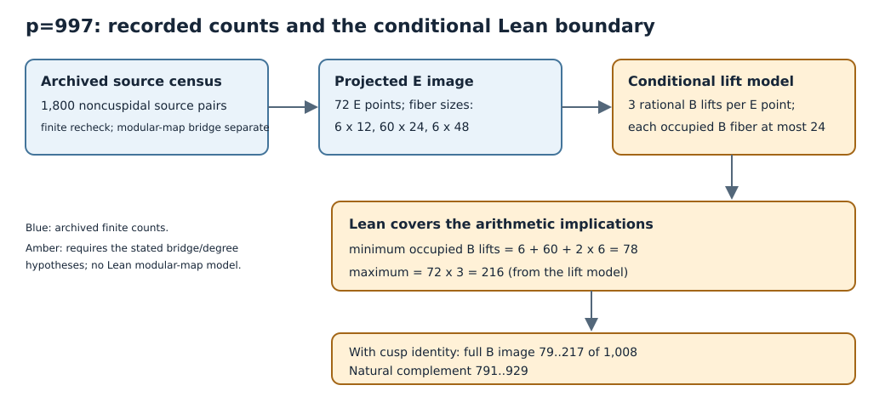

# p=997 Hecke fiber proof and source review

Technical review `T-1791`, 2026-11-07. Reviewed Cryptanalysis source revision
`927d1eada55ff51e87b89930cad48672147e0929`; plan was committed and
pushed first as `639fb3de7ae6558a8beed6c119a820edefc266b1`.

## Result at the checked scope

The independent blind reviewer derived all five finite arithmetic statements
and supplied counterexamples when the load-bearing sum or cap is removed.
The source reviewer verified 17/17 sealed files, 18/18 files against the Git
base, and a byte-identical scratch audit replay. A separate finite-field
reconstruction across all 997 j-values and ten special twists recovered
62 generic classes, 1,800 paired chains, both curve orders of 1,008, 72
recorded E outputs, and histogram 6×12, 60×24, 6×48. It checked 2,306
archived edge occurrences and all saved three-point B preimage cosets.

The archived audit accepted three deliberately invalid alterations: an
isogeny kernel root with nonzero division-polynomial residual, a wrong source
j value, and a projection exchange between two source rows. Those controls
show that an audit pass validates consistency of the saved rows and histogram,
not every chain formula or the source-specific quarter-shift projection.
The independent finite recheck covers the first two altered fields; a fresh
full Sage projection remains an open check.

The five Lean declarations express conditional natural-number arithmetic.
The concrete full B-image interval 79–217 and complement 791–929 also use
the earlier normalized degree-24 modular-map, reduction and cusp-image
results. Those geometric bridges were not freshly reviewed here. The archived
projection admits explicit cap-compatible allocations at both 78 and 216
noncuspidal B points, so the exact image is not determined by its histogram.

The five declarations have `machine_status=passed` on the fresh hosted gate
and `fidelity=faithful_scoped` for their stated arithmetic implications.
The concrete geometric image claim has `fidelity=partial` in this packet;
its review outcome is `inconclusive` pending the cited bridge replays. The
archived audit's wider source-validation interpretation `needs_revision`.
No official hypothesis or evidence status changes in this technical packet.

## Claim table

| Claim | Independent check | Status |
| --- | --- | --- |
| Five named arithmetic implications | blind derivations and exhaustive bounded cases; three negative controls | faithful at conditional arithmetic scope |
| 1,800 archived source pairs and 72-point projected histogram | sealed scratch audit plus independent finite reconstruction | verified for archived finite records |
| Three rational B preimages for each saved E output | direct enumeration of all B points | verified for saved E outputs |
| Source-specific quarter-shift evaluation | evaluator inspected, no fresh full Sage evaluation | open for independent recomputation |
| Degree-24 modular map, reduction and cusp identity | cited earlier written results, not re-proved in this packet | dependency |
| Full B-image interval and complement | conditional bound arithmetic plus cited geometric dependencies | conditional, not independently closed here |
| Exact B-image count | two compatible endpoint allocations | undetermined |

The historical p=997 protocol states a freeze before execution. The prime
screen was committed before that stated freeze; the protocol and resulting
census/image first entered Git together afterward. The pre-execution timing
claim is therefore declared rather than independently authenticated by Git.

## Machine verification and review method

The archived build log names Lean `v4.35.0-rc4`, Mathlib
`021c46bdd042f67b538b9f9871d556a93713a9a9`, and only standard axioms
`propext`, `Classical.choice`, `Quot.sound`. This log is retained historical
evidence, not a fresh build. A fresh hosted corpus gate ran once at branch
head `639fb3de7` as [run 42339546067](https://github.com/isogeny-labs/cryptanalysis/actions/runs/42339546067)
and completed successfully. It installed pinned Lean, passed positive and
negative proof fixtures, fetched the pinned Hecke Mathlib cache, and checked
32 added theorem modules. The gate compiles every added Hecke source,
requires named declarations and matching `#print axioms` commands, and
rejects unexpected axioms. The exact RC toolchain is absent on this host,
so no local replacement build is claimed.

The two reviewers worked without sibling access. The blind reviewer saw
only the committed blind input. The existing independence checker returned
exit 2 on the precommitted plan because it expects a nested `review_plan`
block while this plan uses that field as its ID. The original plan and
checker failure are retained; the plan was not rewritten after verdicts.
Reviewer attestations and source-access lists permit manual inspection, but
the automated independence gate remains open for this round. The fresh
machine receipt, hosted log and checker output are saved beside this report.
No canonical quantitative graph or dashboard input changes in this technical
review; the diagram maps the proof boundary without modifying measured data.

## Next technical checks

1. Recompute all source-to-quarter-shift projections in an isolated Sage run,
   including the imported map inputs and every saved row.
2. Review the earlier degree/reduction and cusp-image arguments as their own
   formal/source obligations; implement a source-dependent B-lift selector
   for an exact image count.
3. Strengthen the archived audit in a new producer revision so the three
   failing negative controls are rejected, then rerun its proof map review.

All exact reviewer controls, receipts, input access and finite recheck code
are archived under [`blind/`](blind/) and [`source/`](source/).
