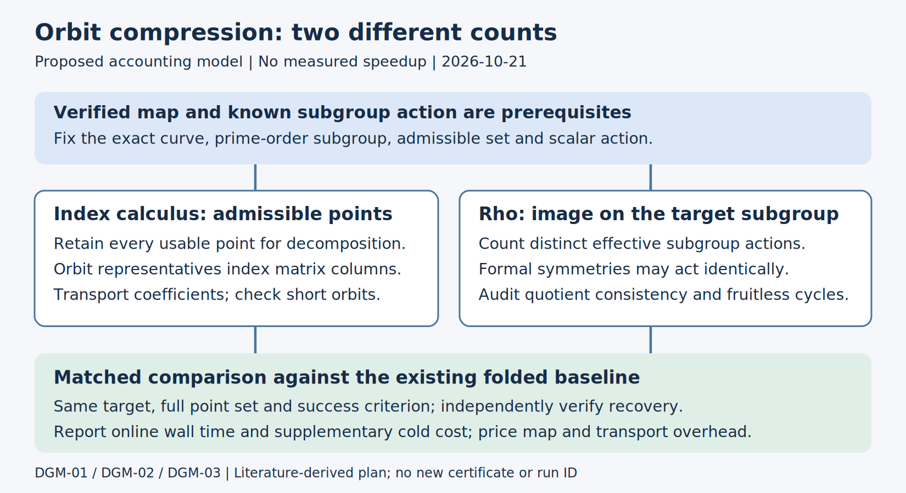

# Automorphism ideas: implementation and experiment plan

**2026-10-21 | Planning report | No experiments run**

## Repository fit and prior work

Reviewed against cryptanalysis:

- Base commit: `df69c0c3c35d6c30ad7f9b96e43c91b2be90b89e`.
- Base branch: `claude/cryptanalysis-repo-setup-p59kek`.

The [candidate catalog](../../experiments/ic-candidate-catalog/README.md)
already separates usable points from folded columns: its N13 profile records
fb6 with two columns, and its N131 normal-basis profiles record fb3668 with
14 columns. These are existing catalog facts, not new measurements here.
DGM-01 therefore tests an incremental change against that folded baseline;
an unfurled arm is a correctness control.

[PR 13](https://github.com/aburan28/cryptanalysis/pull/13) covers automorphism
rho and [PR 64](https://github.com/aburan28/cryptanalysis/pull/64) covers
prime-field candidate distinctions. [PR 416](https://github.com/aburan28/cryptanalysis/pull/416)
and [PR 442](https://github.com/aburan28/cryptanalysis/pull/442) are overlap
pointers for orbit reducers and exponent transport. A PR pointer does not
assert that its proposed implementation is merged or validated.

## Proposed integration boundaries

The following existing files are inspection starting points, not claims that
all necessary APIs already exist. Implementation should first trace current
call sites and reuse their arithmetic and evidence formats.

| Workstream | Starting points | New evidence required before promotion |
| --- | --- | --- |
| DGM-01 | `src/indexcalc.c`, `src/linalg.c`, candidate catalog | Stable point-set digest, orbit transport, current-folded ablation, rank and known-answer replay |
| DGM-02 | `src/curve.c`, curve and route records | Exact map and inverse, subgroup scalar action, native certificate |
| DGM-03 | `src/rho.c`, coefficient/restart handling | Quotient consistency, cycle escape, useful collisions and matched recovery |
| DGM-04 | `src/curve.c`, `src/volcano.c` | Exact standard-curve records and native trace/discriminant exclusion check |
| DGM-05 | New literature/design note before code | Full-paper review, explicit input assumptions and a non-oracular worked algorithm |

Use the native C backend here and the companion crypto repository's native
Rust certificate/design work where appropriate. No Python cryptanalytic
harness is proposed. CPU toy correctness controls do not become IC performance
claims; use the required GPU path when a later performance experiment is ready.

Select exact registered curve and subgroup IDs, full factor-base point digests,
code pins and seed streams before issuing a final IC1 candidate ID. Until then,
candidate IDs and measured costs remain null; this PR does not add or rewrite
Q proposals, candidate JSONL, curve identities or isogeny-route records.
For Koblitz work preserve the repository's m83 fidelity gate before making
ECC2K-130 claims; m31 or N13 controls cannot discharge that gate.

## Scope and evidence

This is a literature-derived research plan dated 2026-10-21, requested as ideas
for the crypto and cryptanalysis repositories. It does not introduce a solver,
run an experiment, or establish a new speedup. Study-local labels DGM-01 through
DGM-05 are planning labels, not candidate, curve, certificate, or run IDs.
Exact experimental curve/subgroup fixtures and immutable IDs remain to be
selected and frozen. Run IDs: none.

The supplied source was Duursma, Gaudry and Morain, *Speeding up the Discrete
Log Computation on Curves with Automorphisms*, ASIACRYPT 1999 [S1]. We compared
its mechanisms with repository notes and the primary literature listed below.
The distinctions worth carrying forward are explicit orbit accounting,
auxiliary-curve symmetry searches, and algebraic rejection of bad walks.
Orbit folding itself is already prior art and already appears in these repos.

## DGM-01: preserve the factor base, compress its logarithm unknowns

**Status: proposed ablation of an existing mechanism.** Let $H=\langle G\rangle$
have prime order $r$, and let an automorphism $\phi$ preserve $H$ with a known
scalar action $\phi(G)=[\lambda]G$. The literature's coefficient-transport rule is

$$\log_G(\phi^i(B))=\lambda^i\log_G(B)\pmod r.$$

This is a cited rule under the stated hypotheses, not a new certified identity.
Before using a new map, independently verify its action and emit the repository's
required evidence. A map merely acting on coordinates is insufficient.

Keep the complete, subgroup-filtered admissible set $\mathcal B$ for decomposition.
Map each point to an orbit representative and transport its coefficient into
the representative's column. Record both $|\mathcal B|$ and the actual number
of columns; neither an orbit representative count nor a dimension is the factor
base cardinality. Short orbits and stabilizers must be counted explicitly.
If the original base is not stable, taking its orbit closure changes the base
and must be tested as a separate treatment.

Under unchanged admissible points, decompositions remain available. An ideal
factor-$m$ reduction of columns can give a factor-$m^2$ reduction of a quadratic
linear-algebra stage; sparsity, fill, useful rank and implementation costs can
change this estimate. It is not an end-to-end speedup claim. Gaudry [S2] already
develops this factor-base idea; novelty must be measured relative to the existing
folded implementation, not a deliberately weakened unfurled baseline.

**Acceptance:** freeze the same target stream, point set and relation witnesses;
independently replay unfolded and folded equations modulo $r$; require identical
accepted decompositions and successful known-answer recovery. Compare current
folding with any proposed extension, reporting matrix rank, nonzeros, memory,
transport cost and complete online wall time. Retain failed and dependent rows.

## DGM-02: search the auxiliary curve for hidden symmetries

**Status: proposed search, with a historical positive example.** DGM's
Sakai-Sakurai example uses a coordinate translation $x\mapsto x+1$ with a
polynomial adjustment of $y$ [S1, section 4.3, Table 1]. This motivates testing affine and
fractional-linear coordinate transformations on a concrete auxiliary curve or
Jacobian, beyond the obvious negation and Frobenius candidates.

A candidate record needs the defining curve, coefficient field, exact map,
inverse and domain, proof that the defining equation is preserved, extension
across exceptional points, and the induced action on the relevant Jacobian.
Then verify that the target prime-order component is stable and determine its
scalar action without assuming the unknown target logarithm. Map discovery,
evaluation and subgroup transport all have costs.

Separate two quantities: the orbits of admissible prime divisors used by index
calculus, and the image of the automorphism group on the target subgroup used by
rho. Several formal symmetries can induce the same subgroup action. A large
coordinate group does not automatically enlarge rho's useful quotient.

**Acceptance:** produce a native replayable map/action certificate, enumerate
orbit lengths on an exact small fixture, and compare the induced subgroup
action with existing negation/Frobenius. Record bounded searches with no
additional action as bounded negatives, not nonexistence proofs. No unverified
isogeny or transfer edge is added to the curve registry.

## DGM-03: audit multiplicative walks before timing them

**Status: proposed correctness and mixing audit.** DGM motivates inexpensive
updates such as $R\mapsto R+\phi^j(R)$. Its order-four setting also illustrates
the identity $(1+\phi)(1-\phi)=2$ when $\phi^2=-1$ [S1]. Before benchmarking,
enumerate short update products in the endomorphism ring and look for products
equal to the identity, an orbit symmetry, or another small exceptional action.
A cheap step can create fruitless cycles or strong dependencies.

A usable quotient walk needs a consistent successor for every representative,
an invariant partition and distinguished-point predicate, and correct transport
of both coefficients in $R=aG+bQ$. Record cycles, deterministic escape actions,
restart histories, and useful collisions between independent starts. Check
that collision denominators are invertible before recovering a logarithm.
Short-product screening is necessary evidence, not a proof of random mixing.

Modern negation-map analyses [S3, S4] must be incorporated before adopting a
1999 walk recipe. Compare the present working walk, a deliberately enabled
multiplicative variant, and an audited variant on matched synthetic targets.
Report failure rates and online time to independently verified recovery;
additions per step alone are insufficient.

## DGM-04: keep P-192/P-224 exclusions narrow and reproducible

**Status: prior assessment awaiting a repository-native reproduction.** The
preceding paper review screened the standard NIST P-192 and P-224 parameters
[S7, S8]: their $j$ values are neither 0 nor 1728; prime-field Frobenius acts
trivially on their rational points. For an ordinary curve, the trace test
$t=p+1-r$, $\Delta=t^2-4p$ distinguishes whether the endomorphism algebra is
$\mathbb Q(i)$ or $\mathbb Q(\sqrt{-3})$. The prior assessment found neither
case for these two curves. This PR provides no native certificate and does not
promote that assessment to an independently verified repository result.

Reproduce from the exact field, model, order and generator using native integer
arithmetic, check ordinarity and the square tests, and emit the required proof
or identity evidence. The intended exclusion concerns same-$\mathbb F_p$
isogenies to the special $j=1728$ or $j=0$ ordinary classes. It does not exclude
all endomorphisms, extension-field routes, higher-dimensional transfers, or
generic negation. An exceptional curve reached in a drawing is not a useful
DLP route until its map and subgroup transport are verified.

## DGM-05: separate lifting from auxiliary-input attacks

**Status: literature-gated proposal.** DGM discusses characteristic-zero lifting
and Xedni. The primary Xedni proposal [S5] and subsequent analysis [S6] were
consulted at abstract level only in this review. The analysis describes severe
lifting/dependence obstacles and asymptotic failure of the original method.
Those abstracts do not justify closing every possible lifting variant.

Read the full papers before designing a run. State precisely which obstruction
a variant changes, how dependent lifts are produced, the height/rank costs, and
how a relation yields the target logarithm without an oracle. Treat any
rank-one/Wieferich mechanism as a separately sourced hypothesis, not an
implemented continuation of Xedni. Keep this distinct from Cheon's attack:
auxiliary powers of the unknown scalar change the input problem. Any such
assumption must appear explicitly in both the candidate and the comparator.

**Acceptance:** a complete algorithm and input contract, a worked public
known-answer example, and a native independent checker before timing or funding.
A literature gap is an open check, not evidence of a working attack.

## Measurement contract for future work

The primary comparison is the matched single-target ONLINE wall ratio
$T_{\rho,\mathrm{online}}/T_{\mathrm{candidate},\mathrm{online}}$,
on the same target, subgroup, hardware and success criterion. Report reusable
setup separately and supply full cold cost as a supplementary view. Price
canonicalization, map evaluation, relation search, rank recovery, target
descent and final verification in their appropriate intervals.

Freeze public synthetic/known-answer fixtures, code revision, seeds, resource
caps, raw logs and verifier output. Do not average away failures or present
batch amortization as a one-target win. Tiny fixtures establish correctness
only; Koblitz small-field diagnostics do not settle ECC2K-130 behavior.
No wall times, samples, confidence intervals or newly verified algebraic
certificates exist for the proposals in this report.

## Primary sources and reading status

- **S1 (full supplied paper):** Duursma, Gaudry, Morain (1999),
  [Speeding up the Discrete Log Computation on Curves with Automorphisms](https://doi.org/10.1007/978-3-540-48000-6_10),
  especially sections 2.3, 3, 4.2-4.3 and 6.
- **S2 (full paper):** Gaudry (2000),
  [An Algorithm for Solving the Discrete Log Problem on Hyperelliptic Curves](https://iacr.org/archive/eurocrypt2000/1807/18070019-new.pdf),
  section 4.2. Read through a
  [mirror of the primary paper](https://dulieu.antoanthongtin.gov.vn/tapchiantoanthongtin/82c664d3-6052-4a70-bb2c-352ea46222f2/18070019-14082017110714.pdf).
- **S3 (full paper):** Bos, Kleinjung, Lenstra,
  [On the Use of the Negation Map in the Pollard Rho Method](https://www.joppebos.com/files/negation.pdf).
- **S4 (abstract/metadata):** Bernstein, Lange, Schwabe (2011),
  [On the correct use of the negation map in the Pollard rho method](https://eprint.iacr.org/2011/003).
  Full implementation details remain a pre-experiment reading gate.
- **S5 (abstract only):** Silverman,
  [The Xedni Calculus and the Elliptic Curve Discrete Logarithm Problem](https://uwaterloo.ca/combinatorics-and-optimization/sites/default/files/uploads/documents/1999_05.pdf).
- **S6 (abstract only):**
  [Analysis of the Xedni Calculus Attack](https://uwaterloo.ca/combinatorics-and-optimization/sites/default/files/uploads/documents/1999_06.pdf).
- **S7 (parameter sections):** NIST,
  [FIPS 186-4](https://nvlpubs.nist.gov/nistpubs/FIPS/NIST.FIPS.186-4.pdf),
  historical P-192 parameters. This withdrawn edition is cited for the
  historical curve, not current deployment guidance.
- **S8 (parameter sections):** NIST,
  [SP 800-186](https://tsapps.nist.gov/publication/get_pdf.cfm?pub_id=935198),
  P-224 parameters.

## Activation and graph record

The companion crypto backlog card `XP-20261021-automorphism-ideas` is blocked
and unfunded. This repository's activation checklist is:

1. Reconcile DGM-01 with the exact current folding implementation and select
   registered known-answer fixtures; pin the full admissible point set.
2. Implement a native independent equation/action verifier and the ablation
   interface; freeze the protocol, code revision, seeds and resume behavior.
3. Verify quotient and scalar transport on exact small fixtures before any
   performance run. Keep each of DGM-02 through DGM-05 blocked until its own
   map, correctness or literature gate is satisfied.
4. Run and retain the requested matched controls only in a later experiment
   task; report failures, raw outputs and whole online wall intervals.

Checked the catalog's `curves.yaml` and the figure inventory under
`experiments/volcano-ic/figures/` (census, ECDLP and tau views). No new
registered curve, certified edge, measured cost or changed historical
conclusion follows from this plan, so no canonical graph data, rendered graph,
or paper PDF is revised. There is no quantitative graph because there are no
new observations to plot.

[orbit-compression.svg](orbit-compression.svg) is the editable diagram source.
[Makefile](Makefile) builds the PDF from this README.
[VALIDATION.md](VALIDATION.md) records the document checks and native gates.
