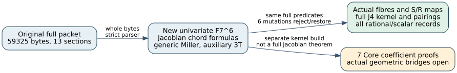

# Separate actual mixed-map certificate verification

The complete original59325-byte packet verifies with separately written
univariate F7^6 arithmetic, Jacobian chord formulas and generic Miller4
auxiliary3T. All7 strict native phases0/guards[]; all six actual packet
corruptions reject and each original restores. Source54f7e789,
resultf66fea69, data dd0208 and interpretation1e1743. [pcc:unverified]

[Inspected two-page PDF](../../../../docs/ic/chained_cm19_univariate_audit_20261123.pdf)
records all fixed cohorts, original failures, complete raw provenance,
and the seven checked Core coefficient leaves. Five declarations print
no axioms, two standard propext; actual field/Jacobian/Hom/Rosati and
curve push-pull bridges remain open, data3d0b82. Same-session separate
implementation, no signed expert or full geometric Lean verdict.
[pcc:unverified]

Both final pages were individually inspected at1550px. Original v1
PDF/source/logs retain its one underfull and two overfull boxes; v2
fixes text/table layout and has no overfull/underfull boxes. Existing
docs/ic PDF keep rules are used unchanged. Native/Lean verification was
not repeated for rendering or CI preparation. The focused ready-PR CI
regression is source-prepared and has not run. [pcc:unverified]

Graphs checked: crypto5080's frozen
research/chained_cm19_actual_j4_20261123/reports/run-20261123T2118Z/chain.dot
at9d8a60f remains accurate: this unit adds verification standing and
partial coefficient proofs, with no new curve or transfer edge. The new
diagram shows the verifier pipeline. Exact degree4 functions, arbitrary
divisor/target evaluation, approved whole-ELF/olean custody and a
computational advantage remain open. [pcc:unverified]
