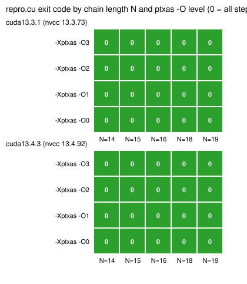
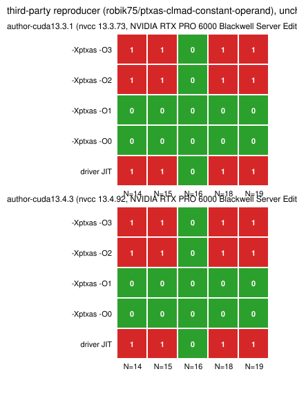
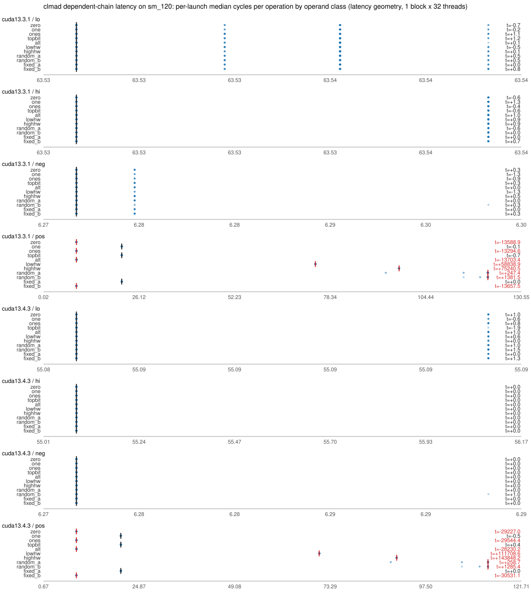

# clmad audit on sm_120: results

Decision rules: `PROTOCOL.md`. Numbers: `results/summary.json`. Raw: `results/<arm>/results/`.

## Arms

| arm | GPU | driver | nvcc | pod | run exit |
|---|---|---|---|---|---|
| cuda13.3.1 | NVIDIA RTX PRO 6000 Blackwell Server Edition (cc 12.0) | 595.91.07 (CUDA 13.3) | 13.3.73 | 84o1aurclqz4mj | 0 |
| cuda13.4.3 | NVIDIA GeForce RTX 5090 (cc 12.0) | 595.91.07 (CUDA 13.4) | 13.4.92 | hm5x2mcbavf75w | 0 |

## Q1: reproduction of the ptxas clmad folding defect

- **cuda13.3.1**: not reproduced ([]); controls: {'karatsuba_ptxjit': '0', 'schoolbook': '0', 'square': '0', 'karatsuba_seed2': '0'}
- **cuda13.4.3**: not reproduced ([]); controls: {'karatsuba_ptxjit': '0', 'schoolbook': '0', 'square': '0', 'karatsuba_seed2': '0'}

| arm | binary | N | -O | codegen | variant | exit | CLMAD in SASS | first output line |
|---|---|---|---|---|---|---|---|---|
| cuda13.3.1 | repro_N14_O3 | 14 | 3 | sass | karatsuba | 0 | 78 | 0 of 14 steps wrong |
| cuda13.3.1 | repro_N14_O2 | 14 | 2 | sass | karatsuba | 0 | 78 | 0 of 14 steps wrong |
| cuda13.3.1 | repro_N14_O1 | 14 | 1 | sass | karatsuba | 0 | 78 | 0 of 14 steps wrong |
| cuda13.3.1 | repro_N14_O0 | 14 | 0 | sass | karatsuba | 0 | 84 | 0 of 14 steps wrong |
| cuda13.3.1 | repro_N15_O3 | 15 | 3 | sass | karatsuba | 0 | 84 | 0 of 15 steps wrong |
| cuda13.3.1 | repro_N15_O2 | 15 | 2 | sass | karatsuba | 0 | 84 | 0 of 15 steps wrong |
| cuda13.3.1 | repro_N15_O1 | 15 | 1 | sass | karatsuba | 0 | 84 | 0 of 15 steps wrong |
| cuda13.3.1 | repro_N15_O0 | 15 | 0 | sass | karatsuba | 0 | 90 | 0 of 15 steps wrong |
| cuda13.3.1 | repro_N16_O3 | 16 | 3 | sass | karatsuba | 0 | 90 | 0 of 16 steps wrong |
| cuda13.3.1 | repro_N16_O2 | 16 | 2 | sass | karatsuba | 0 | 90 | 0 of 16 steps wrong |
| cuda13.3.1 | repro_N16_O1 | 16 | 1 | sass | karatsuba | 0 | 90 | 0 of 16 steps wrong |
| cuda13.3.1 | repro_N16_O0 | 16 | 0 | sass | karatsuba | 0 | 96 | 0 of 16 steps wrong |
| cuda13.3.1 | repro_N18_O3 | 18 | 3 | sass | karatsuba | 0 | 102 | 0 of 18 steps wrong |
| cuda13.3.1 | repro_N18_O2 | 18 | 2 | sass | karatsuba | 0 | 102 | 0 of 18 steps wrong |
| cuda13.3.1 | repro_N18_O1 | 18 | 1 | sass | karatsuba | 0 | 102 | 0 of 18 steps wrong |
| cuda13.3.1 | repro_N18_O0 | 18 | 0 | sass | karatsuba | 0 | 108 | 0 of 18 steps wrong |
| cuda13.3.1 | repro_N19_O3 | 19 | 3 | sass | karatsuba | 0 | 108 | 0 of 19 steps wrong |
| cuda13.3.1 | repro_N19_O2 | 19 | 2 | sass | karatsuba | 0 | 108 | 0 of 19 steps wrong |
| cuda13.3.1 | repro_N19_O1 | 19 | 1 | sass | karatsuba | 0 | 108 | 0 of 19 steps wrong |
| cuda13.3.1 | repro_N19_O0 | 19 | 0 | sass | karatsuba | 0 | 114 | 0 of 19 steps wrong |
| cuda13.3.1 | repro_N14_O3_ptxjit | 14 | 3 | ptx | karatsuba | 0 | na | 0 of 14 steps wrong |
| cuda13.3.1 | repro_N14_O3_schoolbook | 14 | 3 | sass | schoolbook | 0 | 104 | 0 of 14 steps wrong |
| cuda13.3.1 | repro_N64_O3_square | 64 | 3 | sass | square | 0 | 384 | 0 of 64 steps wrong |
| cuda13.3.1 | repro_N14_O3_seed2 | 14 | 3 | sass | karatsuba_seed2 | 0 | 78 | 0 of 14 steps wrong |
| cuda13.4.3 | repro_N14_O3 | 14 | 3 | sass | karatsuba | 0 | 78 | 0 of 14 steps wrong |
| cuda13.4.3 | repro_N14_O2 | 14 | 2 | sass | karatsuba | 0 | 78 | 0 of 14 steps wrong |
| cuda13.4.3 | repro_N14_O1 | 14 | 1 | sass | karatsuba | 0 | 78 | 0 of 14 steps wrong |
| cuda13.4.3 | repro_N14_O0 | 14 | 0 | sass | karatsuba | 0 | 84 | 0 of 14 steps wrong |
| cuda13.4.3 | repro_N15_O3 | 15 | 3 | sass | karatsuba | 0 | 84 | 0 of 15 steps wrong |
| cuda13.4.3 | repro_N15_O2 | 15 | 2 | sass | karatsuba | 0 | 84 | 0 of 15 steps wrong |
| cuda13.4.3 | repro_N15_O1 | 15 | 1 | sass | karatsuba | 0 | 84 | 0 of 15 steps wrong |
| cuda13.4.3 | repro_N15_O0 | 15 | 0 | sass | karatsuba | 0 | 90 | 0 of 15 steps wrong |
| cuda13.4.3 | repro_N16_O3 | 16 | 3 | sass | karatsuba | 0 | 90 | 0 of 16 steps wrong |
| cuda13.4.3 | repro_N16_O2 | 16 | 2 | sass | karatsuba | 0 | 90 | 0 of 16 steps wrong |
| cuda13.4.3 | repro_N16_O1 | 16 | 1 | sass | karatsuba | 0 | 90 | 0 of 16 steps wrong |
| cuda13.4.3 | repro_N16_O0 | 16 | 0 | sass | karatsuba | 0 | 96 | 0 of 16 steps wrong |
| cuda13.4.3 | repro_N18_O3 | 18 | 3 | sass | karatsuba | 0 | 102 | 0 of 18 steps wrong |
| cuda13.4.3 | repro_N18_O2 | 18 | 2 | sass | karatsuba | 0 | 102 | 0 of 18 steps wrong |
| cuda13.4.3 | repro_N18_O1 | 18 | 1 | sass | karatsuba | 0 | 102 | 0 of 18 steps wrong |
| cuda13.4.3 | repro_N18_O0 | 18 | 0 | sass | karatsuba | 0 | 108 | 0 of 18 steps wrong |
| cuda13.4.3 | repro_N19_O3 | 19 | 3 | sass | karatsuba | 0 | 108 | 0 of 19 steps wrong |
| cuda13.4.3 | repro_N19_O2 | 19 | 2 | sass | karatsuba | 0 | 108 | 0 of 19 steps wrong |
| cuda13.4.3 | repro_N19_O1 | 19 | 1 | sass | karatsuba | 0 | 108 | 0 of 19 steps wrong |
| cuda13.4.3 | repro_N19_O0 | 19 | 0 | sass | karatsuba | 0 | 114 | 0 of 19 steps wrong |
| cuda13.4.3 | repro_N14_O3_ptxjit | 14 | 3 | ptx | karatsuba | 0 | na | 0 of 14 steps wrong |
| cuda13.4.3 | repro_N14_O3_schoolbook | 14 | 3 | sass | schoolbook | 0 | 104 | 0 of 14 steps wrong |
| cuda13.4.3 | repro_N64_O3_square | 64 | 3 | sass | square | 0 | 384 | 0 of 64 steps wrong |
| cuda13.4.3 | repro_N14_O3_seed2 | 14 | 3 | sass | karatsuba_seed2 | 0 | 78 | 0 of 14 steps wrong |

## Q1 addendum (A1): the third-party reproducer, unchanged

- **author-cuda13.3.1** (NVIDIA RTX PRO 6000 Blackwell Server Edition, nvcc 13.3.73, driver ?): reproduced [14, 15, 18, 19]; source commit 45d6922ee752919bef85dd45cd8a9d87b5f7616d; pod fxxm25mythbsm2
- **author-cuda13.4.3** (NVIDIA RTX PRO 6000 Blackwell Server Edition, nvcc 13.4.92, driver ?): reproduced [14, 15, 18, 19]; source commit 45d6922ee752919bef85dd45cd8a9d87b5f7616d; pod gzue3uiofinquo

| arm | N | ptxas | exit | wrong steps |
|---|---|---|---|---|
| author-cuda13.3.1 | 14 | O3 | 1 | 14/14 |
| author-cuda13.3.1 | 14 | O2 | 1 | 14/14 |
| author-cuda13.3.1 | 14 | O1 | 0 | 0/14 |
| author-cuda13.3.1 | 14 | O0 | 0 | 0/14 |
| author-cuda13.3.1 | 14 | jit | 1 | 14/14 |
| author-cuda13.3.1 | 15 | O3 | 1 | 15/15 |
| author-cuda13.3.1 | 15 | O2 | 1 | 15/15 |
| author-cuda13.3.1 | 15 | O1 | 0 | 0/15 |
| author-cuda13.3.1 | 15 | O0 | 0 | 0/15 |
| author-cuda13.3.1 | 15 | jit | 1 | 15/15 |
| author-cuda13.3.1 | 16 | O3 | 0 | 0/16 |
| author-cuda13.3.1 | 16 | O2 | 0 | 0/16 |
| author-cuda13.3.1 | 16 | O1 | 0 | 0/16 |
| author-cuda13.3.1 | 16 | O0 | 0 | 0/16 |
| author-cuda13.3.1 | 16 | jit | 0 | 0/16 |
| author-cuda13.3.1 | 18 | O3 | 1 | 18/18 |
| author-cuda13.3.1 | 18 | O2 | 1 | 18/18 |
| author-cuda13.3.1 | 18 | O1 | 0 | 0/18 |
| author-cuda13.3.1 | 18 | O0 | 0 | 0/18 |
| author-cuda13.3.1 | 18 | jit | 1 | 18/18 |
| author-cuda13.3.1 | 19 | O3 | 1 | 19/19 |
| author-cuda13.3.1 | 19 | O2 | 1 | 19/19 |
| author-cuda13.3.1 | 19 | O1 | 0 | 0/19 |
| author-cuda13.3.1 | 19 | O0 | 0 | 0/19 |
| author-cuda13.3.1 | 19 | jit | 1 | 19/19 |
| author-cuda13.4.3 | 14 | O3 | 1 | 14/14 |
| author-cuda13.4.3 | 14 | O2 | 1 | 14/14 |
| author-cuda13.4.3 | 14 | O1 | 0 | 0/14 |
| author-cuda13.4.3 | 14 | O0 | 0 | 0/14 |
| author-cuda13.4.3 | 14 | jit | 1 | 14/14 |
| author-cuda13.4.3 | 15 | O3 | 1 | 15/15 |
| author-cuda13.4.3 | 15 | O2 | 1 | 15/15 |
| author-cuda13.4.3 | 15 | O1 | 0 | 0/15 |
| author-cuda13.4.3 | 15 | O0 | 0 | 0/15 |
| author-cuda13.4.3 | 15 | jit | 1 | 15/15 |
| author-cuda13.4.3 | 16 | O3 | 0 | 0/16 |
| author-cuda13.4.3 | 16 | O2 | 0 | 0/16 |
| author-cuda13.4.3 | 16 | O1 | 0 | 0/16 |
| author-cuda13.4.3 | 16 | O0 | 0 | 0/16 |
| author-cuda13.4.3 | 16 | jit | 0 | 0/16 |
| author-cuda13.4.3 | 18 | O3 | 1 | 18/18 |
| author-cuda13.4.3 | 18 | O2 | 1 | 18/18 |
| author-cuda13.4.3 | 18 | O1 | 0 | 0/18 |
| author-cuda13.4.3 | 18 | O0 | 0 | 0/18 |
| author-cuda13.4.3 | 18 | jit | 1 | 18/18 |
| author-cuda13.4.3 | 19 | O3 | 1 | 19/19 |
| author-cuda13.4.3 | 19 | O2 | 1 | 19/19 |
| author-cuda13.4.3 | 19 | O1 | 0 | 0/19 |
| author-cuda13.4.3 | 19 | O0 | 0 | 0/19 |
| author-cuda13.4.3 | 19 | jit | 1 | 19/19 |

## Q2: ecc2k130 tests

- **cuda13.3.1**: host clmad tests exit 2; test-packed-cuda exit 0
- **cuda13.4.3**: host clmad tests exit 2; test-packed-cuda exit 0

## Q3: two-class timing

- **cuda13.3.1 / latency**: no class distinguishable; {'positive_control_t': -23189.179021015043, 'negative_control_max_abs_t': 1.2967376999313336, 'flagged': {'lo': [], 'hi': []}}
- **cuda13.3.1 / occupancy**: no class distinguishable; {'positive_control_t': -9528.142841665756, 'negative_control_max_abs_t': 2.9061832032363695, 'flagged': {'lo': [], 'hi': []}}
- **cuda13.4.3 / latency**: no class distinguishable; {'positive_control_t': -36704.734680407964, 'negative_control_max_abs_t': 0.9999999999990905, 'flagged': {'lo': [], 'hi': []}}
- **cuda13.4.3 / occupancy**: no class distinguishable; {'positive_control_t': -8973.300889030676, 'negative_control_max_abs_t': 1.7984050273043917, 'flagged': {'lo': [], 'hi': []}}

### cuda13.3.1 / latency: cycles per operation (per-launch median over threads)

| mode | class | n | median | min | max | sd | t vs fixed_a |
|---|---|---|---|---|---|---|---|
| lo | zero | 100 | 63.528 | 63.528 | 63.540 | 0.0038 | -0.67 |
| lo | one | 100 | 63.528 | 63.528 | 63.540 | 0.0039 | -0.18 |
| lo | ones | 100 | 63.528 | 63.528 | 63.540 | 0.0041 | +1.14 |
| lo | topbit | 100 | 63.528 | 63.528 | 63.540 | 0.0040 | +1.17 |
| lo | alt | 100 | 63.528 | 63.528 | 63.540 | 0.0038 | +0.11 |
| lo | lowhw | 100 | 63.528 | 63.528 | 63.540 | 0.0039 | -0.47 |
| lo | highhw | 100 | 63.528 | 63.528 | 63.540 | 0.0040 | +0.06 |
| lo | random_a | 100 | 63.528 | 63.528 | 63.540 | 0.0041 | +0.49 |
| lo | random_b | 100 | 63.528 | 63.528 | 63.540 | 0.0040 | +0.51 |
| lo | fixed_a | 100 | 63.528 | 63.528 | 63.540 | 0.0039 | +0.00 |
| lo | fixed_b | 100 | 63.528 | 63.528 | 63.540 | 0.0043 | +0.76 |
| lo | A/A random_a~random_b t | | -0.02 | | | | fixed_a~fixed_b t -0.76; lowhw~highhw t -0.52 |
| hi | zero | 100 | 63.530 | 63.530 | 63.537 | 0.0025 | -0.56 |
| hi | one | 100 | 63.530 | 63.530 | 63.537 | 0.0030 | +1.34 |
| hi | ones | 100 | 63.530 | 63.530 | 63.537 | 0.0026 | -0.37 |
| hi | topbit | 100 | 63.530 | 63.530 | 63.537 | 0.0025 | -0.56 |
| hi | alt | 100 | 63.530 | 63.530 | 63.537 | 0.0030 | +1.02 |
| hi | lowhw | 100 | 63.530 | 63.530 | 63.537 | 0.0029 | +0.86 |
| hi | highhw | 100 | 63.530 | 63.530 | 63.537 | 0.0029 | +0.86 |
| hi | random_a | 100 | 63.530 | 63.530 | 63.537 | 0.0025 | -0.56 |
| hi | random_b | 100 | 63.530 | 63.530 | 63.537 | 0.0027 | +0.00 |
| hi | fixed_a | 100 | 63.530 | 63.530 | 63.537 | 0.0027 | +0.00 |
| hi | fixed_b | 100 | 63.530 | 63.530 | 63.537 | 0.0029 | +0.69 |
| hi | A/A random_a~random_b t | | -0.56 | | | | fixed_a~fixed_b t -0.69; lowhw~highhw t +0.00 |
| neg | zero | 100 | 6.276 | 6.276 | 6.280 | 0.0009 | +0.27 |
| neg | one | 100 | 6.276 | 6.276 | 6.280 | 0.0005 | -1.30 |
| neg | ones | 100 | 6.276 | 6.276 | 6.280 | 0.0006 | -0.93 |
| neg | topbit | 100 | 6.276 | 6.276 | 6.280 | 0.0009 | +0.27 |
| neg | alt | 100 | 6.276 | 6.276 | 6.280 | 0.0008 | +0.00 |
| neg | lowhw | 100 | 6.276 | 6.276 | 6.280 | 0.0005 | -1.30 |
| neg | highhw | 100 | 6.276 | 6.276 | 6.280 | 0.0009 | +0.52 |
| neg | random_a | 100 | 6.276 | 6.276 | 6.280 | 0.0008 | +0.00 |
| neg | random_b | 100 | 6.276 | 6.276 | 6.299 | 0.0023 | +0.27 |
| neg | fixed_a | 100 | 6.276 | 6.276 | 6.280 | 0.0008 | +0.00 |
| neg | fixed_b | 100 | 6.276 | 6.276 | 6.280 | 0.0009 | +0.27 |
| neg | A/A random_a~random_b t | | -0.27 | | | | fixed_a~fixed_b t -0.27; lowhw~highhw t -1.79 |
| pos | zero | 100 | 9.026 | 9.020 | 9.040 | 0.0063 | -13588.86 |
| pos | one | 100 | 21.401 | 21.395 | 21.415 | 0.0061 | -0.08 |
| pos | ones | 100 | 9.026 | 9.020 | 9.041 | 0.0066 | -13294.61 |
| pos | topbit | 100 | 21.401 | 21.395 | 21.415 | 0.0058 | -0.70 |
| pos | alt | 100 | 9.027 | 9.020 | 9.041 | 0.0062 | -13703.42 |
| pos | lowhw | 100 | 74.283 | 74.262 | 74.291 | 0.0062 | +58838.88 |
| pos | highhw | 100 | 97.164 | 97.145 | 97.172 | 0.0076 | +75240.49 |
| pos | random_a | 100 | 121.414 | 93.520 | 121.545 | 3.9945 | +247.40 |
| pos | random_b | 100 | 121.414 | 114.789 | 121.422 | 0.7195 | +1381.48 |
| pos | fixed_a | 100 | 21.405 | 21.395 | 21.416 | 0.0065 | +0.00 |
| pos | fixed_b | 100 | 9.027 | 9.020 | 9.040 | 0.0063 | -13657.48 |
| pos | A/A random_a~random_b t | | -1.42 | | | | fixed_a~fixed_b t +13657.48; lowhw~highhw t -23189.18 |

### cuda13.3.1 / occupancy: cycles per operation (per-launch median over threads)

| mode | class | n | median | min | max | sd | t vs fixed_a |
|---|---|---|---|---|---|---|---|
| lo | zero | 50 | 255.901 | 255.896 | 255.929 | 0.0088 | -0.18 |
| lo | one | 50 | 255.909 | 255.896 | 255.923 | 0.0072 | +1.44 |
| lo | ones | 50 | 255.902 | 255.894 | 255.928 | 0.0093 | +0.40 |
| lo | topbit | 50 | 255.908 | 255.896 | 255.928 | 0.0089 | +1.38 |
| lo | alt | 50 | 255.902 | 255.897 | 255.933 | 0.0096 | +0.91 |
| lo | lowhw | 50 | 255.901 | 255.895 | 255.924 | 0.0074 | -0.51 |
| lo | highhw | 50 | 255.905 | 255.896 | 255.918 | 0.0060 | -0.49 |
| lo | random_a | 50 | 255.899 | 255.894 | 255.930 | 0.0075 | -1.55 |
| lo | random_b | 50 | 255.904 | 255.892 | 255.920 | 0.0076 | -0.09 |
| lo | fixed_a | 50 | 255.901 | 255.896 | 255.928 | 0.0081 | +0.00 |
| lo | fixed_b | 50 | 255.907 | 255.896 | 255.928 | 0.0084 | +1.32 |
| lo | A/A random_a~random_b t | | -1.50 | | | | fixed_a~fixed_b t -1.32; lowhw~highhw t -0.06 |
| hi | zero | 50 | 255.905 | 255.899 | 255.931 | 0.0085 | +0.27 |
| hi | one | 50 | 255.907 | 255.899 | 255.932 | 0.0073 | +0.40 |
| hi | ones | 50 | 255.904 | 255.897 | 255.930 | 0.0093 | +0.23 |
| hi | topbit | 50 | 255.904 | 255.896 | 255.933 | 0.0098 | +0.59 |
| hi | alt | 50 | 255.903 | 255.899 | 255.931 | 0.0072 | -0.97 |
| hi | lowhw | 50 | 255.905 | 255.898 | 255.931 | 0.0080 | +0.10 |
| hi | highhw | 50 | 255.905 | 255.899 | 255.932 | 0.0075 | -0.14 |
| hi | random_a | 50 | 255.901 | 255.896 | 255.930 | 0.0082 | -1.48 |
| hi | random_b | 50 | 255.903 | 255.895 | 255.933 | 0.0080 | -1.01 |
| hi | fixed_a | 50 | 255.904 | 255.898 | 255.932 | 0.0086 | +0.00 |
| hi | fixed_b | 50 | 255.905 | 255.897 | 255.930 | 0.0075 | -0.83 |
| hi | A/A random_a~random_b t | | -0.50 | | | | fixed_a~fixed_b t +0.83; lowhw~highhw t +0.25 |
| neg | zero | 50 | 13.216 | 13.196 | 13.240 | 0.0116 | +2.91 |
| neg | one | 50 | 13.209 | 13.196 | 13.241 | 0.0095 | +1.21 |
| neg | ones | 50 | 13.207 | 13.184 | 13.242 | 0.0127 | +0.70 |
| neg | topbit | 50 | 13.211 | 13.196 | 13.241 | 0.0124 | +1.83 |
| neg | alt | 50 | 13.208 | 13.195 | 13.240 | 0.0104 | +0.17 |
| neg | lowhw | 50 | 13.210 | 13.199 | 13.241 | 0.0104 | +1.54 |
| neg | highhw | 50 | 13.214 | 13.197 | 13.241 | 0.0108 | +2.60 |
| neg | random_a | 50 | 13.206 | 13.195 | 13.237 | 0.0103 | -0.27 |
| neg | random_b | 50 | 13.209 | 13.196 | 13.237 | 0.0106 | +1.38 |
| neg | fixed_a | 50 | 13.206 | 13.186 | 13.245 | 0.0119 | +0.00 |
| neg | fixed_b | 50 | 13.206 | 13.196 | 13.235 | 0.0097 | +0.07 |
| neg | A/A random_a~random_b t | | -1.78 | | | | fixed_a~fixed_b t -0.07; lowhw~highhw t -1.16 |
| pos | zero | 50 | 31.962 | 31.946 | 31.985 | 0.0106 | +0.89 |
| pos | one | 50 | 104.954 | 104.858 | 105.527 | 0.2492 | +2052.73 |
| pos | ones | 50 | 31.965 | 31.943 | 31.979 | 0.0099 | +1.36 |
| pos | topbit | 50 | 104.949 | 104.830 | 105.490 | 0.2510 | +2038.98 |
| pos | alt | 50 | 31.955 | 31.945 | 31.983 | 0.0093 | -0.90 |
| pos | lowhw | 50 | 257.377 | 257.336 | 257.413 | 0.0181 | +76617.97 |
| pos | highhw | 50 | 353.491 | 353.372 | 353.659 | 0.0682 | +32648.10 |
| pos | random_a | 50 | 450.944 | 450.691 | 451.115 | 0.0964 | +30267.90 |
| pos | random_b | 50 | 450.953 | 450.731 | 451.141 | 0.0873 | +33405.00 |
| pos | fixed_a | 50 | 31.959 | 31.945 | 31.982 | 0.0098 | +0.00 |
| pos | fixed_b | 50 | 31.955 | 31.944 | 31.981 | 0.0107 | -0.19 |
| pos | A/A random_a~random_b t | | -0.65 | | | | fixed_a~fixed_b t +0.19; lowhw~highhw t -9528.14 |

### cuda13.4.3 / latency: cycles per operation (per-launch median over threads)

| mode | class | n | median | min | max | sd | t vs fixed_a |
|---|---|---|---|---|---|---|---|
| lo | zero | 100 | 55.084 | 55.084 | 55.092 | 0.0022 | +1.04 |
| lo | one | 100 | 55.084 | 55.084 | 55.092 | 0.0014 | -0.65 |
| lo | ones | 100 | 55.084 | 55.084 | 55.092 | 0.0021 | +0.80 |
| lo | topbit | 100 | 55.084 | 55.084 | 55.092 | 0.0007 | -1.93 |
| lo | alt | 100 | 55.084 | 55.084 | 55.092 | 0.0022 | +1.04 |
| lo | lowhw | 100 | 55.084 | 55.084 | 55.092 | 0.0020 | +0.55 |
| lo | highhw | 100 | 55.084 | 55.084 | 55.092 | 0.0017 | +0.00 |
| lo | random_a | 100 | 55.084 | 55.084 | 55.092 | 0.0022 | +1.04 |
| lo | random_b | 100 | 55.084 | 55.084 | 55.092 | 0.0024 | +1.48 |
| lo | fixed_a | 100 | 55.084 | 55.084 | 55.092 | 0.0017 | +0.00 |
| lo | fixed_b | 100 | 55.084 | 55.084 | 55.092 | 0.0023 | +1.27 |
| lo | A/A random_a~random_b t | | -0.45 | | | | fixed_a~fixed_b t -1.27; lowhw~highhw t +0.55 |
| hi | zero | 100 | 55.087 | 55.087 | 55.087 | 0.0000 | +0.00 |
| hi | one | 100 | 55.087 | 55.087 | 55.087 | 0.0000 | +0.00 |
| hi | ones | 100 | 55.087 | 55.087 | 55.087 | 0.0000 | +0.00 |
| hi | topbit | 100 | 55.087 | 55.087 | 55.087 | 0.0000 | +0.00 |
| hi | alt | 100 | 55.087 | 55.087 | 55.087 | 0.0000 | +0.00 |
| hi | lowhw | 100 | 55.087 | 55.087 | 55.087 | 0.0000 | +0.00 |
| hi | highhw | 100 | 55.087 | 55.087 | 55.087 | 0.0000 | +0.00 |
| hi | random_a | 100 | 55.087 | 55.087 | 55.087 | 0.0000 | +0.00 |
| hi | random_b | 100 | 55.087 | 55.087 | 55.087 | 0.0000 | +0.00 |
| hi | fixed_a | 100 | 55.087 | 55.087 | 55.087 | 0.0000 | +0.00 |
| hi | fixed_b | 100 | 55.087 | 55.087 | 55.087 | 0.0000 | +0.00 |
| hi | A/A random_a~random_b t | | +0.00 | | | | fixed_a~fixed_b t +0.00; lowhw~highhw t +0.00 |
| neg | zero | 100 | 6.273 | 6.273 | 6.273 | 0.0000 | +0.00 |
| neg | one | 100 | 6.273 | 6.273 | 6.273 | 0.0000 | +0.00 |
| neg | ones | 100 | 6.273 | 6.273 | 6.273 | 0.0000 | +0.00 |
| neg | topbit | 100 | 6.273 | 6.273 | 6.273 | 0.0000 | +0.00 |
| neg | alt | 100 | 6.273 | 6.273 | 6.273 | 0.0000 | +0.00 |
| neg | lowhw | 100 | 6.273 | 6.273 | 6.273 | 0.0000 | +0.00 |
| neg | highhw | 100 | 6.273 | 6.273 | 6.273 | 0.0000 | +0.00 |
| neg | random_a | 100 | 6.273 | 6.273 | 6.273 | 0.0000 | +0.00 |
| neg | random_b | 100 | 6.273 | 6.273 | 6.293 | 0.0019 | +1.00 |
| neg | fixed_a | 100 | 6.273 | 6.273 | 6.273 | 0.0000 | +0.00 |
| neg | fixed_b | 100 | 6.273 | 6.273 | 6.273 | 0.0000 | +0.00 |
| neg | A/A random_a~random_b t | | -1.00 | | | | fixed_a~fixed_b t +0.00; lowhw~highhw t +0.00 |
| pos | zero | 100 | 9.014 | 9.014 | 9.021 | 0.0027 | -29227.01 |
| pos | one | 100 | 20.264 | 20.264 | 20.271 | 0.0026 | -0.54 |
| pos | ones | 100 | 9.014 | 9.014 | 9.021 | 0.0026 | -29544.42 |
| pos | topbit | 100 | 20.264 | 20.264 | 20.271 | 0.0029 | +0.38 |
| pos | alt | 100 | 9.014 | 9.014 | 9.021 | 0.0029 | -28230.18 |
| pos | lowhw | 100 | 70.506 | 70.506 | 70.521 | 0.0035 | +111708.57 |
| pos | highhw | 100 | 90.139 | 90.139 | 90.153 | 0.0040 | +143848.20 |
| pos | random_a | 100 | 113.264 | 88.639 | 113.359 | 3.5523 | +258.74 |
| pos | random_b | 100 | 113.264 | 106.646 | 113.271 | 0.7190 | +1285.44 |
| pos | fixed_a | 100 | 20.264 | 20.264 | 20.271 | 0.0027 | +0.00 |
| pos | fixed_b | 100 | 9.014 | 9.014 | 9.021 | 0.0024 | -30531.12 |
| pos | A/A random_a~random_b t | | -1.41 | | | | fixed_a~fixed_b t +30531.12; lowhw~highhw t -36704.73 |

### cuda13.4.3 / occupancy: cycles per operation (per-launch median over threads)

| mode | class | n | median | min | max | sd | t vs fixed_a |
|---|---|---|---|---|---|---|---|
| lo | zero | 50 | 255.856 | 255.840 | 255.894 | 0.0089 | -0.88 |
| lo | one | 50 | 255.861 | 255.844 | 255.916 | 0.0145 | +1.50 |
| lo | ones | 50 | 255.860 | 255.846 | 255.912 | 0.0132 | +1.12 |
| lo | topbit | 50 | 255.860 | 255.842 | 255.919 | 0.0180 | +1.65 |
| lo | alt | 50 | 255.860 | 255.845 | 255.914 | 0.0156 | +1.81 |
| lo | lowhw | 50 | 255.861 | 255.844 | 255.923 | 0.0209 | +2.04 |
| lo | highhw | 50 | 255.859 | 255.844 | 255.913 | 0.0142 | +1.03 |
| lo | random_a | 50 | 255.857 | 255.841 | 255.921 | 0.0187 | +1.12 |
| lo | random_b | 50 | 255.856 | 255.841 | 255.919 | 0.0160 | -0.02 |
| lo | fixed_a | 50 | 255.860 | 255.842 | 255.881 | 0.0097 | +0.00 |
| lo | fixed_b | 50 | 255.859 | 255.844 | 255.902 | 0.0131 | +1.56 |
| lo | A/A random_a~random_b t | | +0.97 | | | | fixed_a~fixed_b t -1.56; lowhw~highhw t +1.16 |
| hi | zero | 50 | 255.862 | 255.845 | 255.911 | 0.0143 | +1.35 |
| hi | one | 50 | 255.861 | 255.846 | 255.914 | 0.0164 | +1.36 |
| hi | ones | 50 | 255.862 | 255.848 | 255.911 | 0.0137 | +1.27 |
| hi | topbit | 50 | 255.862 | 255.846 | 255.912 | 0.0148 | +1.24 |
| hi | alt | 50 | 255.862 | 255.847 | 255.917 | 0.0156 | +1.37 |
| hi | lowhw | 50 | 255.861 | 255.846 | 255.927 | 0.0156 | +1.02 |
| hi | highhw | 50 | 255.863 | 255.846 | 255.929 | 0.0177 | +1.22 |
| hi | random_a | 50 | 255.859 | 255.842 | 255.913 | 0.0129 | -0.15 |
| hi | random_b | 50 | 255.858 | 255.842 | 255.902 | 0.0114 | -1.06 |
| hi | fixed_a | 50 | 255.860 | 255.841 | 255.905 | 0.0115 | +0.00 |
| hi | fixed_b | 50 | 255.861 | 255.847 | 255.929 | 0.0199 | +1.16 |
| hi | A/A random_a~random_b t | | +0.85 | | | | fixed_a~fixed_b t -1.16; lowhw~highhw t -0.26 |
| neg | zero | 50 | 13.196 | 13.173 | 13.245 | 0.0105 | -1.80 |
| neg | one | 50 | 13.198 | 13.184 | 13.230 | 0.0094 | -0.60 |
| neg | ones | 50 | 13.200 | 13.183 | 13.222 | 0.0073 | -0.76 |
| neg | topbit | 50 | 13.200 | 13.184 | 13.219 | 0.0065 | -0.41 |
| neg | alt | 50 | 13.197 | 13.183 | 13.236 | 0.0107 | -0.42 |
| neg | lowhw | 50 | 13.200 | 13.183 | 13.223 | 0.0085 | -0.58 |
| neg | highhw | 50 | 13.201 | 13.186 | 13.238 | 0.0086 | -0.68 |
| neg | random_a | 50 | 13.199 | 13.182 | 13.232 | 0.0096 | -0.56 |
| neg | random_b | 50 | 13.202 | 13.184 | 13.225 | 0.0079 | +0.83 |
| neg | fixed_a | 50 | 13.200 | 13.184 | 13.222 | 0.0085 | +0.00 |
| neg | fixed_b | 50 | 13.200 | 13.184 | 13.222 | 0.0094 | -0.45 |
| neg | A/A random_a~random_b t | | -1.36 | | | | fixed_a~fixed_b t +0.45; lowhw~highhw t +0.10 |
| pos | zero | 50 | 31.910 | 31.897 | 31.960 | 0.0164 | +0.54 |
| pos | one | 50 | 105.442 | 104.906 | 105.531 | 0.1471 | +3477.99 |
| pos | ones | 50 | 31.910 | 31.897 | 31.953 | 0.0100 | -0.50 |
| pos | topbit | 50 | 105.409 | 104.915 | 105.503 | 0.1968 | +2603.85 |
| pos | alt | 50 | 31.907 | 31.897 | 31.961 | 0.0122 | -0.66 |
| pos | lowhw | 50 | 257.400 | 257.368 | 257.434 | 0.0146 | +75000.51 |
| pos | highhw | 50 | 353.586 | 353.464 | 353.781 | 0.0736 | +29966.83 |
| pos | random_a | 50 | 451.008 | 450.709 | 451.230 | 0.1026 | +28295.28 |
| pos | random_b | 50 | 450.966 | 450.800 | 451.191 | 0.0766 | +37548.82 |
| pos | fixed_a | 50 | 31.909 | 31.896 | 31.963 | 0.0151 | +0.00 |
| pos | fixed_b | 50 | 31.910 | 31.896 | 31.969 | 0.0127 | -0.60 |
| pos | A/A random_a~random_b t | | +1.49 | | | | fixed_a~fixed_b t +0.60; lowhw~highhw t -8973.30 |

