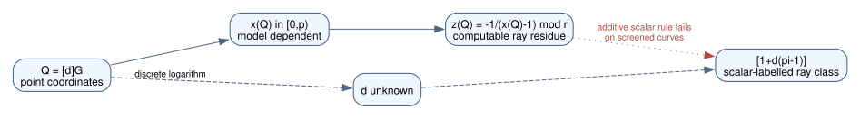

# A coordinate-to-ray ideal that does not carry the point law

The [squared-ray gate](SQUARED_RAY_POINT_BRIDGE.md) identifies an
`r`-element principal-unit subgroup, but its defining map from
`Q=[d]G` uses the unknown `d`. Here is a directly computable,
point-dependent ideal class in that subgroup. This is a
**retrospective exploratory screen**: the candidate and controls
were examined before this report was written. The counts below are
exact for the listed finite curves, but the control ranks are
descriptive rather than preregistered significance levels.
[pcc:unverified]

Use the canonical integer representative `x` in `[0,p)` of the
point's affine x-coordinate. For `x-1` nonzero modulo `r`, set

```text
eta = pi-1,  c = x-1,
I_x = ((x-pi)/(x-1)) = (1-eta/c),
z(P) = -c^(-1) mod r.
```

This fractional principal ideal is coprime to `n=(eta)`, and its
ray class modulo `n^2` is the principal unit `1+z(P)eta`. Thus
`P -> I_(x(P))` is a concrete coordinate-to-ideal assignment;
neither its evaluation nor its ray coefficient needs the point
logarithm. It depends on the chosen Weierstrass coordinates and on
the integer lift of `x`. At `x=1 mod r` it is undefined; those
points are excluded and counted. The unpointed ideal class of
`I_x` is trivial, so any information it carries is solely in the
ray residue. Reversing the Artin convention reverses all ray labels
uniformly and leaves the tests below unchanged. [pcc:unverified]



The upper path computes a residue from coordinates. The lower path
identifies a scalar-labelled residue but requires `d`. The test asks
whether these paths agree under an additive rule. [pcc:unverified]

The [Sage runner](coordinate_ideal_ray_screen.py) checks the ideal
coprimality and residue identity on representative points, then
enumerates every nonidentity scalar label of each curve. It tests:

1. The homomorphism prediction `z([d]G)=d z(G)` wherever defined.
2. Additivity `z([a+b]G)=z([a]G)+z([b]G)` on every defined,
   nonzero-sum ordered pair.
3. The quadratic-character prediction
   `chi_r(z([d]G)/z(G))=chi_r(d)`.

| Curve | Defined labels | Scalar-rule matches | Additive matches / valid ordered pairs | Character matches |
| --- | ---: | ---: | ---: | ---: |
| `D=-19`, `p=47`, `r=61` | 60/60 | 3/60 | 72/3540 | 30/60 |
| `p=1009`, `r=1069` source | 1066/1068 | 2/1066 | 952/1133160 | 544/1066 |
| Degree-5 horizontal endpoint | 1068/1068 | 4/1068 | 1092/1139556 | 580/1068 |

The endpoint uses the image of the same generator under the fixed
horizontal isogeny. The raw endpoint-minus-source character-rate
difference is `0.0327522`, but this point function changes under an
ordinary isomorphism of either curve. To gauge that coordinate
choice, the runner applies the **same** 128 scale values drawn with
Python seed `20261125` to both x-coordinate lists, using
`x -> u^2 x`, and recomputes the paired rate difference. Its
minimum, median, and maximum are `-0.0881801`, `0.0009398`, and
`0.0712946`; **20/128** paired controls have a difference at least
as large as the displayed models. The endpoint's own actual rate
is exceeded by 3/128 of its scale controls, while the source rate
is exceeded by 39/128. These selected-model, retrospective counts
do not establish an isogeny effect or a predictive law on P-192.
[pcc:unverified]

The assignment is a valid, cheap point-dependent *ray-class map*,
but it fails the group-law condition needed to identify its output
with `[(1+d eta)]`. Its quadratic character is not an exact
replacement. Smooth-ideal relation collection can manipulate the
known `I_x` residue, yet that does not make it a relation in `d`.
A successor must specify a coordinate-to-ray assignment that has a
verified algebraic relation to the scalar label, and then compare
fully charged extraction against the same-target rho and matched
coordinate-model controls. [pcc:unverified]

Sources checked: the lead-atlas matches
`LEAD-STR-class-group-ecdlp-bridge` and
`LEAD-EXO-curve-model-representation`; the local
[squared-ray gate](SQUARED_RAY_POINT_BRIDGE.md) supplies the ray-group
construction. The source and endpoint are the runner's explicit
Sage curves and degree-5 isogeny. The existing CM joint S4 graphs
were checked; this coordinate-model screen changes no isogeny graph
edge or scalar-rule construction, so no canonical graph changed.
[pcc:unverified]

Reproduce the complete counts from the repository root:

```sh
/Volumes/SSD990/cryptanalysis/sage -python research/cm_joint_s4_20261123/coordinate_ideal_ray_screen.py
```
