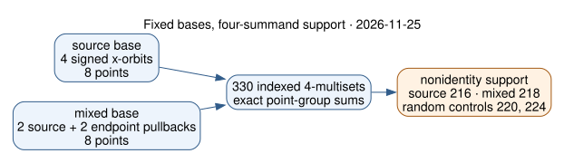
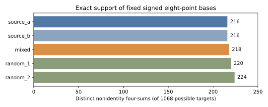

# Four-summand support on the fixed horizontal mixed base (2026-11-25)

## Exact exploratory census

The [frozen S4 comparison](MIXED_EQUAL_YIELD_COST_PROTOCOL.md) held three-summand support fixed at 96 for five signed eight-point bases on `E/F_1009: y²=x³+4x+10`, group order 1069. A four-summand relation changes the combinatorics and is a relevant arity for the prime-field index-calculus cost gate. This retrospective check counts the distinct **nonidentity** point sums of all `binom(8+4-1,4)=330` unordered four-entry multisets for those same bases. It is an exact finite support count, not a solver run or a new frozen performance result. The [Sage source](four_sum_mixed_support.py) reuses the prior base construction; the [retained JSON](four_sum_mixed_support_results.json) records every base and count. [pcc:unverified]

| Arm | Source x-coordinates | Three-sum support | Four-sum support | Four-sum fraction of 1068 nonidentity points |
|---|---|---:|---:|---:|
| source A | `0,1,3,4` | 96 | 216 | 20.225% |
| source B (A/A) | `0,1,3,4` | 96 | 216 | 20.225% |
| mixed source/degree-5 endpoint pullback | `0,1,478,742` | 96 | 218 | 20.412% |
| random control 1 | `100,273,626,656` | 96 | 220 | 20.599% |
| random control 2 | `166,333,560,587` | 96 | 224 | 20.974% |

The mixed base covers two more nonidentity targets than the source base, a `218/216≈1.0093` support ratio. Both retained random controls cover more than the mixed base. The five arms have equal signed size and equal three-sum support, so this is a direct four-summand yield comparison for the fixed constructions. It does **not** identify a horizontal-specific gain: the two random controls are already larger, and the bases were selected for the earlier S4 protocol rather than a held-out four-summand study. [pcc:unverified]

## Cost boundary and next action

The exact source-to-mixed difference is two targets out of 1068, before factor-base construction, target descent, relation verification, and algebraic solving. It does not justify a four-summand solver cost claim. A solver-specific advantage remains possible in a different presentation, but a credible test needs a preregistered equal-support arm at arity four, paired model controls, and complete setup and target costs. The current result narrows the **yield** route for this particular mixed base; it does not close higher-arity horizontal constructions. [pcc:unverified]

Reproduce from the repository root with `/Volumes/SSD990/cryptanalysis/sage -python research/cm_joint_s4_20261123/four_sum_mixed_support.py`. The [editable diagram](four_sum_mixed_support.dot), [plot source](plot_four_sum_mixed_support.py), and [inspected PDF](FOUR_SUM_MIXED_SUPPORT.pdf) are beside the data. Checked canonical graph sources: `experiments/volcano-ic/figures/ecdlp.svg`, `experiments/volcano-ic/figures/census.svg`, and `experiments/ic-candidate-catalog/curves.yaml`; this fixed-base support census adds no candidate curve, edge, or performance measurement, so those graphs remain current. [pcc:unverified]
