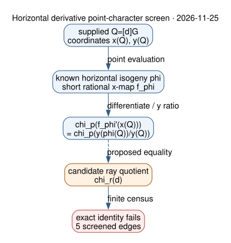
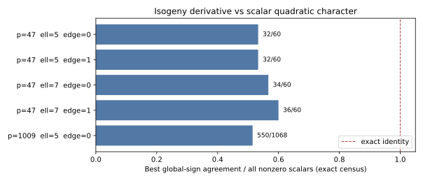

# Horizontal-isogeny derivative as a point character (2026-11-25)

## Candidate and falsifier

For a separable horizontal isogeny `phi:E→E'` with rational x-map `f_phi`, evaluate the cheap point predicate `chi_p(f_phi'(x(Q)))` at a supplied `Q=[d]G`. The proposed ray-label bridge is the exact identity

```text
chi_p(f_phi'(x([d]G))) = epsilon_phi * chi_r(d)
```

for every nonzero `d`, with one fixed orientation `epsilon_phi∈{±1}` per edge. This would give a target-dependent quadratic quotient of the ray label without enumerating the `(r-1)/2` x-orbit. The [ray-label note](RAY_LABEL_CHARACTER_GATE.md) defines that quotient; the [smooth-kernel screen](SMOOTH_KERNEL_CHARACTER_SCREEN.md) tested a different cheap function. The present screen is retrospective and exact on the listed finite curves. It is a candidate-specific falsifier, not a P-192 extrapolation. [pcc:unverified]

On the short Weierstrass models used here, the checked Sage isogenies are normalized. Differentiating the x-map and evaluating the actual image point gives the identity `f_phi'(x(P))=y(phi(P))/y(P)` at every nonidentity rational point tested. Thus the candidate is also the field character of an explicit y-coordinate ratio. The [retained source](isogeny_derivative_character_screen.py) checks this **exact field equality** on every point before comparing characters; [raw results](isogeny_derivative_character_results.json) include the edge kernels and first mismatches. [pcc:unverified]

| Source curve and edge | Checked points | Raw matches | Best one-sign matches | First raw mismatch |
|---|---:|---:|---:|---:|
| `p=47`, `D=-19`, degree-5 edge 0 | 60 | 32 | 32 | 1 |
| `p=47`, `D=-19`, degree-5 edge 1 | 60 | 32 | 32 | 1 |
| `p=47`, `D=-19`, degree-7 edge 0 | 60 | 34 | 34 | 2 |
| `p=47`, `D=-19`, degree-7 edge 1 | 60 | 36 | 36 | 1 |
| `p=1009`, `D=-555`, degree-5 horizontal edge 0 | 1068 | 550 | 550 | 2 |

All point evaluations were nonzero. Every row fails the exact ray-character identity under either global sign. The best sign is chosen after seeing all labels, so these fractions are descriptive finite censuses, not predictive accuracy. The `p=1009` edge is the same source/degree-5 codomain pair used in the [joint S4 screen](README.md); it gives a same-order horizontal control. [pcc:unverified]





## Interpretation and next gate

The derivative is a genuine coordinate-dependent function of `Q` with a short isogeny evaluation. Its exact differential interpretation shows what information it reads. On these edges, that information does not equal `chi_r(d)` and therefore cannot be promoted to a ray-label quotient or used for a full-log cost claim. A combination with another predicate requires a predeclared transformation law and an independent check; choosing a Boolean rule after seeing all scalar labels would fit the finite control without explaining P-192. [pcc:unverified]

The finite failure does not rule out other horizontal maps, more complex compositions, or a different target-coordinate relation. The useful successor is an identity that survives the D−19 and D−163 controls, changes the result under a matched isogeny-versus-model comparison, and has an explicit cold full-recovery cost below the same-target rho baseline. [pcc:unverified]

Reproduce from the repository root with `/Volumes/SSD990/cryptanalysis/sage -python research/cm_joint_s4_20261123/isogeny_derivative_character_screen.py`. The [editable mechanism diagram](isogeny_derivative_character.dot), [agreement plot source](plot_isogeny_derivative_character.py), and [inspected PDF](ISOGENY_DERIVATIVE_CHARACTER_SCREEN.pdf) are retained beside the data. Checked canonical graph sources: `experiments/volcano-ic/figures/ecdlp.svg`, `experiments/volcano-ic/figures/census.svg`, and `experiments/ic-candidate-catalog/curves.yaml`. This screen adds no curve, isogeny edge, or performance measurement, so those graphs remain current. [pcc:unverified]
