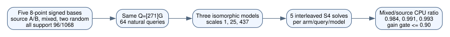

# Equal-yield mixed horizontal base: S4 cost follow-up

The [protocol](MIXED_EQUAL_YIELD_COST_PROTOCOL.md) and
[runner](mixed_equal_yield_cost.py) were committed and pushed at
`e051f55df` before the measured panel. The trigger was an
eight-query exploratory timing probe, excluded from this result.
The fixed source and two-source/two-endpoint mixed bases each have
exact three-sum support `96/1068`; two same-size random bases were
selected by the protocol to have the same support. The comparison
asks whether the mixed base lowers the **S4 membership solve** cost
at equal yield. [pcc:unverified]

The run used source `E/F_1009:y^2=x^3+4x+10`, order `r=1069`, public
fixture target `Q=[271]G`, two frozen 32-query seeds, five
interleaved solves per arm/query/model, and model scales `1,25,437`.
The mixed base has source x-values `0,1,478,742`; the source base
has `0,1,3,4`. Random controls have `100,273,626,656` and
`166,333,560,587`. The [raw gzip JSON](mixed_equal_yield_cost_raw.json.gz)
contains all 192 query/model rows and 4,800 solve samples; the
[summary JSON](mixed_equal_yield_cost_summary.json) and
[process receipt](mixed_equal_yield_cost_time.txt) are retained.
[pcc:unverified]

The primary metric is the sum of per-query median process-CPU solve
time over all 64 queries at each model scale. Wall clocks are shown
beside it. Ratios use the first source arm. The second source arm is
the A/A control.

| Scale | Source A CPU / wall (s) | Source B CPU (s) | Mixed CPU / wall (s) | Mixed / source A CPU | A/A CPU ratio | Mixed / random-control median CPU |
| ---: | ---: | ---: | ---: | ---: | ---: | ---: |
| 1 | `0.089769 / 0.098357` | `0.087708` | `0.088332 / 0.095223` | `0.9840` | `0.9770` | `0.9789` |
| 25 | `0.090709 / 0.100108` | `0.087929` | `0.089901 / 0.093240` | `0.9911` | `0.9694` | `0.9871` |
| 437 | `0.089991 / 0.094552` | `0.092077` | `0.089331 / 0.097078` | `0.9927` | `1.0232` | `0.9651` |

All three A/A ratios lie in the frozen `[0.95,1.05]` admission
band. The mixed/source ratios are `0.9840–0.9927`, well outside
the required `<=0.90` gain threshold; the mixed/random-control
ratios also fail it. Each seed separately gives the same decision:
the mixed CPU sums range from `0.041667` to `0.046665` seconds,
while source A ranges from `0.043287` to `0.046482` seconds across
the six scale/seed cells. The runner checked every algebraic verdict
against exact group membership. A separate raw-file parser
recomputed all 192 rows, 4,800 verdicts, per-query medians, and
positive counts from the gzip JSON, matching the summary. This is
a producer replay, not an independent PCC verification.
[pcc:unverified]

The 64 natural query points happen to hit the source support 8
times and the mixed support 4 times (the counts repeat under every
isomorphic scale). That finite stream imbalance does not change
the exact uniform support `96/1068` in each arm. The timing metric
prices the same query stream, including positive and negative
solves. Equal exact yield removes one confound, but this 64-query
stream is not an exact uniform-cost census.
The complete process took `23.60 s` real, `9.88 s` user, and
`0.78 s` sys; those totals combine all arms and Sage startup.
[pcc:unverified]

This fixed mixed-base construction therefore fails its solver
component gain gate. The result does not exclude different
horizontal edges, base sizes, coordinate models, or polynomial
encodings. It does not price complete relation collection, base-log
rank, target descent, memory, or matched rho; no whole-attack
improvement follows. A next candidate needs a mechanism that changes
the point-dependent equation or its unknown dimension, with a
prespecified fully charged comparison. [pcc:unverified]

Sources checked: the [signed support ceiling](SIGNED_THREE_SUM_CEILING.md),
[native same-target cost screen](NATIVE_THREE_SUM_COST_REPORT.md),
[same-base joint S4 panel](README.md), and lead-atlas
`LEAD-ICP-isogeny-transported-relation-yield` (shared KB source
`source:6dc4aae8f15ea3520242d94af9fcf8e8`). This panel changes
no curve or isogeny graph edge; its graphic depicts the cost
comparison only. [pcc:unverified]
