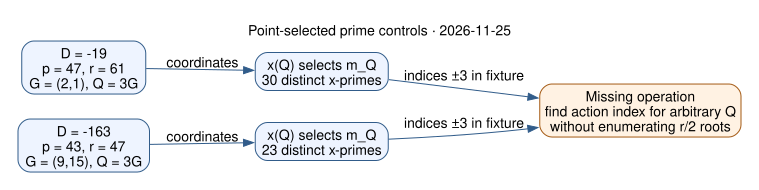

# Point-selected primes on a second ordinary curve (2026-11-25)

## Question and method

Does the finite point-to-prime assignment in the [reduced ray-orbit bridge](REDUCED_RAY_PRIME_BRIDGE.md) use special CM structure? The construction itself uses only the coordinates of a cyclic prime-order elliptic group. This control repeats its exact selector on a second ordinary curve with a different Frobenius discriminant. The supplied target's x-coordinate selects the ideal `(X-x(Q))`; the fixture scalar is used only to check the action index. The [Sage source](point_prime_generic_control.py) and [retained output](point_prime_generic_control_results.json) give the full inputs and counts. [pcc:unverified]

| Curve over F_p | Group order | Frobenius discriminant | x-orbit degree | Distinct selected primes | Indices taking m_G to m_3G |
|---|---:|---:|---:|---:|---|
| `p=47`, `y²=x³+x+38`, `G=(2,1)` | 61 | -19 | 30 | 30 | 3, 58 |
| `p=43`, `y²=x³+x+3`, `G=(9,15)` | 47 | -163 | 23 | 23 | 3, 44 |

These are **observed finite-field checks**, with an exhaustive scan of the nonzero subgroup points in each row. Both curves have prime group order, ordinary reduction, and nonexceptional j-invariant. The second curve is an ordinary CM curve too, as every ordinary finite-field elliptic curve is; the control removes dependence on the **specific** D=-19 curve and its chosen isogeny machinery. It is not a comparison of CM versus non-CM elliptic curves. [pcc:unverified]

## Interpretation

The selector's success is generic to cyclic elliptic groups: factor the formal orbit polynomial into the distinct roots `x([u]G)` and identify the root `x(Q)`. Writing or factoring that whole polynomial already enumerates `(r-1)/2` roots. In each row the available scalar action maps the generator ideal to the target ideal for `u=3` and `u=-3`, which is exactly the x-coordinate sign ambiguity. Identifying those indices for an arbitrary supplied target remains the point-orbit logarithm problem. This control therefore confirms the assignment, while giving no evidence that horizontal isogenies improve its construction or index extraction. [pcc:unverified]

The older [ray-class proposal](https://github.com/isogeny-labs/crypto-autoresearcher/blob/main/ledger/proposals/IDEA-20260808-5158fa.yaml) predicts one reduced Weber value per level fiber. The [reduction audit](RAY_CLASS_REDUCTION_AUDIT.md) explains why trivial Frobenius action does not identify distinct values under good prime-to-p reduction. These two exact finite-field rows show 30 and 23 distinct x-values respectively. They do not construct the characteristic-zero ray fields, and the second row alone does not independently test the proposal's full Artin setup. [pcc:unverified]

The next useful result is a compressed coordinate-dependent operation that outputs a nontrivial quotient of the unknown action index from `(E,G,Q)` and public CM data. It must work without materializing the orbit polynomial, and its full single-target cost must beat a matched rho baseline. The [bridge report](REDUCED_RAY_PRIME_BRIDGE.md) gives that cost gate. [pcc:unverified]

Reproduce with `/Volumes/SSD990/cryptanalysis/sage -python research/cm_joint_s4_20261123/point_prime_generic_control.py`. Checked canonical graph sources: `experiments/volcano-ic/figures/ecdlp.svg`, `experiments/volcano-ic/figures/census.svg`, and `experiments/ic-candidate-catalog/curves.yaml`; this control adds no isogeny edge, curve-catalog candidate, or performance measurement, so those graphs remain current. The editable [diagram source](point_prime_generic_control.dot) and [PDF](POINT_PRIME_GENERIC_CONTROL.pdf) are beside this report. [pcc:unverified]
