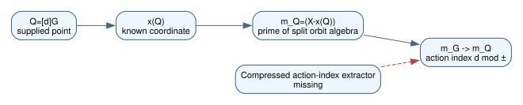

# A point-selected prime in the reduced ray orbit algebra

The [ray reduction audit](RAY_CLASS_REDUCTION_AUDIT.md) showed that
the `(r-1)/2` Weber x-values of a prime-order rational subgroup
remain distinct after good reduction. This gives a literal, cheap
point-to-**prime** assignment in the *reduced orbit algebra*. It
does not yet give a prime ideal of the quadratic CM order or an
algorithm for the unknown Artin label. [pcc:unverified]

Let `E(F_p)=<G>` have odd prime order `r`, and define

```text
F_G(X) = product_{u in F_r^*/{+1,-1}} (X-x([u]G)),
A_x = F_p[X]/(F_G(X)).
```

All roots are distinct, so `A_x` is a split étale algebra of
dimension `(r-1)/2`. For any supplied nonzero point `Q`, its known
coordinate selects the maximal ideal

```text
m_Q = (X-x(Q)) in A_x.
```

This definition needs `x(Q)` but not its scalar `d`. The known
scalar action of `a in F_r^*/{±1}` permutes the maximal ideals by
`m_P -> m_[a]P`. Thus if `Q=[d]G`, the exact orbit relation is
`m_Q = d . m_G`, with `d` determined only up to sign at this
x-only level. This is a *torsor relation containing the target*;
finding its action index is the unresolved computation. The same
finite algebra can be built for any cyclic prime-order elliptic
group, so the assignment alone is not a CM gain. [pcc:unverified]



The [Sage runner](reduced_ray_prime_bridge.py) uses the earlier
`D=-19`, `p=47`, `r=61`, `G=(2,1)` control. Its degree-30
polynomial is squarefree and splits into 30 distinct linear factors.
For the public fixture `Q=[3]G`, it constructs `m_G=(X-2)` and
`m_Q=(X-32)` from the point coordinates, then checks that the
action indices carrying `m_G` to `m_Q` are precisely `3` and
`58=-3 mod 61`. Across all 60 nonidentity points there are 30
distinct x-selected ideals and 60 distinct signed `(x,y)` pairs.
The [retained JSON](reduced_ray_prime_bridge_results.json) records
the polynomial and counts. The fixture label is used to check the
answer; the selector itself reads only the supplied point.
[pcc:unverified]

For a signed selector one can use the split coordinate algebra
`A_xy=F_p[X,Y]/(F_G(X),Y^2-(X^3+aX+b))` and the maximal ideal
`(X-x(Q),Y-y(Q))`. It has `r-1` geometric factors on this
prime-order group and distinguishes `Q` from `-Q`. This is a
generic coordinate construction. To interpret these selectors as
primes in a **characteristic-zero ray field**, one must still
construct a compatible CM lift, choose the Weber or signed torsion
invariant and its normalization, identify the correct prime above
`p`, and prove that reduction matches the displayed algebra.
Those objects were not constructed in this screen. The primary
[Koo–Shin–Yoon torsion-coordinate construction](https://arxiv.org/html/1007.2307v1)
shows how x and suitable powers of y generate ray fields in its
stated CM family and modulus `N O_K`; its theorems do not directly
identify this ideal modulus `(π-1)` or its square. [pcc:unverified]

## Direct cost and the missing nonlinear operation

For P-192, the x-orbit degree `(r-1)/2` has 191 bits. Even one dense
vector of that many `F_p` coefficients at 24 bytes each occupies
about `2^195.585` bytes. The signed algebra doubles that dimension.
These are exact representation counts, not a lower bound on every
compressed circuit or symbolic ideal representation. They rule out
materializing this split algebra as the point-to-ideal evaluator on
P-192. The negation-aware rho reference is about `2^95.826`
group additions, in a different cost unit; a future compressed
evaluator must price its own construction, per-target orientation,
and full recovery against that same-target reference.
[pcc:unverified]

One might hope to exploit the factorization of `r-1` by applying
Pohlig–Hellman to the multiplicative action group. On P-192 its
largest prime factor has 92 bits. The obstacle is an exact operation
gap. If `d=a^e mod r` for a public generator `a`, the available
action `[a^k]Q` changes `e` to `e+k`. Pohlig–Hellman projection
requires an operation that changes `e` to `e*(r-1)/q`, equivalently
turning `[d]G` into `[d^((r-1)/q)]G` without knowing `d`.
Horizontal isogenies and smooth principal loops act as **known
scalar multiplications**, so they supply shifts, not that
projection. Smooth factorization of `r-1` therefore does not by
itself lower the point-orbit logarithm cost. [pcc:unverified]

The falsifier for a compressed ray-field proposal is precise: given
only `(E,G,Q)` and public CM/isogeny data, output a nontrivial
quotient character or action index of `m_Q` without enumerating
the orbit or using a point logarithm. Check it on all 60 signed
points here, then on a second CM curve and a matched ordinary
known-scalar control. Charge construction, failed branches,
orientation, and full scalar recovery. A small factorization of
`r-1` is useful only after such a nonlinear projection is actually
implemented. [pcc:unverified]

Sources checked: [CM ray-class reduction audit](RAY_CLASS_REDUCTION_AUDIT.md),
[ray character factor map](RAY_CHARACTER_FACTOR_MAP.md),
[squared-ray gate](SQUARED_RAY_POINT_BRIDGE.md), the primary
[Koo–Shin–Yoon paper](https://arxiv.org/html/1007.2307v1), and
lead-atlas `LEAD-STR-class-group-ecdlp-bridge`.

Reproduce from the repository root:

```sh
/Volumes/SSD990/cryptanalysis/sage -python research/cm_joint_s4_20261123/reduced_ray_prime_bridge.py
```
