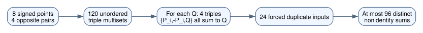

# A signed three-sum support ceiling on the fixed horizontal pair

For a signed factor base `B={±P_1,...,±P_m}` with `2m` distinct
nonzero points in an odd-order abelian group, there are
`C(2m+2,3)` unordered triples with repetition. For every `Q in B`,
the `m` different triples `{P_i,-P_i,Q}` all sum to `Q`. These
families are disjoint across `Q`: a three-element multiset cannot
contain two different opposite pairs when zero and points of order
two are excluded. Thus the triple-sum map has at least
`2m(m-1)` forced duplicate inputs, giving

```text
|{P+Q+R != O : P,Q,R in B}| <= C(2m+2,3)-2m(m-1)
                            = 4m(m^2+2)/3.
```

At `m=4`, this is `120-24=96`. The bound is combinatorial: it
does not assume a curve, coordinate model, or isogeny. It bounds
distinct nonidentity sums, not the number of triple witnesses or
their solver cost. [pcc:unverified]



The [existing exact census](NATIVE_THREE_SUM_REPORT.md) found 96
nonidentity sums for the eight-point source native base on
`E/F_1009: y^2=x^3+4x+10`, whose group order is 1069. It therefore
attains the universal eight-point signed ceiling. No other signed
eight-point base, including one selected through horizontal
isogenies, can raise uniform three-summand hit probability above
`96/1068` on this group. [pcc:unverified]

The [new runner](signed_three_sum_ceiling.py) independently builds
the first Sage degree-5 isogeny to
`E'/F_1009: y^2=x^3+888x+852`. It pulls endpoint points to the
source via the dual isogeny followed by multiplication by
`5^(-1) mod 1069`; the runner verifies that each pulled point maps
back to its endpoint. It then keeps the base at exactly four signed
pairs while varying how many lowest-`x` pairs come from each curve.
[pcc:unverified]

| Source pairs | Endpoint pairs | Source `x` | Endpoint `x` | Distinct nonidentity three-sums |
| ---: | ---: | --- | --- | ---: |
| 0 | 4 | — | `0,2,4,7` | 92 |
| 1 | 3 | `0` | `0,2,4` | 92 |
| 2 | 2 | `0,1` | `0,2` | 96 |
| 3 | 1 | `0,1,3` | `0` | 96 |
| 4 | 0 | `0,1,3,4` | — | 96 |

All five rows are exact finite-group counts for the displayed
pair and selection rule. The two mixed bases reaching 96 tie the
source; the others lose support. The source already meets the
general bound, so a same-size signed-base **yield** improvement is
mathematically excluded on this fixed instance. This says nothing
about a lower membership-solver cost, a larger base, a nonsigned
base, or another curve. The existing [native cost screen](NATIVE_THREE_SUM_COST_REPORT.md)
addresses a different comparison and does not turn this support
bound into a full-cost result. [pcc:unverified]

Sources checked: [transported relation gate](TRANSPORTED_RELATION_GATE.md),
[native base census](NATIVE_THREE_SUM_REPORT.md), and lead-atlas
`LEAD-ICP-isogeny-transported-relation-yield` (shared KB source
`source:6dc4aae8f15ea3520242d94af9fcf8e8`). The existing
horizontal graph remains current: the runner uses its fixed
degree-5 edge and changes no curve or edge identity. [pcc:unverified]

Reproduce from the repository root:

```sh
/Volumes/SSD990/cryptanalysis/sage -python research/cm_joint_s4_20261123/signed_three_sum_ceiling.py
```
