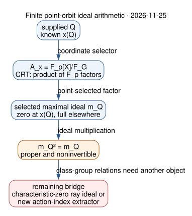

# Ideal arithmetic of the finite point-orbit bridge (2026-11-25)

## Which ideal was constructed?

The [reduced point-prime bridge](REDUCED_RAY_PRIME_BRIDGE.md) assigns a supplied nonzero `Q` the maximal ideal `m_Q=(X-x(Q))` in

```text
A_x = F_p[X] / (F_G(X)),
F_G(X) = product over u in F_r^*/{±1} of (X-x([u]G)).
```

For a prime-order group `E(F_p)=<G>`, the roots are exactly the x-coordinates of **all** nonzero rational points modulo sign; `F_G` is independent of which generator `G` was chosen. The selector `(X-x(Q))` has a short symbolic description even when the full orbit polynomial is enormous. This is a genuine point-selected prime of `A_x`, but its ambient ring is a split finite coordinate algebra, rather than the quadratic CM order or the characteristic-zero ray field. [pcc:unverified]

## Arithmetic of the selected primes

The roots are distinct, so the Chinese remainder theorem gives `A_x ≅ product_(r-1)/2 F_p`. Under this identification, `m_Q` is zero at the factor indexed by `x(Q)` and the full field at every other factor. Therefore

```text
m_Q^2 = m_Q,
m_Q * m_R = m_Q ∩ m_R  when x(Q) != x(R).
```

Each `m_Q` is a proper, **noninvertible** ideal. Its quotient has `p` elements; multiplying distinct selected primes merely records the set of excluded coordinates. Every invertible ideal of a finite product of fields is the unit ideal, and every rank-one projective module over that product is free, so its Picard group is trivial. The class-group relation machinery for invertible ideals of `O_K` cannot run on the selected `m_Q` by ideal multiplication. These are standard consequences of the displayed product-ring decomposition, not an impossibility statement about all compressed ray-field constructions. [pcc:unverified]

An explicit Bezout proof of idempotence avoids relying on a quotient-ring ideal-equality API. For a root `x`, write `F_G=(X-x)H_x`; squarefreeness gives `gcd(X-x,H_x)=1`. Choose `U,V` with `U(X-x)+VH_x=1`. Multiplying by `X-x` yields `(X-x)=U(X-x)^2+VF_G`. In `A_x`, the generator of `m_x` belongs to `m_x²`, while the reverse inclusion holds for every ideal. The [Sage replay](split_orbit_ideal_arithmetic.py) checks this identity for all 30 selected primes on the `p=47,r=61,D=-19` control and all 23 on the separate `p=43,r=47,D=-163` control. [Retained results](split_orbit_ideal_arithmetic_results.json) include both curve identities and counts. [pcc:unverified]



## Formal proof map and consequence

[`formal/SplitOrbitIdeal.lean`](formal/SplitOrbitIdeal.lean) uses the faithful product-ring presentation `ι→F` and defines the selected ideal as the span of the coordinate idempotent. `mem_pointIdeal_iff` proves that membership is exactly vanishing at the selected coordinate; `pointIdeal_mul_self` proves idempotence; `pointIdeal_ne_top` and `pointIdeal_not_invertible` prove that this proper selected ideal has no multiplicative inverse. The file does not formalize the Chinese remainder isomorphism from `F_p[X]/F_G` to the product, nor the whole Picard-group statement. Those dependencies remain in the written CRT argument above. [pcc:unverified]

The proof compiled with Lean 4 `v4.28.0` and mathlib commit `fadcf92bfcfe7575bbdf04c6f83ab3ada53e3d42` in `/Volumes/SSD990-2/ecdlp-lean-check` using `lake env lean` on the file. `#print axioms` reports only Lean foundations `propext`, `Quot.sound`, and `Classical.choice` for the five declarations, with no `sorryAx`. `lean4checker --fresh` was unavailable. [pcc:unverified]

```sh
cd /Volumes/SSD990-2/ecdlp-lean-check
lake env lean /Volumes/SSD990-2/cryptanalysis-cm-joint-s4-pr-20261123/research/cm_joint_s4_20261123/formal/SplitOrbitIdeal.lean
```

This narrows the bridge precisely. A point-selected maximal ideal of the **finite split algebra** does not inherit Hafner–McCurley relation arithmetic. The next construction must place the supplied point in an appropriate characteristic-zero ray object, or supply another operation on its compact coordinate selector that extracts an action-index quotient. Either route must charge its orientation and full same-target recovery cost. [pcc:unverified]

Reproduce from the repository root with `/Volumes/SSD990/cryptanalysis/sage -python research/cm_joint_s4_20261123/split_orbit_ideal_arithmetic.py`. The [editable diagram](split_orbit_ideal_arithmetic.dot) and [inspected PDF](SPLIT_ORBIT_IDEAL_ARITHMETIC.pdf) are beside the data. Checked canonical graph sources: `experiments/volcano-ic/figures/ecdlp.svg`, `experiments/volcano-ic/figures/census.svg`, and `experiments/ic-candidate-catalog/curves.yaml`; no curve, isogeny edge, or performance result changes here, so those graphs remain current. [pcc:unverified]
