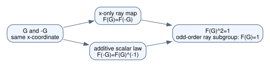

# The negation gate for an additive point-to-ray label

The [squared-ray construction](SQUARED_RAY_POINT_BRIDGE.md) has an
order-`r` principal-unit subgroup. Once a generator `G` is marked,
its desired point label is `F([d]G)=[(1+d(π-1))]`. The
[coordinate-to-ray screen](COORDINATE_IDEAL_RAY_SCREEN.md) instead
uses only `x(P)` to construct a ray residue. Its failure of the
additive scalar rule has a general explanation that does not require
the finite census. [pcc:unverified]

Let `E(F_p)=<G>` have odd prime order `r`, and let `A` be any abelian
group with no nontrivial element of order two. Suppose `F` is
defined on all nonidentity points, depends only on the elliptic
`x`-coordinate, and satisfies the scalar law
`F([d]G)=F(G)^d` for every integer `d` with `[d]G` nonzero.
Then `x(-G)=x(G)`, so `F(-G)=F(G)`. The scalar law at `d=-1`
gives `F(-G)=F(G)^(-1)`. Thus `F(G)^2=1`, forcing
`F(G)=1`; the scalar law makes `F` identically one. In additive
notation the same argument is `F(G)=-F(G)`, hence `F(G)=0`.
Therefore an `x`-only function cannot realize a nontrivial additive
point label in the order-`r` squared-ray subgroup. [pcc:unverified]

The specific coordinate ideal
`I_P=((x(P)-π)/(x(P)-1))` has coefficient
`z(P)=-(x(P)-1)^(-1) mod r` wherever defined. Its domain is
negation-invariant, and `z(P)` is nonzero there. Hence it cannot
satisfy `z([d]G)=d z(G)` on a domain containing `G` and `-G`
for any odd `r`; the finite matches in the prior report are
incidental. On the `D=-19`, `p=47`, `r=61` control, the runner gives
`z(G)=60`; it also gives `z(-G)=60`, while an additive law would
require `-60=1 mod 61`. [pcc:unverified]

The scope is deliberately narrow. An even function can encode an
even scalar predicate such as `χ_r(d)` when `χ_r(-1)=1`; the
quadratic-character test in the prior report is therefore still a
separate finite screen. A map using `y(P)` can distinguish `P`
from `-P`, but sign sensitivity alone does not make it additive or
cheap. A useful successor needs a concrete target-coordinate
construction with an exact scalar-bearing law, an isogeny-specific
mechanism, and a charged comparison against its generic analogue.
[pcc:unverified]

Sources checked: the local [coordinate-to-ray screen](COORDINATE_IDEAL_RAY_SCREEN.md),
[squared-ray point bridge](SQUARED_RAY_POINT_BRIDGE.md), and
[point-to-ray homomorphism gate](POINT_TO_RAY_HOMOMORPHISM_GATE.md).
The assertion is a group-theoretic sign argument and changes no
curve or isogeny graph edge. [pcc:unverified]
