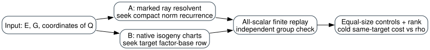

# Marked ray resolvent and native-chart point relations

**Status:** preregistered research proposals; no new positive result or PCC claim. **Target:** a cold, same-target P-192 ECDLP comparison against negation-aware rho. This note preserves two proposals raised on 2026-11-25 and their first falsifiers. It does not promote a component identity to a solve or speedup. [pcc:unverified]



## Shared admission rule

Input to a candidate evaluator is `(E, G, x(Q), y(Q))` and public CM/isogeny data. During evaluation it may not read `d`, a precomputed target label, or a generating endomorphism whose action encodes `d`. In finite controls, a driver may generate `Q=[d]G` to check the output, but `d` must remain outside the evaluator. Freeze the source curve, horizontal edges, point encoding, parameter search, cost units, and pass thresholds before the first outcome. Validate every nonzero `d` on the `D=-19`, `p=47`, `r=61`, `G=(2,1)` control, then an independent maximal-order CM curve and a same-size ordinary control. Distinguish a relation identity, component gain, and full single-target gain. [pcc:unverified]

For every arm, retain raw outputs, failures, source revision, seeds, and the same query stream. Charge setup, isogeny construction, evaluator, relation collection, orientation, storage, linear algebra, descent, and verification. Compare against matched same-target rho; any reuse amortization is secondary. A source-versus-codomain comparison must include an isomorphic coordinate-model null and a native known-scalar control. [pcc:unverified]

## Proposal A: compress a marked ray resolvent

The existing [quadratic factor map](../cm_joint_s4_20261123/RAY_CHARACTER_FACTOR_MAP.md) gives an exact `f_G(x(Q))=chi_r(d)`, but its direct construction enumerates `(r-1)/2` subgroup x-values. The [smooth-kernel character screen](../cm_joint_s4_20261123/SMOOTH_KERNEL_CHARACTER_SCREEN.md) found a short horizontal circuit for a *different* point predicate and rejected its identification with `chi_r(d)`. These are distinct baselines. [pcc:unverified]

Let `n=(pi-1)` and `A=(O_K/n)^*/{±1}`. For an explicitly specified torsion function `u` and subgroup `H<=A`, define a marked coset product `U_H(T)=product_{h in H} u([h]T)`. Its formal coset identity is `U_H([d]T)=U_{dH}(T)`. A character-weighted resolvent over `A/H` could transform by a nontrivial character of `d`. The proposed *new operation* is a norm-compatible recurrence across smooth horizontal ideals that evaluates this **marked** resolvent, or a useful quotient, without expanding all cosets. A norm identity for an unmarked kernel product is insufficient. This is a hypothesis, not an algorithm. [pcc:unverified]

**First experiment:** specify `u`, `H`, the normalization at `G`, and the recurrence *symbolically* before examining scalar labels. Give code whose evaluator accepts `Q` solely through coordinates. On all 60 nonzero control points, compare its output with the predeclared character and compare the operation count with the direct factor map and the smooth-kernel predicate. A recurrence that visits `(r-1)/2` marked points, collapses to a screened kernel function, has target-dependent hidden precomputation, or fails any exact control point is rejected. If a quadratic bit survives, price its effect on **full** recovery; a single bit does not establish an end-to-end gain. [pcc:unverified]

The primary class-field literature establishes torsion-coordinate generators in its stated settings; it does not provide this evaluator for the ideal modulus `(pi-1)`: [Koo–Shin–Yoon](https://arxiv.org/abs/1408.5650), [Jung–Koo–Shin](https://arxiv.org/abs/2111.01021). The precise source-fidelity obligation is to identify the CM lift, torsion invariant, modulus, normalization, and reduction prime, then prove that the finite-field evaluator implements the same marked character. [pcc:unverified]

## Proposal B: native-coordinate charts on horizontal neighbors

Fix small horizontal isogenies `phi_i:E->E_i` of degrees `ell_i`, marked points `H_i=phi_i(G)`, and independently specified native bases `B_i` on each `E_i` using the same coordinate rule and total base-size budget. For each natural query `R=[a]G+[b]Q` with `b!=0`, ask for `phi_i(R)=P_1+P_2+P_3`, `P_j in B_i`. A witness yields the **checkable point row**

```text
[ell_i*a]G + [ell_i*b]Q = dual(phi_i)(P_1)+dual(phi_i)(P_2)+dual(phi_i)(P_3).
```

The evaluator may use `a,b`, the public maps, and `Q`'s coordinates, but not `d`. Base-point logarithms remain unknowns in a later relation matrix. The proposed gain is lower *complete native coordinate-solver cost* across a fixed set of charts, after accounting for union-base rank and transport. Transporting one unchanged base gives exactly the same point support and cannot count as a yield gain. [pcc:unverified]

**First experiment:** freeze two horizontal vertices and their native coordinate rule on the existing `p=1009`, `r=1069`, degree-5 pair. Run the full nonidentity target census for support and direct group-identity replay of every accepted row. Then run identically sized (1) exact pullback bases, (2) independent source bases, (3) an isomorphic-model null, and (4) the earlier [native S4 cost](../cm_joint_s4_20261123/NATIVE_THREE_SUM_COST_REPORT.md) and [equal-yield mixed-base](../cm_joint_s4_20261123/MIXED_EQUAL_YIELD_COST_REPORT.md) baselines. Use natural, precommitted query streams for solver time; do not balance positive and negative queries after observing outcomes. Compute matrix rank and full extraction cost before any gain claim. Reject if the point-row gain disappears under equal-size controls or the cold setup-charged total exceeds rho. [pcc:unverified]

The existing lead atlas already names isogeny-transported relation yield, and earlier native-chart screens found no qualifying gain for their fixed bases. This proposal narrows the next experiment to **several independently native charts with a single shared rank and cost ledger**; it makes no novelty claim for isogeny transport, Semaev equations, or native factor bases. [pcc:unverified]

## Decision and proof map

| Item | Current status | Required evidence |
| --- | --- | --- |
| Marked resolvent transformation | Conditional algebraic identity; no compact evaluator | Exact definition and point-coordinate implementation with all-scalar replay |
| Horizontal norm compression | Hypothesis | Recurrence proof and charged operation count against direct map and generic control |
| Native-chart point row | Follows from isogeny homomorphism and dual composition | Independent arithmetic replay of each emitted row and `b!=0` |
| Isogeny-attributable improvement | Unestablished | Frozen equal-base and model controls, rank, failures, cold full cost |

No new theorem is asserted, so this protocol adds no Lean declaration. If an evaluator survives its first screen, the follow-up report owes a faithful theorem, pinned Lean proof where feasible, `#print axioms`, source-linked raw records, diagram, PDF, and PCC submission under the repository gate. The existing CM study graph is unchanged because neither proposal supplies a verified finding. [pcc:unverified]
