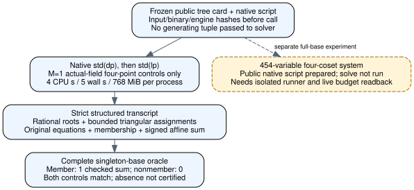

# Native four-point root recovery and scoped rejection rules

15 November 2026. Producer evidence; PCC standing unverified.

Native Singular plus Rust recovery matches the complete M=1 four-point oracle
over p=2^255-19, A=486662: one assignment and one checked signed sum for the
member control, zero assignments/sums and a reported unit basis for the
nonmember control. Both are functional diagnostics. The full-base system
has not been solved. PCC-20261115-47a01f. [pcc:unverified]

## What is implemented and checked

The immutable v4 qualifier exposes `prepare-tree`, `recover-tree` and
`native-tree-controls`. Public cards specify arity 2–8 and one or four
Chebyshev membership branches. Native std(dp) and std(lp) emit a strict
term/exponent protocol. The Rust consumer rejects truncation, engine errors,
duplicate or mixed frames and malformed shapes; it uses gcd(f,X^p-X),
bounded splitting and triangular specialization, checks every original
equation, then checks rational lifts, union membership and all actual affine
point signs. Empty recovery is not an absence certificate.

[Pre-call records and raw native output](../../evidence/native-four-controls-v1/)
pin inputs, scripts, engine and qualifier. Each process is limited to four
CPU seconds, five wall seconds and 768 MiB. Recovery limits are degree 4096,
10,000,000 coefficient-loop units, 4096 branches and 128 split attempts.
The loop counter is an implementation guard, not a group-equivalent work
price or admitted cost comparison. Known finite-base labels are inspected
after native execution. [pcc:unverified]

[Final tests](../../recovery-final-v4.log) report nine unit tests and one
process-level immutable-input test passing. Tests exhaust monic polynomials
through degree three over F5, include repeated and nonrational factors at
actual p, and exercise an actual 454-variable four-coset known assignment.
That assignment is supplied through a synthetic linear basis: it tests
recovery and mutations, not solver discovery. Frozen consumer source is
archived beside the native controls. [pcc:unverified]

The [prepared actual four-point public script](../../evidence/public-four-prepared-v1/)
has 454 variables and 455 quadratic equations and records
`solver_invoked=false`. There is no large-base timing, success-rate sample,
geometric theorem or changed exponent in this dataset. [pcc:unverified]

## Criteria and current verdict

The [route criteria](../../ROUTE_CRITERIA_V3.md) distinguish proved exclusion,
counterexample to a universal claim, corrected statistical rejection of a
budgeted promise, parked implementation, invalid experiment and open route.
For seven independent failures, the proposed q>=3/4 promise is rejected at
alpha=1/10000 because 4^-7=1/16384; the document explains family correction.
This is an example design, not a test executed here.

A fixed-base concentration example cannot refute an average-over-bases energy
bound. A synthetic planted basis cannot establish uniform-target yield.
Timeouts do not prove every solver has exponent gamma>=1. The finite
controls validate only the implemented diagnostic path; the route remains open.

## Remaining obligations and sources

The full-base pilot still needs aggregate CPU accounting, an independently
registered target law and resource card, a supported isolated native-workload
image/runner, and live capacity/spend remainder. No cloud job was launched.
See the shared [cost/proof obstruction](https://github.com/isogeny-labs/crypto/blob/98b6b736a53412ef86f02f9e789edc393af1fc20/problems/curve25519-torus-four-point-decomposition.md)
and [runner obstruction](https://github.com/isogeny-labs/crypto/blob/98b6b736a53412ef86f02f9e789edc393af1fc20/problems/curve25519-singular-isolated-runner.md).

Native root algorithms use standard finite-field polynomial facts;
[HAC chapter 3, section 3.11](https://cacr.uwaterloo.ca/hac/about/chap3.pdf)
was read. Parameters/maps: [RFC 7748](https://www.rfc-editor.org/rfc/rfc7748),
[RFC 9380](https://www.rfc-editor.org/rfc/rfc9380). Algebraic-decomposition
context: [Petit–Kosters–Messeng](https://people.maths.ox.ac.uk/petit/files/16PKC_primeECDLP.pdf).
The source pin in TREE_DEPENDENCY.json complements the older unchanged-library
pin in DEPENDENCY.json. No novelty clearance or canonical performance edge
is claimed. The original revision-two PDF remains historical evidence.
