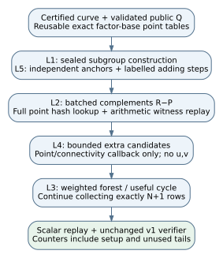

# Point hashing: five integrated paths

2026-11-16. Implementation and development controls; performance evaluation pending.
All producer assertions in this report remain unsigned. [pcc:unverified]

The five planned leads now compose in an opt-in Rust collector and file CLI in
Crypto and its Cryptanalysis mirror. Reusable exact point tables remain the
relation-search foundation. Default options use the original joint prepared
solver. The implementation supports prime-field curves and two factor-base
slots; these changes do not extend the binary challenge pipeline. [pcc:unverified]

## What each lead implements

1. **Subgroup provenance.** A private immutable token enters through validated
   external points, the certified generator, or checked subgroup operations.
   Exact p, a, b, order, cofactor and generator equality binds a token to a
   prepared table's owned curve. Internally generated targets can avoid another
   order multiplication; raw public queries remain checked. No serialized token
   or caller boolean admits an unvalidated point. [pcc:unverified]
2. **Batched complements.** Ordinary affine R-P denominators share a Montgomery
   inversion. Chunk choices are 1, 8, 32 and 128. Exceptional points use the
   existing checked arithmetic. Complete chunks, products and unused tails are
   charged, including work before a resource failure. Full point equality and
   witness replay remain mandatory. [pcc:unverified]
3. **Weighted cycle collection.** Slot-tagged point identifiers form a bipartite
   forest. Sparse path provenance supplies dependency coefficients; zero-v
   cycles are screened and later cycles remain eligible. Once a useful
   dependency is retained, connected edges need no new path materialization.
   The v1 certificate still contains exactly N+1 rows. Early stopping needs a
   separate versioned verifier and is not implemented here. [pcc:unverified]
4. **Bounded alternative witnesses.** After a first hit, cap 4 or 16 counts
   additional candidates, including misses. The first closing edge wins;
   otherwise the first hit remains the fallback. The graph callback has points
   and connectivity only, never the public u/v labels or secret. Callback and
   scan errors propagate even after a fallback exists. [pcc:unverified]
5. **Anchored target walks.** Two-dimensional public increment labels generate
   targets with exact R=uG+vQ. Each block starts with fresh coefficients. Tables
   of 16 or 32 increments and blocks of 16, 64 or 256 are supported. Rank-deficient
   label tables redraw within a bound; identity increments remain valid. This
   policy changes coefficient RNG consumption and introduces correlation; label
   span is not a relation-rank or iid guarantee. [pcc:unverified]

## Development checks and their limits

The shared tests exercise each path and all five together. Complete known-answer
solves cover four public scalars, seven option arms and three seeds on
E/F17: y²=x³+2x+2, order 19, G=(5,1). This is an off-panel correctness fixture,
chosen for exhaustive replay, not a standard-panel timing sample. F5 cofactor
fixtures test rejection and subgroup boundaries. [pcc:unverified]

Arithmetic-only controls compare entire certificates and final seeded RNG states,
including sparse factor-base misses. Other controls check full witness equations,
corruption rejection, exact v1 row count, strict JSON, bounded input/output,
identity targets and resource errors. Route counters detect ignored switches.
Mirror-specific controls audit group-call accounting and the original online
boundary at target validation after reusable setup. [pcc:unverified]

Exact native manifests, toolchain identities, command receipts, raw failures and
final development logs accompany this report. Initial malformed-option acceptance,
missing sparse manifests, stale mirror lock entries, Crypto-only test counters
and SHA digest formatting errors are retained. The lock repair removes orphan
nodes without upgrading dependencies. The declared mirror Rust 1.85 check still
fails on inherited sha2 0.11.1, which requires Rust 1.88; no 1.85 pass is claimed.
Portable digest formatting keeps standard
SHA-256 vectors unchanged. These are producer development checks, not signed
execution or an independent audit. [pcc:unverified]

No runtime, GAE, significance, relation-yield or challenge-scalar result is
reported. Local suite elapsed times are incidental tool output and are not
comparison data. Canonical scoreboards, progress charts and benchmark graphs
remain unchanged because this work adds no admitted measurement or graphable
performance finding. The diagram describes implementation flow only.

## Next measurement step

The individual option files preserve the five ablations and the combined arm;
lead 4 necessarily includes its graph foundation. The next study should compare
cold setup, online search, verification, memory, successful relation yield and
failure/censoring against the original joint prepared control, with A/A and
positive controls on exact matched inputs and a matched external component
reference. Freeze actual instances, seeds, arm order, sample count, pricing,
selection rule and thresholds before collecting measurements.

Use the standard prime panel P24a, P32a, P36a and P40a with their pinned ICV1
identities. Fresh current-source S3 checkpoint upload/readback and authenticated
exact native execution, image and L2 admission remain prerequisites. No scientific
job, image build or benchmark was launched for this implementation. The prior
pilot, frozen A/B panel, profiling, binary pipeline, challenge scalars and general
independent audit remain open at their existing scope.

## Sources and status

The original five-lead plan is retained unchanged at
[the planning report](https://github.com/isogeny-labs/crypto/blob/69674b9276a1c1a35c00550f0d264f80b80ab118/research/point_hash_next_leads_20261116/reports/REPORT.md).
Its pinned source audit informed this implementation. KB tools were unavailable;
the repository wrapper could not find its executable. Direct source review was
the fallback. No novelty claim follows from that retrieval gap.

Bos, Kaihara and Montgomery,
[Pollard Rho on PlayStation 3](https://www.hyperelliptic.org/tanja/SHARCS/record2.pdf),
SHARCS 2009 sections 3.4–3.5 and 4.3, supplies the established adding-walk and
simultaneous-inversion context. Godsil and Guo,
[Cycle Spaces of Digraphs](https://arxiv.org/abs/1609.09118), sections 2–3,
informs the incidence/cycle formulation. Teske's full text was inaccessible;
no claim depends on having read it. The five algebraic rationales remain open
proof obligations, not new formally certified identities.
