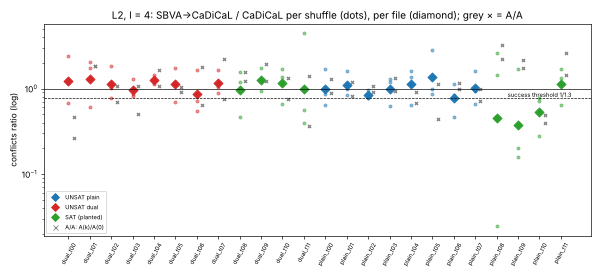

# L2 result: SBVA preprocessing does not help CaDiCaL on m = 4 PDP instances (KILL)

Run 2026-11-18, following the protocol frozen in commit 042240a
([`PROTOCOL.md`](PROTOCOL.md)). It is an exploratory measurement on an
unisolated 4-core shared container. Conflicts are the primary metric. All
of it is `[pcc:unverified]`.

The benchmark record is
`benchmarks/records/20261118T0350Z-l2-sbva-cadical-pdp-m4.json`.

## Decision: KILL, by the pre-registered rule

On the l = 4 UNSAT instances (non-decomposable targets, 16 base CNFs × 3
shuffles = 48 pairs), SBVA → CaDiCaL takes **1.061× the conflicts of
CaDiCaL alone, 95% CI [0.979, 1.143]**. The A/A noise band is
0.948 [0.793, 1.108]. The ratio lies inside the A/A interval and above the
success threshold 1/1.3 = 0.769. Wall time is 1.061× [0.972, 1.149],
including SBVA's own 0.05 s mean (0.105 s at most).

| Subset | Files | Pairs | Conflicts B/A (95% CI) | A/A conflicts (95% CI) | Wall B/A (95% CI) |
|---|--:|--:|--|--|--|
| **l4 UNSAT (primary)** | 16 | 48 | **1.061 [0.979, 1.143]** | 0.948 [0.793, 1.108] | 1.061 [0.972, 1.149] |
| l4 UNSAT plain | 8 | 24 | 1.005 [0.897, 1.124] | 0.934 [0.833, 1.034] | 0.997 [0.881, 1.130] |
| l4 UNSAT dual | 8 | 24 | 1.121 [1.019, 1.216] | 0.962 [0.680, 1.292] | 1.128 [1.023, 1.225] |
| l4 SAT | 8 | 24 | 0.782 [0.568, 1.047] | 1.268 [0.858, 1.820] | 0.757 [0.532, 1.039] |
| l3 UNSAT | 16 | 48 | 0.978 [0.834, 1.149] | 1.193 [0.977, 1.464] | 1.008 [0.852, 1.208] |
| l3 SAT | 8 | 24 | 0.655 [0.433, 0.963] | 0.840 [0.496, 1.383] | 0.762 [0.534, 1.064] |

B is SBVA → CaDiCaL; A is CaDiCaL alone. Each geometric mean has a 95%
bootstrap interval from 10,000 resamples of base CNFs.

## Reading

- **UNSAT, the case that matters.** Refuting a non-decomposable target is
  where the relation search spends its time. SBVA leaves it unchanged on the
  plain encoding (1.005) and makes it about 12% worse on the dual-rail
  encoding (1.121; the interval excludes 1, though it overlaps the
  encoding's own wide A/A band). SBVA rewrites very little: on
  `l4_plain_t00` it goes from 1,910 to 1,916 variables and from 11,605 to
  11,595 clauses. The CNF is mostly XOR chains, AND gates and parity
  clauses, and BVA's pattern of shared literal pairs finds little to
  factor in them.
- **SAT targets.** The point estimates favour SBVA (0.78 at l = 4 and 0.66
  at l = 3), but the intervals are wide, the SAT A/A band is also wide, and
  SAT targets do not decide under the protocol. A positive SAT effect would
  matter little in any case: almost every relation-search query is a
  non-decomposable target.
- **The feasibility probe was noise.** On one l = 4 UNSAT instance it showed
  conflicts halving (880,596 → 454,587). The full run shows that size of
  swing between shuffles of the same CNF under CaDiCaL alone. This is why
  the protocol carries an A/A arm.

## Deviation from the protocol: model check

The protocol says any answer or model mismatch makes the run invalid.

- **What happened.** 23 of the 48 arm-A SAT answers failed the runner's
  model check. Every one of those answers was correct against ground truth.
- **Cause.** The CaDiCaL build used (git HEAD `6b3d70b9ce00`, which reports
  itself as 3.1.0) printed models that leave out eliminated variables: for
  example, 2,060 of 3,106 variables printed, with 1,024 eliminated. The
  runner's check assumed a full assignment.
- **Check.** `recheck_models.py` re-solved all 23 cases on the identical
  shuffled CNF with `--elim=0`. All 23 are SAT, with full models that
  satisfy every clause (`model_recheck.json`). CaDiCaL's own internal
  witness check (`--checkwitness`, default on) also did not fire.
- **Treatment.** `analyze.py` accepts such a row only if its recheck
  passed; all 23 did, so 0 rows are invalid. The recheck changes no metric,
  and none of the 23 rows is in the primary (UNSAT) subset.
- **Possible upstream bug.** The truncated model output may be a bug in the
  CaDiCaL development build. I did not report it upstream.

## Files

- `PROTOCOL.md`: frozen before the run.
- `gen_instances.py` and `manifest.json`: the 48 base CNFs, with SHA-256,
  crypto commit `833a35d`.
- `run_l2.py`, `rows.jsonl`: 288 rows, all exit 0, none censored.
- `analyze.py`, `summary.json`, `summary.md`.
- `recheck_models.py`, `model_recheck.json`.
- `plot_l2.py`, `l2_ratios.svg`, `l2_ratios.png`.

To reproduce:

1. Build CaDiCaL at `6b3d70b9ce00` and SBVA at `35e74d0` (clang++ -O3,
   Eigen 3.4.0).
2. `python3 gen_instances.py --crypto <crypto checkout> --out <dir>`
3. `python3 run_l2.py --inst <dir> --cadical ... --sbva ... --out rows.jsonl --workers 3`
4. `python3 analyze.py`

The instances regenerate byte-identically: compare against the
`manifest.json` hashes.

## Process notes

- **Checkpoint.** No resume checkpoint was pushed, because the container has
  no upload token. The run was launched with `CHECKPOINT_SKIP`, with that
  reason.
- **Raw data.** It is in Git: `rows.jsonl` is 65,386 bytes, under the
  64 KiB policy limit. Nothing went to S3, because the container has no AWS
  credentials.
- **Literature check.** The research-kb CLI was unavailable, so the
  novelty check was a repository grep.
