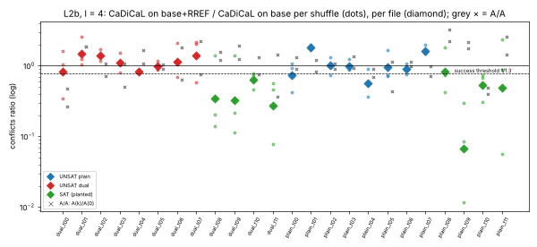

# L2b result: RREF XOR rows as prefix-chain extension variables, KILL on the decision subset

Run 2026-11-18, following the protocol frozen in commit f34cc4a
([`PROTOCOL.md`](PROTOCOL.md)). It is exploratory, on an unisolated 4-core
shared container. Conflicts are the primary metric. Everything here is
`[pcc:unverified]`.

The benchmark record is
`benchmarks/records/20261118T0527Z-l2b-rref-xor-cadical-pdp-m4.json`.

## Decision: KILL, by the pre-registered rule

On the l = 4 UNSAT instances (16 base CNFs × 3 shuffles = 48 pairs),
CaDiCaL on the RREF-augmented CNF takes **1.061× the conflicts of CaDiCaL on
the base CNF, 95% CI [0.918, 1.225]**. That is inside the A/A band
[0.793, 1.108] and above the 1/1.3 threshold. Wall time is
1.134× [0.992, 1.288]; on the dual encoding it is 1.342× [1.211, 1.489],
because the added chains enlarge the CNF.

| Subset | Files | Pairs | Conflicts C/A (95% CI) | A/A conflicts (95% CI) | Wall C/A (95% CI) |
|---|--:|--:|--|--|--|
| **l4 UNSAT (primary)** | 16 | 48 | **1.061 [0.918, 1.225]** | 0.948 [0.793, 1.108] | 1.134 [0.992, 1.288] |
| l4 UNSAT plain | 8 | 24 | 1.008 [0.796, 1.295] | 0.934 [0.833, 1.034] | 0.959 [0.813, 1.149] |
| l4 UNSAT dual | 8 | 24 | 1.118 [0.962, 1.293] | 0.962 [0.680, 1.292] | 1.342 [1.211, 1.489] |
| l4 SAT | 8 | 24 | 0.358 [0.204, 0.556] | 1.268 [0.858, 1.820] | 0.382 [0.206, 0.595] |
| l3 UNSAT | 16 | 48 | 1.018 [0.923, 1.132] | 1.193 [0.977, 1.464] | 1.395 [1.225, 1.599] |
| l3 SAT | 8 | 24 | 0.604 [0.484, 0.760] | 0.840 [0.496, 1.383] | 0.934 [0.741, 1.165] |

C is base CNF + RREF rows; A is the base CNF.

## Reading

- **UNSAT, the decision subset.** Adding the leaf-independent part of lead
  E's extension variables does not shorten CaDiCaL's refutations. This
  agrees with lead E's own reading: the short certificate's power comes
  from the *per-leaf* elimination, after the AND gates are substituted.
  That part cannot be precomputed without fixing the leaf.
- **SAT, exploratory only and not part of the decision.** On planted
  (decomposable) targets the reduced rows cut conflicts to
  **0.358× [0.204, 0.556]** at l = 4 and 0.604× [0.484, 0.760] at l = 3.
  Both lie outside their subsets' A/A bands. The per-file geometric mean is
  below 1 on all 8 l = 4 SAT files, ranging from 0.066 to 0.826. It is one of six reported subsets and was
  not pre-registered as a decision, so it is a hypothesis for a separate
  frozen protocol, not a finding. Its practical value for relation search
  is small: nearly every query is a non-decomposable target. Only the yield
  fraction, about 1/m! or less, is SAT.
- **Reproducibility.** Arm A reproduced L2's arm-A conflict counts exactly
  on 144 of 144 pairs. The CNF, the shuffle seed and the solver are the
  same, and CaDiCaL is deterministic. Only wall time varies with the host.

## Correctness

- 0 invalid rows and 0 censored calls.
- 49 SAT answers had printed models that left out eliminated variables, as
  in L2. Each was re-verified in-run with `--elim=0` on the identical
  shuffled CNF, and all passed (`model_rechecked` / `model_ok` in
  `rows.jsonl`).

## Files

- `PROTOCOL.md`
- `gen_l2b.py` and `manifest.json`: base files byte-identical to L2.
- `run_l2b.py` and `rows.jsonl` (288 rows).
- `analyze.py`, `summary.json`, `summary.md`.
- `plot_l2b.py`, `l2b_ratios.svg`, `l2b_ratios.png`.
- `report_pdf.py`, `l2b_report.pdf`.

## Process notes

- **Checkpoint.** No resume checkpoint was pushed: the container has no
  upload token. The run was launched with `CHECKPOINT_SKIP`, with that
  reason.
- **Raw data.** It is in Git, at 58,665 bytes. Nothing went to S3, because
  there are no AWS credentials.
- **Rows during the run.** They were written outside the repository and
  copied in once at the end. This avoids the snapshot-commit churn of L2.
