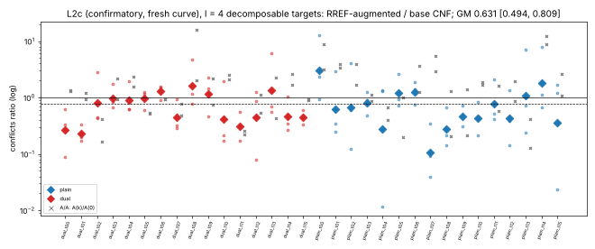

# L2c result: RREF prefix-chain rows speed up CaDiCaL on decomposable PDP targets (CONFIRMED)

This is a confirmatory run of the exploratory L2b observation, on fresh
curves and targets. It ran 2026-11-18, following the protocol frozen in
commit 8c3dfac ([`PROTOCOL.md`](PROTOCOL.md)), on the unisolated 4-core
container. Conflicts are the primary metric. Everything here is
`[pcc:unverified]`.

The benchmark record is
`benchmarks/records/20261118T1710Z-l2c-rref-sat-confirm-pdp-m4.json`.

## Decision: CONFIRMED, by the pre-registered rule

On l = 4 decomposable targets (a fresh curve with cell seed 2026111804; 16
planted targets × 2 encodings = 32 base CNFs, × 3 shuffles = 96 pairs),
CaDiCaL on the RREF-augmented CNF takes **0.631× the conflicts of CaDiCaL
on the base CNF, 95% CI [0.494, 0.809]**. All three conditions hold:

- the geometric mean 0.631 ≤ 0.769;
- the upper bound 0.809 < 1;
- there is no overlap with the A/A band [0.892, 1.659].

Wall time, including the larger CNF, is also lower, at
0.742× [0.576, 0.957].

| Subset | Files | Pairs | Conflicts C/A (95% CI) | A/A conflicts (95% CI) | Wall C/A (95% CI) |
|---|--:|--:|--|--|--|
| **l4 SAT (primary)** | 32 | 96 | **0.631 [0.494, 0.809]** | 1.210 [0.892, 1.659] | 0.742 [0.576, 0.957] |
| l4 plain | 16 | 48 | 0.628 [0.426, 0.924] | 1.413 [0.862, 2.303] | 0.660 [0.433, 0.997] |
| l4 dual | 16 | 48 | 0.634 [0.472, 0.856] | 1.036 [0.704, 1.506] | 0.834 [0.631, 1.108] |
| l3 SAT | 32 | 96 | 0.577 [0.450, 0.729] | 1.217 [0.806, 1.926] | 0.871 [0.684, 1.095] |

C is base CNF + RREF rows; A is the base CNF.

## Reading

- **The effect replicates on unseen instances, but it is smaller than the
  exploratory estimate:** 0.631 against L2b's 0.358. That shrinkage is
  expected for a subset picked after the fact.
- **It is heterogeneous.** The per-file geometric mean is below 1 on 23 of
  the 32 l = 4 files, ranging from 0.107 to 3.04. The per-shuffle scatter
  is wide. So it is an average speed-up, not a uniform one.
- **Both encodings show it** (plain 0.628, dual 0.634), and so does l = 3,
  at 0.577. Those subsets don't decide.
- **Wall time is lower, but less than conflicts are:** 0.742 against 0.631.
  The added prefix chains make each conflict slightly more expensive.

## What this does and does not mean

As the protocol stated before the run, this is a solver-behaviour finding on
satisfiable instances. **It is not an index-calculus improvement.**

A relation-search query costs, in conflicts, p·SAT + (1 − p)·UNSAT, where p
is the decomposable fraction. Two numbers set the trade-off, both from L2b
at l = 4:

- **Baseline costs:** geometric means of 416,996 conflicts per UNSAT query
  and 239,134 per SAT query.
- **UNSAT ratio:** 1.061×, with a 95% CI of [0.918, 1.225].

Taking point estimates, the RREF rows reduce expected conflicts per query
only when **p ≥ 0.22**:

| p | 0.05 | 0.10 | 0.20 | 0.30 | 0.50 |
|---|--:|--:|--:|--:|--:|
| expected C/A per query | 1.048 | 1.035 | 1.007 | 0.976 | 0.904 |

At the yields of these m = 4 cells, p is well below that. The UNSAT ratio's
interval includes 1, so the true break-even could be lower. Showing a net
gain would need a regime where most queries are SAT. The one such regime
tried here (pilot idea 9) was killed. The finding is recorded as a measured
solver effect, with no leaderboard or benchmark-row claim.

## Correctness

- 384 rows; 0 invalid and 0 censored. Every answer is SAT.
- 173 printed models were incomplete (eliminated variables); each was
  re-verified in-run with `--elim=0`, and all passed.
- `rows.jsonl` drops fields that are constant in this run (`decomposable`,
  `censored`, `answer_ok`) and fields already in `manifest.json` (`vars`,
  `clauses`). This keeps it under 64 KiB. All dropped fields were asserted
  constant before they were removed.

## Files

- `PROTOCOL.md`
- `manifest.json`: 64 + 64 CNFs, with SHA-256.
- `rows.jsonl`
- `analyze_l2c.py`, `summary.json`, `summary.md`
- `plot_l2c.py`, `l2c_ratios.svg`, `l2c_ratios.png`
- `report_pdf.py`, `l2c_report.pdf`

The instance generator and runner are `../l2b_rref/gen_l2b.py`, run with
`--seed-base 2026111800 --n-non 0 --n-dec 16`, and `../l2b_rref/run_l2b.py`.

## Process notes

No resume checkpoint was pushed (no upload token), and no S3 upload was made
(no AWS credentials).
