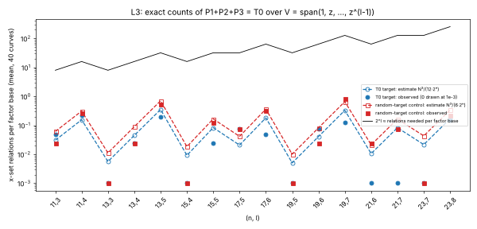

# L3: torsion-target relation count, exact enumeration (2026-11-18)

Status: **exact counts, exploratory, unisolated container.** No timing claim
and no benchmark row. The counts are exact; the comparison with the estimate
is statistical. All of it is `[pcc:unverified]` until a validator replays it.

## Question

Round-4 lead A (`crypto:research/sat_leads_round4_20261116/PROPOSALS.md`)
proposes deciding relations P1 + P2 + P3 = ±T0 by factoring in F2[z]. T0 is
the 2-torsion point (0, √b). The leads note (L3) argued that these relations
are homogeneous and number only O(1) per factor base, while the relation
phase needs about 2^l. This check counts them exactly.

## Method

- **Curve and target.** E: y² + xy = x³ + a x² + b over GF(2^n) = GF(2)[z]/(f),
  with n odd. The modulus is the first irreducible trinomial, or else a
  pentanomial. T0 = (0, √b), and −T0 = T0.
- **Factor base.** All points with x ∈ V \ {0}, where V is the set of
  polynomials in z of degree < l.
- **Cells.** n ∈ {11, 13, 15, 17, 19, 21, 23} and l with n − 3l ∈ {−2, …, 4}.
  That gives 16 cells, each with 40 curves (a, b) drawn from seeds derived
  as `l3-t0-<n>-<l>-<seed>`.
- **Counting** (`count_t0_relations.py`). Enumerate every ordered pair
  (P1, P2). Then P3 = T0 − (P1 + P2), with x(P3) = √b / x(P1 + P2). Before
  counting, that identity is checked against full group addition on 200
  sampled pairs per cell. Every x-set found is re-verified by an independent
  three-point group sum. The enumeration is complete: it omits only P2 = −P1,
  which gives P3 = T0 with x = 0, outside the base, and P1 + P2 = T0, which
  gives P3 = O.
- **Estimate.** N³/2^n ordered triples, where N is the measured factor-base
  size. Each T0 x-set carries 12 ordered triples (3! orderings × 2 global
  signs, since −T0 = T0), so the x-set estimate is N³/(12·2^n).
- **Parity check** (`refine_estimate.py`). This uses the 2-descent character
  χ(P) = Tr(x) + Tr(a). It checks that χ is additive on sampled sums and that
  every found relation satisfies χ(P1) + χ(P2) + χ(P3) = χ(T0). It also
  computes a coset-aware estimate.
- **Control** (`control_random_target.py`). Same curves, base and
  enumeration, but with a random non-torsion target R, where each x-set
  carries 6 ordered triples.

## Results

| Arm | Observed x-sets (640 curves) | Estimate | Ratio |
|---|--:|--:|--:|
| T0 target | 40 | 61.7 | 0.65 |
| Random-target control | 103 | 123.4 | 0.83 |

- **Per curve.** The largest count in any cell is 2 x-sets (`summary.txt`).
  The factor bases hold 2^l = 8 to 256 abscissae.
- **Multiplicity.** The ordered-to-x-set ratio is 12.0 in every T0 cell
  without repeated abscissae; 26 ordered triples have a repeated x. The
  control gives 6 ordered triples per x-set, as expected.
- **Parity.** 0 of 640 cells violate the χ rule. The coset-aware estimate
  (737.0 ordered) is indistinguishable from the naive one (740.7). The
  factor base is not biased toward one coset of 2E on average.
- **T0 against the control.** The estimate runs high for the generic target
  too (ratio 0.83). Scaled by that, T0 is 40 against an expected 51.5,
  about 1.6σ low under a Poisson model. That is not a significant
  T0-specific deficit.
- **Correction to the leads note.** Its figure 2^(3l−n)/6 counts both sign
  patterns, so it double-counts T0 x-sets. The right x-set scale is about
  2^(3l−n)/12.

## Decision against L3's pre-written rule

L3's rule: if the count matches the estimate, mark R4-A as "stage only".

The count matches the estimate within the factor-2 band: 0.65 pooled, and
0.78 relative to the control. Its scale is O(1) or below per factor base:
the mean is at most 0.23 x-sets per curve in every cell, against about 2^l
needed. **R4-A is therefore "stage only".** At best it is a cheaper decision
procedure for the few T0 relations, and not a source of relations for the
linear-algebra phase. The leads note's verdict stands, with the
factor-of-2 correction above.

## Files

- `count_t0_relations.py`, `results.jsonl`, `summary.txt`: T0 counts.
- `refine_estimate.py`, `refined.jsonl`, `stratified.txt`: parity checks
  and the coset-aware estimate.
- `control_random_target.py`, `control.jsonl`: the random-target control.
- `plot_counts.py`, `l3_counts.svg`, `l3_counts.png`: the graph.

SHA-256 of `results.jsonl`:
`2a71898d27bce12b6b3b4f607422664ebc0a8f443395194b3d64de430046c33e`.

The committed JSONL files are slimmed to stay under the repository's 64 KiB
data-file limit (the artifact store was not writable from this container).
They drop the modulus, the curve coefficient b and the estimate columns. All
of these regenerate deterministically from (n, l, seed): the estimates are
N³/2^n and the curves come from the seed derivation. The scripts still emit
the full rows. The PNG is rendered at 60 dpi; `l3_counts.svg` is the
full-resolution graph.

To reproduce, run from this directory:
`python3 count_t0_relations.py 40 > results.jsonl`, then the other two
scripts the same way. Each takes about 2 minutes on one core. Python 3,
standard library, plus matplotlib for the graph.

## Process notes

- No resume checkpoint was pushed: this container has no checkpoint upload
  token. The runs were foreground enumerations of a few minutes, launched
  with `CHECKPOINT_SKIP` and that reason.
- No `bench.record` was made: this is an exact count with no performance
  measurement.
- The research-kb CLI was unavailable, as in the leads note.
