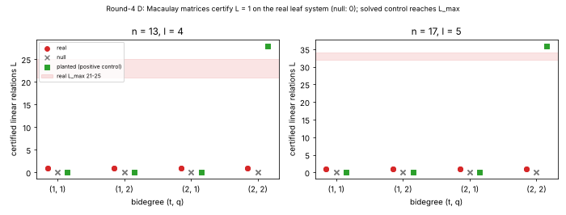

# Round-4 D result: low-bidegree Macaulay matrices certify almost nothing on the bilinear leaf system

This is an exact computation run on 2026-11-19, following the protocol
frozen in commit da351bc ([`PROTOCOL.md`](PROTOCOL.md)), with one documented
control amendment. There is no timing claim. Everything here is
`[pcc:unverified]`.

## Decision

- **By the letter of the frozen rule: INCONCLUSIVE.** The protocol ran the
  n = 17 positive control only up to bidegree (2,1), where it is not yet
  solved. That counts as "positive control fails".
- **With the documented control amendment: KILL.** The missing control was
  then run alone: n = 17 planted at (2,2), recorded in
  `amendment_planted_n17_22.jsonl`. It is solved there, with L = 36 =
  L_max. That shows the instrument resolves solving at exactly the matrix
  size of the real l = 5 cells (29,414 columns).
- **The kill conditions.** Every real l = 5 cell has L < L_max at every
  bidegree up to (2,2): L = 1 against an L_max of 32–34. No real-cell data
  was rerun or changed.

## Results

L counts the independent linear relations certified after elimination.
L_max = N − dim aff(S) is the count needed to pin down the exact relaxed
solution set S.

| n, l | bidegree | columns | rank: real (each seed) / null | L: real / null / planted | L_max (real) |
|---|---|--:|--|--|--|
| 13, 4 | (1,1) | 224 | 26 / 26 | 1 / 0 / 0 | 25, 21, 24 |
| 13, 4 | (1,2) | 1,694 | 416 / 416 | 1 / 0 / 0 | |
| 13, 4 | (2,1) | 1,472 | 364 / 364 | 1 / 0 / 0 | |
| 13, 4 | (2,2) | 11,132 | 5,472 / 5,473 | 1 / 0 / **28 = L_max** | |
| 17, 5 | (1,1) | 360 | 34 / 34 | 1 / 0 / 0 | 32, 34, 34 |
| 17, 5 | (1,2) | 3,438 | 680 / 680 | 1 / 0 / 0 | |
| 17, 5 | (2,1) | 3,080 | 612 / 612 | 1 / 0 / 0 | |
| 17, 5 | (2,2) | 29,414 | 11,644 / 11,645 | 1 / 0 / **36 = L_max** (amendment) | |

- The real ranks are identical across the three seeds in every cell.
- The real solution counts are 4, 8 and 5 at n = 13, and 5, 3 and 3 at
  n = 17.
- There were no errors and no censored matrices.
- The soundness check passed: every certified linear relation vanishes on
  every true solution.

## Reading

- **The real system behaves like a random bilinear system** at every
  bidegree up to (2,2). Its rank is the null's rank or one less, and it
  yields exactly one linear relation where the null yields none.
- **Why it isn't solved.** A planted overdetermined system with 3N
  equations is solved at (2,2). The real system has only 2n equations in
  N = n + 4l − 1 unknowns, which is underdetermined. Its single extra
  relation is far from the 21–34 needed to isolate its solutions.
- **What this confirms.** Round 4 predicted that D would confirm the
  pilots: plain bilinear Gröbner/XL does not beat enumeration at low
  bidegree. That is what we see.
- **What it does not show.** It does not rule out higher bidegrees. At
  (3,2) or (2,3) the matrices grow past 10^5 columns, and (2,2) already
  certifies one relation, the same as (1,1). Nothing suggests a fall
  is near.
- **Combined with L4.** L4 put the isolating information entirely in this
  link. So both the MinRank route and the plain-linearisation route on the
  leaf are closed at these sizes.

## Protocol notes

- **Reformulated criterion.** D's original falsifier, "a unique kernel
  vector", was replaced before the freeze by L against L_max, because the
  relaxed system has several solutions. The reason is recorded in
  `PROTOCOL.md`.
- **Amendment.** The n = 17 (2,2) planted control was added after the
  measured run, because the protocol's bidegree list for that control
  omitted the one bidegree at which it could pass. It changes no real or
  null cell.

## Files

- `PROTOCOL.md`
- `macaulay_r4d.py`: the instrument, solution enumerator, controls and
  soundness check.
- `run_r4d.py` and `rows.jsonl` (55 rows).
- `amendment_planted_n17_22.jsonl`
- `plot_r4d.py`, `r4d_L.svg`, `r4d_L.png`

To reproduce, run `python3 run_r4d.py rows.jsonl` from this directory. It
takes a few minutes on 3 cores, plus about 2.5 minutes for the amendment
cell.

## Process notes

No resume checkpoint was pushed (no upload token). There is no benchmark
record, because this is an exact computation with no performance claim.
