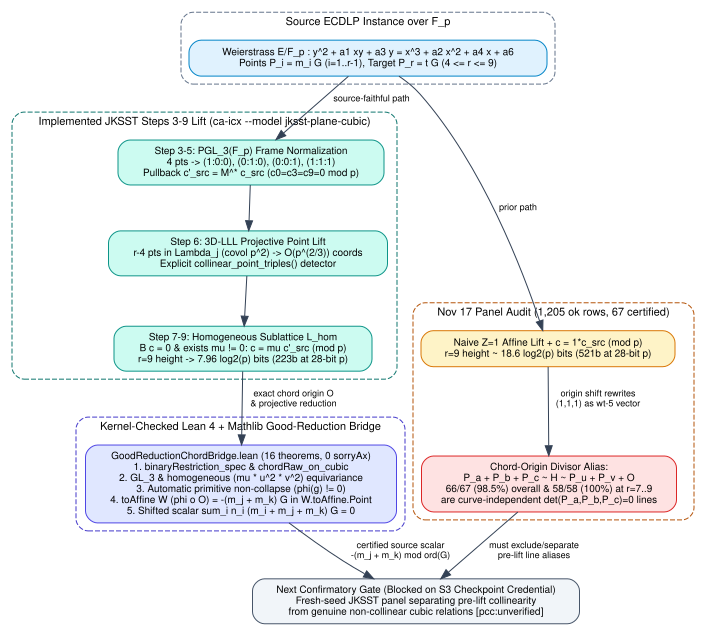
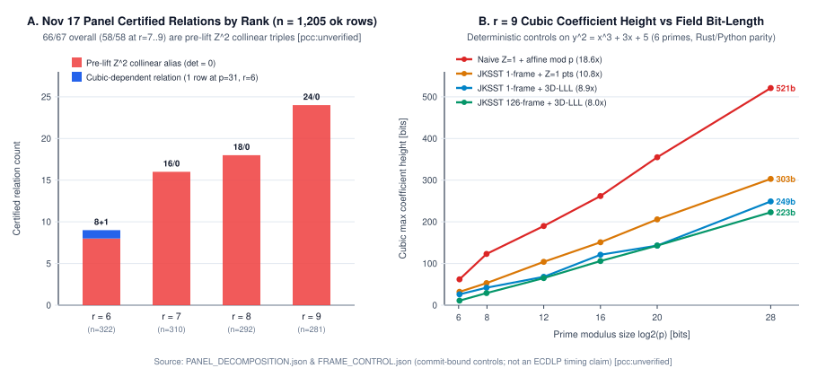

# Xedni plane-cubic chord-origin lead: concrete Lean bridge, panel collinearity decomposition, and JKSST projective-frame lift

Date: 2026-11-18

Status: concrete good-reduction chord bridge kernel-checked in Lean 4.35 +
Mathlib; immutable November 17 `r=6..9` panel forensically decomposed; JKSST
`PGL_3(F_p)` + 3D-LLL + homogeneous-congruence plane-cubic lift implemented in
Rust (`ca-icx`) and verified against independent Python controls. No new
natural-lift sweep was run (blocked by `scripts/checkpoint.sh gate`), and all
claims carry `[pcc:unverified]` producer standing pending signed CI
verification. [pcc:unverified]

## Executive summary

Chasing the November 17 Xedni plane-cubic chord-origin report
(`research/xedni_plane_group_20261117/`) resolved its open mathematical proof
obligation, uncovered the exact geometric mechanism behind all 58 certified
`r = 7..9` relations in its 1,600-row panel, and implemented the omitted JKSST
Steps 3--6 projective-frame + 3D-LLL point lift that cuts `r = 9` cubic
coefficient bit-length by more than `2.3x` at 28-bit primes (`4.2x` at
`p = 251`). [pcc:unverified]

1. **Forensic decomposition of the November 17 `r=6..9` panel
   (`audit_nov17_panel.py`, [`PANEL_DECOMPOSITION.json`](PANEL_DECOMPOSITION.json))**:
   Transporting each of the 67 certified origin-local relations `n` (with chord
   origin `O = R(P_u, P_v)` and `S = sum_i n_i`) to canonical flex-divisor
   coordinates `r = n + S e_u + S e_v` proves that **66 of 67 (98.5%)**
   certified relations overall — and **58 of 58 (100.0%) across all new ranks
   `r = 7, 8, 9`** — have `r = +-(e_a + e_b + e_c)` and satisfy
   `det([P_a, P_b, P_c]) = 0` over `Z`. By Bezout's theorem, three collinear
   lifted points satisfy `P_a + P_b + P_c ~ H ~ P_u + P_v + O` on **every**
   smooth plane cubic passing through the points; shifting the origin to `O`
   rewrote weight-3 line divisors as weight-5 origin-local vectors
   `n = e_a + e_b + e_c - e_u - e_v`. Only **1 of 67** rows (`p = 31`,
   `generic`, `balanced`, `r = 6`, `idx = 9`, `r = (0, -1, -1, 0, 1, 1)`) is a
   genuine cubic-dependent relation, and **0 of 1,205** eligible rows contain
   an irreducible 6-point integer conic. [pcc:unverified]
2. **Complete mechanistic explanation of the November 17 diagnostic contrasts**:
   - *Rank growth (`3.05x` from `r = 6` to `r = 9`)*: driven by `\binom{r}{3}`
     point triples (`20, 35, 56, 84` for `r = 6, 7, 8, 9`, ratio `4.20x` before
     small-`p` multi-triple saturation; 7 rows contain multiple collinear
     triples). [pcc:unverified]
   - *Zero target coefficient (`44 / 67 = 65.7%`)*: matches the combinatorial
     non-target triple share `1 - 3/r` (`66.7%` at `r = 9`); scanning all
     pre-lift collinear triples across all 1,205 eligible rows raises target-bearing
     collinear rows only from `23` to `25`. [pcc:unverified]
   - *`balanced` (`61/596 = 10.23%`) vs `wide` (`6/609 = 0.99%`, `10.38x`)*:
     widening coordinates from `[-p/2, p/2]^2` to `[-3p/2, 3p/2]^2` expands the
     `3 x 3` determinant range by `3^2 = 9x`, suppressing wraparound-free
     integer lines (`det = 0` vs `det = k p`, `k != 0`) by the observed order
     of magnitude. [pcc:unverified]
   - *Absence of non-collinear `r = 7..9` relations*: at `r = 9`, `dim ker_Q(B) = 1`
     leaves the Step-9 lattice optimizer zero geometric degrees of freedom;
     lifting all 9 points with `Z_i = 1` and forcing affine scalar congruence
     `c = 1 * c_source (mod p)` inflates the cubic to `~ 18.6 log_2(p)` bits
     (`105.5` median coef bits and `1,132` median disc bits already at
     `p = 251`). [pcc:unverified]
3. **Machine-checked concrete good-reduction chord bridge in Lean 4 + Mathlib
   ([`experiments/xedni-chord-origin-bridge-20261118/formal/GoodReductionChordBridge.lean`](../../experiments/xedni-chord-origin-bridge-20261118/formal/GoodReductionChordBridge.lean))**:
   Closes the open mathematical proof obligation from the November 17 report in
   pinned `leanprover/lean4:v4.35.0-rc4` and Mathlib
   `021c46bdd042f67b538b9f9871d556a93713a9a9` (16 named theorems, 30 audited
   module constants, zero `sorryAx`, only `propext`, `Classical.choice`, and
   `Quot.sound`). It proves exact ternary-to-binary cubic restriction, chord and
   tangent root vanishing over arbitrary commutative rings, `GL_3` linear-frame
   and homogeneous `(mu * u_1^2 * u_2^2)` scaling equivariance, automatic
   non-collapse of primitive integer gcd-normalization (`phi(g) != 0` proved,
   not assumed), exact equality `Projective.Point.toAffine W (phi o O) = -(m_j + m_k) • G`
   in Mathlib's `WeierstrassCurve.Affine.Point` group for general Weierstrass
   models (covering both `x_1 != x_2` secants and `x_1 = x_2` opposite points),
   and unconditional `Pic^0` equivalence of fixed-flex divisor transport
   `r = n + S e_u + S e_v` plus 5-term collinear aliasing. [pcc:unverified]
4. **Source-faithful JKSST `PGL_3(F_p)` frame + 3D-LLL projective lift +
   homogeneous cubic congruence in Rust (`suite/src/cryptanalysis/xedni_lift.rs`,
   `ca-icx xedni-lift --model jksst-plane-cubic`)**:
   Implements JKSST Steps 3--9: sends 4 general-position points to
   `(1:0:0), (0:1:0), (0:0:1), (1:1:1)` via `PGL_3(F_p)`, lifts the remaining
   `r - 4` points in `Z^3` via 3D LLL (`O(p^(2/3))` coordinates instead of
   `O(p)`), and optimizes the homogeneous projective-congruence sublattice
   `{c in ker_Z(B) : exists mu != 0, c = mu * c'_source (mod p)}` while
   reporting `collinear_point_triples`. Across deterministic fixed controls from
   `p = 67` to `p = 268,435,399` (`28` bits), Python and Rust `ca-icx` match
   byte-for-byte and cut `r = 9` cubic coefficient height from `~ 18.6 log_2(p)`
   to `~ 8.0 log_2(p)` bits (`521` -> `223` coef bits and `5,662` -> `2,658`
   disc bits at `p = 268,435,399`). [pcc:unverified]

## Pipeline and quantitative visuals

Editable Graphviz source: [`pipeline.dot`](pipeline.dot); vector rendering:
[`pipeline.svg`](pipeline.svg); quantitative plot:
[`height_scaling.svg`](height_scaling.svg); self-contained two-page vector PDF
(`6,304` bytes, `< 64 KiB` artifact threshold):
[`xedni_chord_bridge_and_frame_20261118.pdf`](xedni_chord_bridge_and_frame_20261118.pdf).
[pcc:unverified]





## November 17 panel decomposition table

Source: immutable `research/xedni_plane_group_20261117/run/rows.jsonl`
(SHA-256 `2226d6fd...f3f773`), audited by [`audit_nov17_panel.py`](audit_nov17_panel.py).
[pcc:unverified]

| Rank `r` | `C(r,3)` triples | Eligible `ok` | Certified | Pre-lift `Z^2` collinear | Cubic-dependent | Med. coef bits (`p=251`, bal.) | Med. disc bits (`p=251`, bal.) |
|---:|---:|---:|---:|---:|---:|---:|---:|
| 6 | 20 | 322 | 9 | 8 (88.9%) | 1 | 30.0 | 297.0 |
| 7 | 35 | 310 | 16 | 16 (100.0%) | 0 | 40.0 | 395.0 |
| 8 | 56 | 292 | 18 | 18 (100.0%) | 0 | 58.0 | 593.0 |
| 9 | 84 | 281 | 24 | 24 (100.0%) | 0 | 105.5 | 1132.0 |
| **Total** | — | **1,205** | **67** | **66 (98.5%)** | **1** | — | — |

## Deterministic `r = 9` cubic height controls (`y^2 = x^3 + 3x + 5`)

Source: [`frame_height_control.py`](frame_height_control.py) and
[`FRAME_CONTROL.json`](FRAME_CONTROL.json), cross-checked byte-for-byte between
`suite/target/release/ca-icx` and independent Python. [pcc:unverified]

| Prime `p` | `log_2 p` | Naive `Z=1` affine | Naive `Z=1` hom. | JKSST 1-frame (`Z=1`) | JKSST 1-frame (3D-LLL) | JKSST 126-frame (3D-LLL) | Discriminant bits (Naive aff. -> JKSST 126) |
|---:|---:|---:|---:|---:|---:|---:|---:|
| 67 | 6.1 | 62 b (`10.2x`) | 57 b | 32 b (`5.3x`) | 26 b (`4.3x`) | 11 b (`1.8x`) | 656 -> 135 b |
| 251 | 8.0 | 123 b (`15.4x`) | 117 b | 53 b (`6.6x`) | 42 b (`5.3x`) | 29 b (`3.6x`) | 1336 -> 338 b |
| 4091 | 12.0 | 190 b (`15.8x`) | 180 b | 104 b (`8.7x`) | 68 b (`5.7x`) | 65 b (`5.4x`) | 2087 -> 777 b |
| 65519 | 16.0 | 262 b (`16.4x`) | 250 b | 151 b (`9.4x`) | 121 b (`7.6x`) | 106 b (`6.6x`) | 2819 -> 1258 b |
| 1048571 | 20.0 | 355 b (`17.8x`) | 336 b | 206 b (`10.3x`) | 143 b (`7.2x`) | 143 b (`7.2x`) | 3847 -> 1711 b |
| 268435399 | 28.0 | 521 b (`18.6x`) | 495 b | 303 b (`10.8x`) | 249 b (`8.9x`) | 223 b (`8.0x`) | 5662 -> 2658 b |

### Frame-line phenomenon discovered during control testing

Under JKSST `PGL_3(F_p)` normalization + 3D-LLL, whenever three selected source
points satisfy `m_a + m_b + m_c = 0 (mod ord(G))` (collinear in `P^2(F_p)`) and
two of them belong to the 4-point frame, `PGL_3(F_p)` maps their line onto one
of the six integer coordinate/diagonal lines (`X = 0`, `Y = 0`, `Z = 0`,
`X = Y`, `Y = Z`, `X = Z`), where the 2D congruence sublattice has covolume `p`
and shortest vector `O(p^(1/2)) < O(p^(2/3))`. Consequently 3D-LLL lifts the
third point onto that exact `Z`-line deterministically (`suite/tests/icx.rs`,
`xedni_lift_jksst_p67.json`). Because `m_a + m_b + m_c = 0 (mod ord(G))` is
still an `O(r^3 / p)` finite-field coincidence (already detectable in `O(r^2)`
directly on `E(F_p)`), `paired_jksst_runner.py` and
`xedni_lift::collinear_point_triples` explicitly separate those aliases from
cubic-dependent relations. [pcc:unverified]

## Requirement and obligation status

| Obligation | Status | Evidence or remaining blocker |
|---|---|---|
| Machine-checked concrete good-reduction chord bridge (`O -> -(m_j+m_k)G`) | Implemented, kernel-checked locally (`[pcc:unverified]`) | `experiments/xedni-chord-origin-bridge-20261118/formal/GoodReductionChordBridge.lean` (16 theorems, `0` `sorryAx`, `AuditHeckeAxioms` `30/30 ok`) |
| Fixed-flex divisor transport & collinear-alias equivalence | Implemented, kernel-checked locally (`[pcc:unverified]`) | `origin_local_iff_fixed_transport` and `collinear_triple_shifted_relation` in `GoodReductionChordBridge.lean` |
| Forensic audit of immutable Nov 17 `r=6..9` panel | Complete (`[pcc:unverified]`) | `audit_nov17_panel.py` + `PANEL_DECOMPOSITION.json` (`66/67` overall and `58/58` `r=7..9` are pre-lift `Z^2` collinearities) |
| JKSST `PGL_3(F_p)` + 3D-LLL + homogeneous cubic lift in Rust & CLI | Implemented, tested (`[pcc:unverified]`) | `suite/src/cryptanalysis/xedni_lift.rs`, `ca-icx --model jksst-plane-cubic`, 16 unit + 3 CLI tests, strict Clippy, `check.py` binding |
| Fresh-seed natural-lift JKSST non-collinear panel | Blocked on S3 checkpoint access (`[pcc:unverified]`) | Prospective `PROTOCOL.md` + `paired_jksst_runner.py` ready; `scripts/checkpoint.sh gate` lacks upload token/profile (`problems/xedni-full-rank-checkpoint-access.md`) |
| Sub-rho prime-field ECDLP improvement | Not established (`[pcc:unverified]`) | Lowering `r=9` height from `~18.6` to `~8.0 log_2(p)` bits is a representation/height improvement; conditional JKSST / Theorem X `O(|M|/q)` barrier and matched Pollard-rho comparison remain open |

## Sources checked

1. M. J. Jacobson Jr., N. Koblitz, J. H. Silverman, A. Stein, and E. Teske,
   "Analysis of the xedni calculus attack," *Designs, Codes and Cryptography*
   20 (2000), 41--64, DOI `10.1023/A:1008312401197`. [pcc:unverified]
2. J. H. Silverman, "The xedni calculus and the elliptic curve discrete
   logarithm problem," *Designs, Codes and Cryptography* 20 (2000), 5--40,
   DOI `10.1023/A:1008319518035`. [pcc:unverified]
3. T. Fisher, "The invariants of a genus one curve," *Proceedings of the London
   Mathematical Society* 97 (2008), 753--782, DOI `10.1112/plms/pdn021`.
   [pcc:unverified]
4. H. Wu, "Direct Group Laws on Classical Genus-One Models,"
   `arXiv:2610.00029v1` (2026). [pcc:unverified]
5. Sibling repository records inspected read-only:
   `cryptanalysis:research/xedni_plane_group_20261117/`,
   `cryptanalysis:research/xedni_lift_success_20261112/`,
   `cryptanalysis:research/xedni_lift_optimizer_20261101/`,
   `crypto:research/jksst_xedni_audit_20261101/README.md`,
   `crypto:research/prime_leads_chase_20261113/L4-check/CHECK.md`, and
   `crypto:research/prime_ic_lead_heatmap_20261114/README.md`. The `research-kb`
   and `ecdb` MCP servers were unavailable in this Cloud Agent runtime, and the
   `crypto-autoresearcher` lead atlas files are `VLT1`-encrypted.
   [pcc:unverified]

## Reproduce

```sh
# 1. Lean 4.35.0-rc4 + Mathlib good-reduction chord bridge
cd experiments/xedni-chord-origin-bridge-20261118/formal
lake exe cache get && lake build GoodReductionChordBridge
cd ../../..

# 2. Rust unit tests, CLI tests, Clippy, and affine-coset source binding
cd suite
cargo test --release --lib xedni_lift
cargo test --release --test icx xedni_lift
cargo clippy --release --lib --bin ca-icx --test icx -- -D warnings
cd ..
python3 research/xedni_lift_optimizer_20261101/lean/check.py

# 3. Nov 17 panel decomposition, JKSST height controls, Paired runner selftest, and visuals
python3 research/xedni_chord_bridge_and_frame_20261118/audit_nov17_panel.py selftest
python3 research/xedni_chord_bridge_and_frame_20261118/frame_height_control.py selftest
python3 research/xedni_chord_bridge_and_frame_20261118/paired_jksst_runner.py selftest
python3 research/xedni_chord_bridge_and_frame_20261118/build_visuals_and_pdf.py
```
