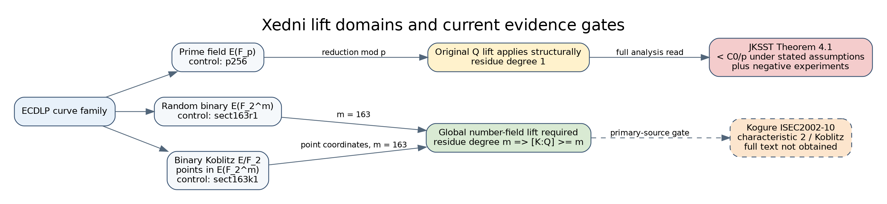
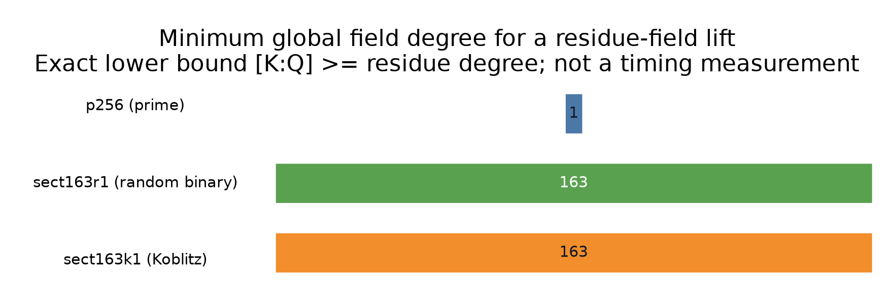

# Xedni applicability across prime, binary, and Koblitz curves

Date: 2026-11-01
Status: structural audit implemented; characteristic-two primary source gated

## Question and scope

Can Silverman's prime-field xedni construction be applied unchanged to the
prime-field, random-binary, and binary-Koblitz curves already represented in
`ca-icx`, and what is the next source-backed implementation step?

This is a literature and code-domain audit, not an attack experiment. No
relation search, timing, ECDLP recovery, run ID, candidate ID, or performance
claim is reported. The three concrete catalog controls are `p256`,
`sect163r1`, and `sect163k1`; their curve parameters and subgroup checks remain
owned by `suite/src/cryptanalysis/curve_catalog.rs`.

## Method

1. Searched the `crypto` and `cryptanalysis` repositories for xedni code,
   research notes, lifting code, and curve-family dispatch.
2. Read the full 24-page primary analysis by Jacobson, Koblitz, Silverman,
   Stein, and Teske (JKSST), including the algorithm in section 3, conditional
   Theorem 4.1, experiments in section 5, assumptions, and conclusion.
3. Checked OpenAlex, CiNii Research, and the National Diet Library catalog for
   characteristic-two work. This found Kogure's directly relevant 2002 report,
   but not accessible full text.
4. Added a pure structural assessment to `ca-icx` and unit controls for the
   three families. The assessment does not execute or simulate xedni.

## Findings

### F1 — Prime fields are the original domain, with a conditional negative theorem

**Independently verified from the full primary paper.** The original algorithm
chooses points in `E(F_p)`, lifts their projective coordinates to integers, and
constructs a curve over `Q` reducing to the original curve modulo `p`. JKSST
Theorem 4.1 bounds success probability by `C0/p` under Lang's canonical-height
conjecture and their explicit discriminant/height assumption. Their experiments
also found that useful lifted relations become prohibitively rare and that the
relations observed at larger discriminant have tiny coefficients.

This is not an unconditional impossibility theorem, and the implementation
labels it `conditional-theorem-plus-experiments`. Any new prime-field variant
must say which theorem assumption or bounded-coefficient mechanism it changes.

### F2 — Binary extension fields cannot use the rational lift verbatim

**Derived.** Reduction of rational integers at 2 has residue field `F_2`, not
`F_{2^m}`. If a number field `K` has a prime with residue degree `m`, then
`m <= [K:Q]`. Consequently, a global lift of general coordinates in
`F_{2^m}` requires a number field of degree at least `m`.

For `sect163r1`, the structural lower bound is therefore `[K:Q] >= 163`.
This is a domain/cost floor, not proof that every possible number-field lift
fails.

### F3 — Koblitz coefficients descending to `F_2` do not remove the point-lift degree

**Derived.** A binary Koblitz equation is defined over `F_2`, but an ECDLP on
the extension curve uses points in `E(F_{2^m})`. Lifting those point coordinates
globally still needs residue degree `m`. Thus `sect163k1` has the same exact
`[K:Q] >= 163` floor even though its curve coefficients are rationally easy to
lift.

### F4 — A missing characteristic-two/Koblitz primary source is now identified

**Bibliographically verified; substantive result unknown.** Jun Kogure,
“xedni calculus法について(標数2の場合)” (roughly, “On the xedni calculus
method: the characteristic-two case”), IEICE Technical Report ISEC2002-10,
volume 102(71), pages 57–60, 22 May 2002, NDL bibliographic ID 6188214.
CiNii tags it with `xedni calculus` and `Koblitz curve`. The full four-page
text was not available from OpenAlex, CiNii, NDL, or the indexed repository
links checked here.

The binary and Koblitz rows are therefore `primary-source-gated`. No algorithm,
success probability, or conclusion is inferred from title and metadata.

## Implementation

`ca-icx xedni [CURVE]` emits the field, residue degree, minimum possible global
field degree, original-rational-lift flag, evidence status, obstruction/gate,
next check, and sources. Omitting the curve assesses the full catalog;
`--family prime|binary|koblitz|extension|char3` filters it.

The implementation is in
`suite/src/cryptanalysis/xedni.rs`, with CLI wiring in
`suite/src/cli/tools/icx.rs` and controls for `p256`, `sect163r1`, and
`sect163k1`.

## Validation

Validated on 2026-11-01 with the stable Rust 1.99 toolchain:

- `cargo fmt --all -- --check`: passed.
- `cargo clippy --all-targets -- -D warnings`: passed.
- `cargo test --release --lib`: 3,164 passed, 0 failed, 92 ignored.
- The three xedni unit controls passed in release mode.
- Two `ca-icx` xedni integration controls passed in release mode.
- Direct `ca-icx xedni --json` checks confirmed minimum global-field degrees
  1 for `p256`, 163 for `sect163r1`, and 163 for `sect163k1`; a catalog-wide
  Koblitz query returned the expected degree `m` for each row.

These checks validate the assessment logic and its catalog integration. They
do not validate a xedni attack or make a performance claim.

## Visuals

- [Domain and evidence flow](xedni_domains.svg), editable source:
  [xedni_domains.dot](xedni_domains.dot).
- [Exact minimum global-field degree on the three controls](degree_bounds.svg),
  editable source: [degree_bounds.dot](degree_bounds.dot), source data:
  [degree_bounds.csv](degree_bounds.csv).

The quantitative bars are exact structural lower bounds, not measured costs.
There is no uncertainty interval.

## Sources and reading status

- Joseph H. Silverman, *The Xedni Calculus and the Elliptic Curve Discrete
  Logarithm Problem*, Designs, Codes and Cryptography 20(1), 5–40 (2000),
  <https://doi.org/10.1023/A:1008319518035>. Abstract and algorithm as
  reproduced in the companion analysis; the public CORR PDF retrieved here
  contained only its first page.
- Michael J. Jacobson, Neal Koblitz, Joseph H. Silverman, Andreas Stein, Edlyn
  Teske, *Analysis of the Xedni Calculus Attack*, Designs, Codes and
  Cryptography 20(1), 41–64 (2000),
  <https://doi.org/10.1023/A:1008312401197>. Full primary paper read from
  <https://pages.cpsc.ucalgary.ca/~jacobs/PDF/xedni.pdf>.
- Jun Kogure, *xedni calculus法について(標数2の場合)*, IEICE Technical
  Report ISEC2002-10, 102(71), 57–60 (2002),
  <https://cir.nii.ac.jp/crid/1520853833621034368>. Metadata only; full text
  not obtained.

## Uncertainty and open checks

- Obtain Kogure ISEC2002-10 through IEICE, NDL document delivery, or an author
  copy and read it before implementing a characteristic-two lift.
- Determine whether Kogure's construction is a number-field lift, a
  characteristic-two analogue using a different global object, or only a
  feasibility analysis. The title and tags do not answer this.
- If it supplies a complete algorithm, freeze a separate protocol with a
  public known-answer binary/Koblitz fixture, a dependence certificate, and an
  independent scalar replay before any timing.

## Canonical graph check

Checked the challenge curve catalog and existing xedni/automorphism research
report. This audit adds no curve, isogeny, endomorphism, scalar rule, or route,
so no canonical curve or isogeny graph changes. The new diagrams describe the
research-domain boundary only.
