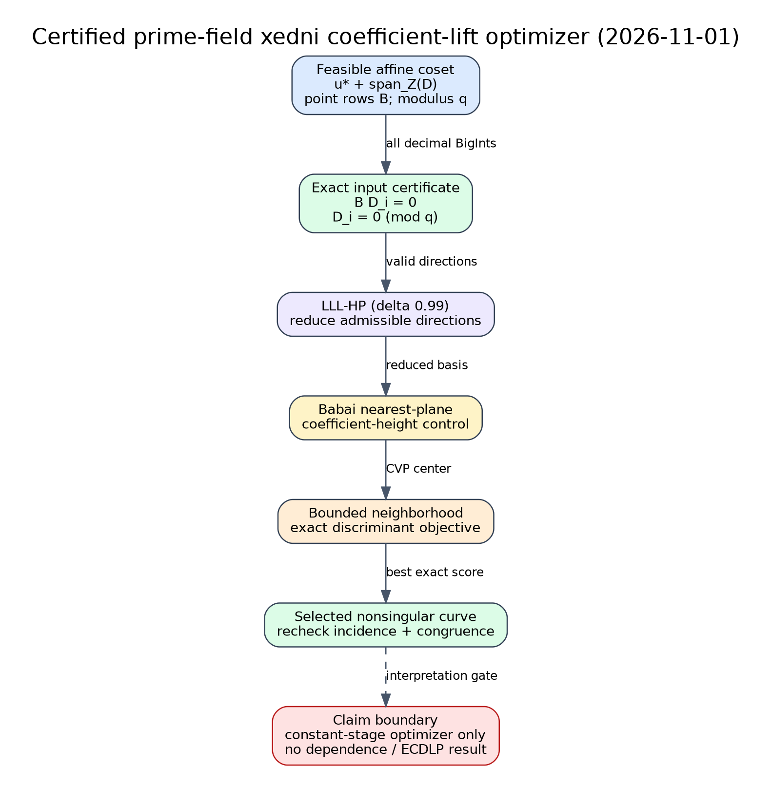

# Xedni affine-lift optimization: implementation and blocked p=67 diagnostic

Date: 2026-11-01

## Outcome

The coefficient-lifting seam of prime-field xedni now has an executable,
certifying optimizer: high-precision LLL, Babai closest-plane selection, and a
bounded exact discriminant search, exposed as `ca-icx xedni-lift`.  The code
rejects a direction unless it preserves every supplied point-incidence row and
the coefficient residue class; it rechecks both properties on the result.

The frozen p=67 comparison has **not run**.  The mandatory pre-run checkpoint
upload is denied by the available S3 identity, including through a token signed
by that identity.  The exact blocker and exit condition are recorded in
[`problems/xedni-affine-cvp-checkpoint-access.md`](../../problems/xedni-affine-cvp-checkpoint-access.md).
Consequently this report makes no empirical claim that the new nonlinear
search beats the 2000 implementation.

Claim labels used below are **source**, **derived**, **verified control**,
**implemented but unmeasured**, and **blocked**.

## What “the nine points” actually means

**Source.** JKSST Section 3.2 chooses an integer `r` with `2 <= r <= 9`, saying
that `r=4..6` is most likely.  A general projective cubic has ten coefficients
up to the incidence equations, so nine independent point rows are the maximum
the construction permits; the algorithm does not require a special fixed set
of nine points.

For `r>=4` in general cubic form, the paper first sends four points to a fixed
projective frame.  Steps 6--7 lift the remaining point coordinates and solve
an affine coefficient system.  Steps 9--10 vary kernel vectors to reduce the
discriminant and apply a rank heuristic.  The authors' implementation already
used the Havas--Majewski--Matthews HNF algorithm.  Therefore replacing a raw
integer solve by “some lattice reduction” is not itself a new improvement over
their implementation.

## Implemented algorithm

Let `u*` be one feasible signed Weierstrass coefficient vector, let the rows of
`D` be admissible coefficient changes, let `B` be the lifted-point incidence
matrix, and let `q=Mp` be the required modulus.  The input certificate checks

```
B D_i = 0                 and                 D_i = 0 (mod q)
```

for every direction.  The optimizer then:

1. LLL-reduces `D` with the repository's 2048-bit fixed-point
   Gram--Schmidt implementation at delta 0.99;
2. applies Babai nearest-plane to target `-u*`;
3. enumerates a bounded neighborhood around the Babai coefficients;
4. rejects singular curves and orders candidates by exact discriminant bit
   length, coefficient-height bits, then exact squared L2 norm; and
5. certifies `B u = B u*` and `u = u* (mod q)` on the selected vector.

**Derived.** For signed input order
`(a0,a1,a3,-a00,-a2,-a4,-a6)`, completing the square gives

```
(2 a0 y + a1 x + a3)^2 = A x^3 + C2 x^2 + C1 x + C0,
A  = 4 a0 a00,
C2 = 4 a0 a2 + a1^2,
C1 = 4 a0 a4 + 2 a1 a3,
C0 = 4 a0 a6 + a3^2.
```

The implementation evaluates the standard integral cubic discriminant
`18 A C2 C1 C0 - 4 C2^3 C0 + C2^2 C1^2 - 4 A C1^3 - 27 A^2 C0^2` exactly.
It is 16 times the usual elliptic discriminant in the monic standard case, so
it preserves ordering there and also detects singularity in this generalized
form when the leading coefficients are nonzero.

The data flow and claim boundary are shown in the labeled
[editable diagram](pipeline.dot) and its [SVG](pipeline.svg).



## Verification completed

**Verified control.** Under the suite's declared Rust 1.87.0 floor:

- four focused release-mode library tests pass;
- the actual `ca-icx` JSON integration path passes;
- a synthetic rank-three coset containing the known curve
  `y^2+y=x^3-x` recovers its signed vector `(1,0,1,-1,0,1,0)` while preserving
  four incidence rows and modulus 67;
- invalid incidence-changing and noncongruent directions are rejected before
  search; and
- the discriminant formula returns 1024 for `y^2=x^3-x`, exactly 16 times its
  elliptic discriminant 64.

The complete release library suite also passes: 3,049 passed, 0 failed, and 90
ignored.  `cargo clippy --all-targets -- -D warnings` passes on the same tree.

For orientation only, the synthetic input has a 118-bit exact discriminant and
15-bit maximum coefficient, while the planted short representative has a
10-bit exact discriminant and 1-bit maximum coefficient.  This is a planted
correctness control, not evidence about natural xedni lift quality.

## Frozen diagnostic and current evidence boundary

The [protocol](PROTOCOL.md) freezes one JKSST-derived p=67 coefficient coset:
curve `y^2=x^3+28`, generator `(1,30)`, multipliers `(1,5,17,29)`, balanced
point lifts, four exact incidence rows, and radii `0,1,2,4`.  Its three rows of
interest are:

| Row | Meaning | Status |
| --- | --- | --- |
| raw exact solve | deliberately skew Smith-decomposition representative | input frozen; not a fair HMM baseline |
| LLL + Babai | modern linear coefficient-height control | implemented but unmeasured on the frozen coset |
| exact neighborhood | nonlinear discriminant candidate | implemented but unmeasured on the frozen coset |

**Blocked.** No quantitative graph is emitted for the p=67 comparison because
there are no run rows to graph.  Inventing a plot from planned values or
silently substituting the planted control would be misleading.  Once the
checkpoint gate passes, `run_evaluation.py` produces the raw JSON and the
quantitative graph will be generated from those retained rows.

## Relation to the asymptotic obstruction and other fields

**Source.** JKSST Theorem 4.1 conditionally bounds the original prime-field
xedni success probability by `C0/p`; their experiments found useful dependent
lifts prohibitively rare.  Lowering one curve discriminant is therefore a
constant-factor engineering result unless a variant explicitly breaks one of
the theorem's hypotheses.  This optimizer does not claim to do so and does not
test point dependence.

**Derived.** The implementation is prime-field Step-7/9 machinery.  It does
not construct a lift for `F_{2^m}`.  A global number field whose residue field
contains general `F_{2^m}` coordinates must have degree at least `m`; Koblitz
curve coefficients descending to `F_2` do not make their ECDLP point
coordinates descend.  The unavailable Kogure 2000/2002 primary texts remain a
source gate for a source-faithful characteristic-two variant.

## Requirement status

| Requested item | Status | Evidence / remaining gap |
| --- | --- | --- |
| Reconstruct the lift and “nine point” step | verified complete | JKSST Section 3.2; `r` is variable, nine is the cubic maximum |
| Implement a modern lift optimizer | verified complete for the code-level surface | module, CLI, exact certificates, focused tests |
| Test whether it drastically improves the old algorithm | partial / blocked | frozen p=67 protocol exists; S3 checkpoint gate cannot upload |
| Prime-field ECDLP improvement | not established | no dependence test or scalar recovery |
| Binary and Koblitz transfer | not implemented | degree-`m` lift plus Kogure primary-text gate remain |

## Sources

1. M. J. Jacobson Jr., N. Koblitz, J. H. Silverman, A. Stein, and E. Teske,
   “Analysis of the xedni calculus attack,” *Designs, Codes and Cryptography*
   20 (2000), 41--64, DOI 10.1023/A:1008312401197. Primary PDF reviewed,
   especially Sections 3.2, 4, and 5.4.
2. J. H. Silverman, “The xedni calculus and the elliptic curve discrete
   logarithm problem,” *Designs, Codes and Cryptography* 20 (2000), 5--40,
   DOI 10.1023/A:1008319518035.
3. G. Havas, B. Majewski, and K. Matthews, “Extended GCD and Hermite normal
   form algorithms via lattice basis reduction,” *Experimental Mathematics*
   7 (1998), 125--136.
4. Jun Kogure, “Implementation of the Xedni Calculus algorithm,” IEICE
   Technical Report 100(77), 17--23 (2000), NDL 5409112; metadata only.
5. Jun Kogure, “xedni calculus method (characteristic 2),” ISEC2002-10,
   57--60 (2002), NDL 6188214; metadata only.

## Reproduction and files

- Code: `suite/src/cryptanalysis/xedni_lift.rs`
- CLI: `ca-icx --json xedni-lift --input FILE`
- Frozen input: `inputs/p67_balanced_snf.json`
- Runner: `run_evaluation.py` (not yet executed)
- Blocker: `problems/xedni-affine-cvp-checkpoint-access.md`
- This PDF: `xedni_lift_optimizer_20261101.pdf`

