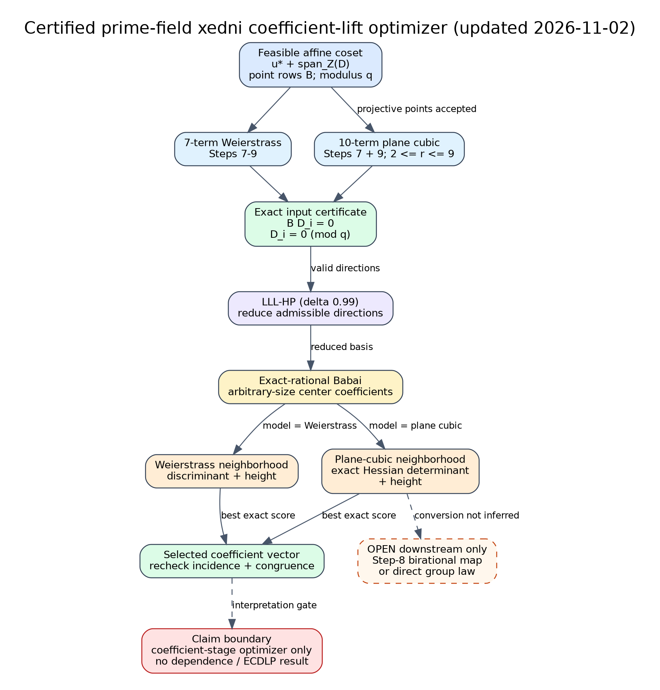
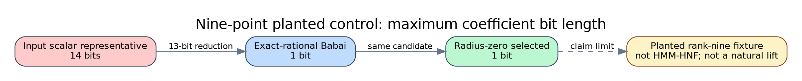

# Xedni affine-lift optimization: seven- and ten-coefficient paths

Date: 2026-11-01
Updated: 2026-11-02

## Outcome

The coefficient-lifting seam of prime-field xedni now has two executable,
certifying paths exposed as `ca-icx xedni-lift`.  Both use high-precision LLL,
**exact-rational** Babai closest-plane selection, and a bounded exact search.
The seven-coefficient Weierstrass path and the ten-coefficient general-cubic
path both rank by an exact discriminant for all `2 <= r <= 9`.  The latter
uses Fisher's direct ternary-cubic Hessian determinant, so Step 9 no longer
depends on first finding a Step-8 Weierstrass conversion.  Both paths reject
any direction that changes a supplied point-incidence row or coefficient
residue class and recheck those properties on the result.

**Update 2026-11-12:** the frozen p=67 comparison ran once under an owner waiver of the S3 checkpoint (PROTOCOL.md, "Amendment 2026-11-12"; `runs/run-20261112/`): the exact neighborhood (radii 1, 2, 4) gave the same 56-bit discriminant as Babai (radius 0), a bounded null result `[pcc:unverified]`. The text below is the 2026-11-02 state.

The frozen p=67 comparison had **not run** as of 2026-11-02.  The mandatory pre-run checkpoint
upload is denied by both the installed presigned token (HTTP 403) and the
2026-11-02 managed AWS identity (`PutObject AccessDenied`).  The exact blocker
and exit condition are recorded in
[`problems/xedni-affine-cvp-checkpoint-access.md`](../../problems/xedni-affine-cvp-checkpoint-access.md).
Consequently this report makes no empirical claim that the new nonlinear
search beats the 2000 implementation.

Claim labels used below are **source**, **derived**, **verified control**,
**implemented but unmeasured**, and **blocked**.

## What “the nine points” actually means

**Source.** JKSST Section 3.2 chooses an integer `r` with `2 <= r <= 9`, saying
that `r=4..6` is most likely.  A general projective cubic has ten coefficients
up to the incidence equations, so nine independent point rows are the maximum
the construction permits; the algorithm does not require a special fixed set
of nine points.

For `r>=4` in general cubic form, the paper first sends four points to a fixed
projective frame.  Steps 6--7 lift the remaining point coordinates and solve
an affine coefficient system.  Steps 9--10 vary kernel vectors to reduce the
discriminant and apply a rank heuristic.  The authors' implementation already
used the Havas--Majewski--Matthews HNF algorithm.  Therefore replacing a raw
integer solve by “some lattice reduction” is not itself a new improvement over
their implementation.

## Implemented algorithms

Let `u*` be one feasible coefficient vector, let the rows of
`D` be admissible coefficient changes, let `B` be the lifted-point incidence
matrix, and let `q=Mp` be the required modulus.  The input certificate checks

```
B D_i = 0                 and                 D_i = 0 (mod q)
```

for every direction.  The optimizer then:

1. LLL-reduces `D` with the repository's 2048-bit fixed-point
   Gram--Schmidt implementation at delta 0.99;
2. applies exact-rational Gram--Schmidt and Babai nearest-plane to target
   `-u*`, retaining arbitrary-precision integer center coefficients;
3. enumerates a bounded neighborhood around the Babai coefficients;
4. uses the model-specific exact objective; and
5. certifies `B u = B u*` and `u = u* (mod q)` on the selected vector.

For both models, step 4 rejects singular curves and orders candidates by exact
discriminant bit length, coefficient-height bits, then exact squared L2 norm.
The general-cubic machine result now emits `discriminant_evaluated: true`.

**Source and implementation.** Fisher Section 7.2 gives a direct construction
for a ternary cubic `U`: compute its integral Hessian
`H(U) = -det(d^2 U)/2`; put the six quadratic coefficient rows
`U_X,U_Y,U_Z,H_X,H_Y,H_Z` into a `6 x 6` matrix; and take its determinant.
This determinant is `+/- 1728 Delta`.  The implementation evaluates that
matrix with fraction-free Bareiss elimination, so it detects singularity and
supplies the Step-9 objective using integers only.

This deliberately bypasses, rather than claims to implement, JKSST Step 8.
A projective linear change sends a plane cubic to Weierstrass form only when a
rational flex is available; an arbitrary rational point does not supply that
condition.  A separate birational conversion or direct plane-cubic group law
is still required by downstream rank/dependence code, but neither is needed
to minimize the model discriminant.

**Derived.** For signed input order
`(a0,a1,a3,-a00,-a2,-a4,-a6)`, completing the square gives

```
(2 a0 y + a1 x + a3)^2 = A x^3 + C2 x^2 + C1 x + C0,
A  = 4 a0 a00,
C2 = 4 a0 a2 + a1^2,
C1 = 4 a0 a4 + 2 a1 a3,
C0 = 4 a0 a6 + a3^2.
```

The implementation evaluates the standard integral cubic discriminant
`18 A C2 C1 C0 - 4 C2^3 C0 + C2^2 C1^2 - 4 A C1^3 - 27 A^2 C0^2` exactly.
It is 16 times the usual elliptic discriminant in the monic standard case, so
it preserves ordering there and also detects singularity in this generalized
form when the leading coefficients are nonzero.

The data flow and claim boundary are shown in the labeled
[editable diagram](pipeline.dot) and its [SVG](pipeline.svg).



## Verification completed

**Verified control.** Under the suite's declared Rust 1.87.0 floor, the
2026-11-02 focused validation currently establishes:

- the focused library and CLI controls for both models pass;
- both actual `ca-icx` JSON integration paths pass;
- a synthetic rank-three coset containing the known curve
  `y^2+y=x^3-x` recovers its signed vector `(1,0,1,-1,0,1,0)` while preserving
  four incidence rows and modulus 67;
- invalid incidence-changing and noncongruent directions are rejected before
  search; and
- the discriminant formula returns 1024 for `y^2=x^3-x`, exactly 16 times its
  elliptic discriminant 64;
- the direct ternary formula returns `-110592 = -1728 * 64` for the same
  Weierstrass plane cubic, returns 34,012,224 for the Fermat cubic, and returns
  zero for the singular Hesse member `x^3+y^3+z^3-3xyz`;
- exact Babai recovers a representative whose center coefficient has magnitude
  `10^40`, removing the former `i64` limit; and
- nine rational multiples on `y^2=x^3-x+1` produce an exact rank-nine `9 x 10`
  incidence matrix.  General-cubic mode recovers the coefficient vector
  `(1,0,0,0,0,0,-1,-1,0,1)` while preserving all nine rows and modulus 67;
  its direct determinant is 635,904, equal in magnitude to `1728 * 368` for
  the planted curve `y^2=x^3-x+1`.

The complete current-tree release library suite also passes: 3,052 passed, 0
failed, and 90 ignored in 239.37 seconds.  Direct touched-file rustfmt checks,
`cargo clippy --all-targets -- -D warnings`, and both release CLI integration
paths pass on the same tree.

For orientation only, the synthetic input has a 118-bit exact discriminant and
15-bit maximum coefficient, while the planted short representative has a
10-bit exact discriminant and 1-bit maximum coefficient.  This is a planted
correctness control, not evidence about natural xedni lift quality.

The nine-point fixture is likewise a planted correctness control.  Its scalar
input representative has 14-bit maximum coefficient; exact Babai and radius
zero recover a 1-bit representative.  The [editable quantitative source](nine_point_control.dot),
[SVG](nine_point_control.svg), and source data
[`nine_point_control.csv`](nine_point_control.csv) show that exact deterministic
comparison.  It is not a comparison with HMM-HNF and not a natural-lift result.



## Frozen diagnostic and current evidence boundary

The [protocol](PROTOCOL.md) freezes one JKSST-derived p=67 coefficient coset:
curve `y^2=x^3+28`, generator `(1,30)`, multipliers `(1,5,17,29)`, balanced
point lifts, four exact incidence rows, and radii `0,1,2,4`.  Its three rows of
interest are:

| Row | Meaning | Status |
| --- | --- | --- |
| raw exact solve | deliberately skew Smith-decomposition representative | input frozen; not a fair HMM baseline |
| LLL + Babai | modern linear coefficient-height control | implemented but unmeasured on the frozen coset |
| exact neighborhood | nonlinear discriminant candidate | implemented but unmeasured on the frozen coset |

**Blocked.** No quantitative graph is emitted for the p=67 comparison because
there are no run rows to graph.  Inventing a plot from planned values or
silently substituting the planted control would be misleading.  Once the
checkpoint gate passes, `run_evaluation.py` produces the raw JSON and the
quantitative graph will be generated from those retained rows.

## Relation to the asymptotic obstruction and other fields

**Source.** JKSST Theorem 4.1 conditionally bounds the original prime-field
xedni success probability by `C0/p`; their experiments found useful dependent
lifts prohibitively rare.  Lowering one curve discriminant is therefore a
constant-factor engineering result unless a variant explicitly breaks one of
the theorem's hypotheses.  This optimizer does not claim to do so and does not
test point dependence.

**Derived.** The implementation is prime-field Step-7/9 machinery.  It does
not construct a lift for `F_{2^m}`.  A global number field whose residue field
contains general `F_{2^m}` coordinates must have degree at least `m`; Koblitz
curve coefficients descending to `F_2` do not make their ECDLP point
coordinates descend.  The unavailable Kogure 2000/2002 primary texts remain a
source gate for a source-faithful characteristic-two variant.

## Requirement status

| Requested item | Status | Evidence / remaining gap |
| --- | --- | --- |
| Reconstruct the lift and “nine point” step | verified complete through direct Step-9 discriminant search | JKSST Section 3.2; ten coefficients, direct point rows, rank-nine control, Fisher determinant |
| Implement a modern lift optimizer | verified complete for both coefficient models | module, exact-rational Babai, two exact discriminant objectives, exact certificates, focused tests |
| General-cubic Step 8/conversion | bypassed for discriminant; conversion still open | direct Hessian determinant supplies `+/-1728 Delta`; downstream birational map/group law is separate |
| Test whether it drastically improves the old algorithm | partial / blocked | frozen p=67 protocol exists; S3 checkpoint gate cannot upload |
| Prime-field ECDLP improvement | not established | no dependence test or scalar recovery |
| Binary and Koblitz transfer | not implemented | degree-`m` lift plus Kogure primary-text gate remain |

## Sources

1. M. J. Jacobson Jr., N. Koblitz, J. H. Silverman, A. Stein, and E. Teske,
   “Analysis of the xedni calculus attack,” *Designs, Codes and Cryptography*
   20 (2000), 41--64, DOI 10.1023/A:1008312401197. Primary PDF reviewed,
   especially Sections 3.2, 4, and 5.4.
2. J. H. Silverman, “The xedni calculus and the elliptic curve discrete
   logarithm problem,” *Designs, Codes and Cryptography* 20 (2000), 5--40,
   DOI 10.1023/A:1008319518035.
3. G. Havas, B. Majewski, and K. Matthews, “Extended GCD and Hermite normal
   form algorithms via lattice basis reduction,” *Experimental Mathematics*
   7 (1998), 125--136.
4. T. Fisher, “The invariants of a genus one curve,” *Proceedings of the
   London Mathematical Society* 97 (2008), 753--782,
   DOI 10.1112/plms/pdn021; arXiv:math/0610318. Primary PDF reviewed,
   especially Theorem 4.4 and Section 7.2.
5. Jun Kogure, “Implementation of the Xedni Calculus algorithm,” IEICE
   Technical Report 100(77), 17--23 (2000), NDL 5409112; metadata only.
6. Jun Kogure, “xedni calculus method (characteristic 2),” ISEC2002-10,
   57--60 (2002), NDL 6188214; metadata only.

## Reproduction and files

- Code: `suite/src/cryptanalysis/xedni_lift.rs`
- CLI: `ca-icx --json xedni-lift --model weierstrass|plane-cubic --input FILE`
- Nine-point fixture: `suite/tests/fixtures/xedni_lift_nine_points.json`
- Frozen input: `inputs/p67_balanced_snf.json`
- Runner: `run_evaluation.py` (not yet executed)
- Blocker: `problems/xedni-affine-cvp-checkpoint-access.md`
- This PDF: `xedni_lift_optimizer_20261101.pdf`

