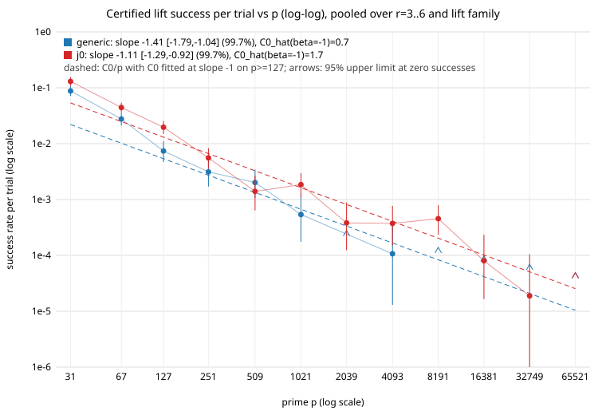

# Xedni lift success per trial over toy primes: results (2026-11-12)

Protocol: [`PROTOCOL.md`](PROTOCOL.md), frozen by sha256 in `FREEZE.json` before
any row existed.  All numbers below are `[pcc:unverified]`: no pcc claim has
been filed, and this session produced them (sabotage is assumed; see
`AGENTS.md`).  Raw rows: `data/rows-p*.jsonl.gz`; analysis `analyze.py`
-> `results.json`; graph `success_vs_p.svg`; log `run.log`.

## Verdict

* The frozen prediction is **supported by its decision rule**: no unit is
  classed LEAD, and the three pooled units are in class "tracks 1/p"
  (`pool/j0`) or "faster than 1/p" (`pool/all`, `pool/generic`).  No
  family of the 16 is bounded away from `1/p`.  `[pcc:unverified]`
* One part of the prediction text is **not met as worded**: the prediction
  asked the pooled slope point estimates to lie in [-1.25, -0.75].  Measured
  (window `p >= 127`): `pool/all` -1.174 (99.7% interval -1.337 to -1.012),
  `pool/j0` -1.105 (-1.287 to -0.924), `pool/generic` -1.412 (-1.788 to
  -1.037).  `pool/generic` lies outside [-1.25, -0.75]; its interval is
  entirely below -1, i.e. it falls faster than `1/p`, which the bound allows.
* Fitted constants with the slope fixed at -1 (`C0_hat`, window `p >= 127`):
  `pool/all` 1.16, `pool/generic` 0.68, `pool/j0` 1.66 (`p x rate` at
  `p = 127`: 1.68, 0.94, 2.50).  At `p = 65521`: 0 successes in 150,057
  trials, 95% upper limit 2.46e-05 per trial, i.e. `p x rate <= 1.61`.
* **Most successes are not deep relations.** Of 572 certified successes,
  476 (83%) are *line* events (three lifted points collinear, a relation
  `+/-P_i +/- P_j +/- P_k = O` with unit coefficients), 3 are single-point
  torsion relations, and 96 are non-line.  Non-line successes: 59 at p=31, 24 at
  67, 9 at 127, 2 at 251, 1 at 509, 1 at 4093, none above (see the class column;
  they carry no slope claim (every non-line unit is "uninformative"; the pooled
  non-line count at `p >= 127` is 13).
  `dl_recovered` holds for 423 of 572 successes (the relation had `n_Q`
  coprime to the point order and gave `l`).
* Nothing here is an improvement over the index-calculus baseline, a
  relabelling or accounting change, or a statement about ECDLP cost against
  Pollard rho (not computed).  Distance remaining to matched rho: not measured
  by this experiment.

## What ran

| item | value |
|:--|:--|
| base commit | `0d69fc5526c02c4071db896d8800be74929f4ff7` |
| `ca-icx` sha256 | `53addfe29282034d2715b33e65edd686b24a2e79e9a20e91dd1c3f71853abb25` |
| trials scheduled / ok | 504,304 / 500,242 |
| excluded (reported, not in denominators) | small_order 3,780; no_integer_solution 280; rank_deficient 2 |
| certificate failures (`lift_cert_failed`, `relation_cert_failed`, `lift_error`) | 0 |
| wall time | 2152 s on 4 processes, all 12 prime stages ran (none censored) |
| detector selftest | all 6 checks pass (`python3 sweep.py selftest`) |
| waiver | S3 checkpoint waived by the owner for this toy-size run (2026-11-12), see PROTOCOL.md |

Each success was verified exactly: lifted curve non-singular over Q, reduces to
E mod p, lifted points on it and reducing to the intended points, and the
relation summing to O over Q by exact rational arithmetic (twice), and holding
in E(F_p). [pcc:unverified]

## Success counts per prime (pooled over r = 3..6 and both lift families)

### pool/all

| p | trials (ok) | successes | rate | 95% CI (Garwood) | p x rate | non-line | recovers l | F_p-box relation |
|--:|--:|--:|--:|:--|--:|--:|--:|--:|
| 31 | 2114 | 226 | 1.069e-01 | [9.34e-02, 1.22e-01] | 3.31 | 59 | 170 | 2114 |
| 67 | 4273 | 155 | 3.627e-02 | [3.08e-02, 4.25e-02] | 2.43 | 24 | 111 | 4273 |
| 127 | 5959 | 79 | 1.326e-02 | [1.05e-02, 1.65e-02] | 1.68 | 9 | 56 | 5959 |
| 251 | 8796 | 38 | 4.320e-03 | [3.06e-03, 5.93e-03] | 1.08 | 2 | 28 | 8796 |
| 509 | 12884 | 22 | 1.708e-03 | [1.07e-03, 2.59e-03] | 0.87 | 1 | 13 | 12859 |
| 1021 | 18487 | 22 | 1.190e-03 | [7.46e-04, 1.80e-03] | 1.22 | 0 | 20 | 17704 |
| 2039 | 26293 | 5 | 1.902e-04 | [6.17e-05, 4.44e-04] | 0.39 | 0 | 4 | 24502 |
| 4093 | 37434 | 9 | 2.404e-04 | [1.10e-04, 4.56e-04] | 0.98 | 1 | 7 | 32585 |
| 8191 | 52917 | 12 | 2.268e-04 | [1.17e-04, 3.96e-04] | 1.86 | 0 | 11 | 43567 |
| 16381 | 74939 | 3 | 4.003e-05 | [8.26e-06, 1.17e-04] | 0.66 | 0 | 2 | 58428 |
| 32749 | 106089 | 1 | 9.426e-06 | [2.39e-07, 5.25e-05] | 0.31 | 0 | 1 | 72650 |
| 65521 | 150057 | 0 | 0.000e+00 | [0.00e+00, 2.46e-05] | 0.00 | 0 | 0 | 101364 |

### pool/generic

| p | trials (ok) | successes | rate | 95% CI (Garwood) | p x rate | non-line | recovers l | F_p-box relation |
|--:|--:|--:|--:|:--|--:|--:|--:|--:|
| 31 | 1161 | 102 | 8.786e-02 | [7.16e-02, 1.07e-01] | 2.72 | 32 | 79 | 1161 |
| 67 | 2063 | 57 | 2.763e-02 | [2.09e-02, 3.58e-02] | 1.85 | 7 | 39 | 2063 |
| 127 | 3112 | 23 | 7.391e-03 | [4.69e-03, 1.11e-02] | 0.94 | 1 | 15 | 3112 |
| 251 | 4483 | 14 | 3.123e-03 | [1.71e-03, 5.24e-03] | 0.78 | 1 | 10 | 4483 |
| 509 | 6451 | 13 | 2.015e-03 | [1.07e-03, 3.45e-03] | 1.03 | 1 | 7 | 6430 |
| 1021 | 9292 | 5 | 5.381e-04 | [1.75e-04, 1.26e-03] | 0.55 | 0 | 5 | 8910 |
| 2039 | 13179 | 0 | 0.000e+00 | [0.00e+00, 2.80e-04] | 0.00 | 0 | 0 | 11990 |
| 4093 | 18709 | 2 | 1.069e-04 | [1.29e-05, 3.86e-04] | 0.44 | 1 | 2 | 16304 |
| 8191 | 26501 | 0 | 0.000e+00 | [0.00e+00, 1.39e-04] | 0.00 | 0 | 0 | 21240 |
| 16381 | 37498 | 0 | 0.000e+00 | [0.00e+00, 9.84e-05] | 0.00 | 0 | 0 | 27835 |
| 32749 | 53041 | 0 | 0.000e+00 | [0.00e+00, 6.95e-05] | 0.00 | 0 | 0 | 35449 |
| 65521 | 75044 | 0 | 0.000e+00 | [0.00e+00, 4.92e-05] | 0.00 | 0 | 0 | 47881 |

### pool/j0

| p | trials (ok) | successes | rate | 95% CI (Garwood) | p x rate | non-line | recovers l | F_p-box relation |
|--:|--:|--:|--:|:--|--:|--:|--:|--:|
| 31 | 953 | 124 | 1.301e-01 | [1.08e-01, 1.55e-01] | 4.03 | 27 | 91 | 953 |
| 67 | 2210 | 98 | 4.434e-02 | [3.60e-02, 5.40e-02] | 2.97 | 17 | 72 | 2210 |
| 127 | 2847 | 56 | 1.967e-02 | [1.49e-02, 2.55e-02] | 2.50 | 8 | 41 | 2847 |
| 251 | 4313 | 24 | 5.565e-03 | [3.57e-03, 8.28e-03] | 1.40 | 1 | 18 | 4313 |
| 509 | 6433 | 9 | 1.399e-03 | [6.40e-04, 2.66e-03] | 0.71 | 0 | 6 | 6429 |
| 1021 | 9195 | 17 | 1.849e-03 | [1.08e-03, 2.96e-03] | 1.89 | 0 | 15 | 8794 |
| 2039 | 13114 | 5 | 3.813e-04 | [1.24e-04, 8.90e-04] | 0.78 | 0 | 4 | 12512 |
| 4093 | 18725 | 7 | 3.738e-04 | [1.50e-04, 7.70e-04] | 1.53 | 0 | 5 | 16281 |
| 8191 | 26416 | 12 | 4.543e-04 | [2.35e-04, 7.94e-04] | 3.72 | 0 | 11 | 22327 |
| 16381 | 37441 | 3 | 8.013e-05 | [1.65e-05, 2.34e-04] | 1.31 | 0 | 2 | 30593 |
| 32749 | 53048 | 1 | 1.885e-05 | [4.77e-07, 1.05e-04] | 0.62 | 0 | 1 | 37201 |
| 65521 | 75013 | 0 | 0.000e+00 | [0.00e+00, 4.92e-05] | 0.00 | 0 | 0 | 53483 |

#### Units

| unit (curve / lift / r) | successes p>=127 | beta | 99.7% interval | C0_hat | class | non-line succ. (p>=127) |
|:--|--:|--:|:--|--:|:--|--:|
| generic/balanced/3 | 13 | -1.91 | [-3.11, -0.71] | 1.24 | tracks 1/p | 1 |
| generic/balanced/4 | 8 | n/a | n/a | n/a | uninformative | 2 |
| generic/balanced/5 | 12 | -1.45 | [-2.31, -0.60] | 1.15 | tracks 1/p | 0 |
| generic/balanced/6 | 16 | -1.35 | [-2.01, -0.68] | 1.55 | tracks 1/p | 0 |
| generic/wide/3 | 3 | n/a | n/a | n/a | uninformative | 0 |
| generic/wide/4 | 4 | n/a | n/a | n/a | uninformative | 1 |
| generic/wide/5 | 0 | n/a | n/a | n/a | uninformative | 0 |
| generic/wide/6 | 1 | n/a | n/a | n/a | uninformative | 0 |
| j0/balanced/3 | 36 | -1.35 | [-1.79, -0.90] | 3.44 | tracks 1/p | 3 |
| j0/balanced/4 | 20 | -1.22 | [-1.75, -0.70] | 1.98 | tracks 1/p | 2 |
| j0/balanced/5 | 23 | -0.92 | [-1.29, -0.55] | 2.31 | tracks 1/p | 0 |
| j0/balanced/6 | 28 | -1.02 | [-1.39, -0.66] | 2.90 | tracks 1/p | 2 |
| j0/wide/3 | 17 | -1.16 | [-1.70, -0.62] | 1.63 | tracks 1/p | 2 |
| j0/wide/4 | 2 | n/a | n/a | n/a | uninformative | 0 |
| j0/wide/5 | 1 | n/a | n/a | n/a | uninformative | 0 |
| j0/wide/6 | 7 | n/a | n/a | n/a | uninformative | 0 |
| pool/all | 191 | -1.17 | [-1.34, -1.01] | 1.16 | faster than 1/p | 13 |
| pool/generic | 57 | -1.41 | [-1.79, -1.04] | 0.68 | faster than 1/p | 4 |
| pool/j0 | 134 | -1.11 | [-1.29, -0.92] | 1.66 | tracks 1/p | 9 |

The last column is the number of ok trials in which some non-zero vector of the
box satisfies the relation in E(F_p), a necessary condition for success; it is
close to all trials at every p, so the success events are rare inside a set of
instances that nearly all have a mod-p relation.

## Checks beyond the preregistered analysis (post hoc, labelled)

* Pearson dispersion of the pooled Poisson fits (window `p >= 127`):
  `pool/all` 2.87, `pool/generic` 1.04, `pool/j0` 4.05 (`dispersion.json`).
  Trials within a cell share 40 curves, and `pool/j0` at p=8191 has 12
  successes (about 5 expected from a slope-minus-one fit), 8 of them on three of
  its 40 curves.  The preregistered intervals assume Poisson counts and are
  therefore too narrow for `pool/all` and `pool/j0`.  Inflating the standard
  errors by the root of the dispersion widens `pool/all` to about [-1.45,
  -0.90], which contains -1 (class "tracks 1/p" instead of "faster than 1/p");
  `pool/j0` stays "tracks".  Neither change affects the verdict.
* The p = 31 and p = 67 cells (outside the window) have `p x rate` of 2.4 to
  4.0, above the later values: the rate is saturating there, as expected when
  the group order is of the size of the box. [pcc:unverified]

## Scorecard

| check | outcome |
|:--|:--|
| frozen decision rule: any LEAD unit | none (0 of 19 units) |
| pooled units in class 2 or 3 | yes (3 of 3) |
| prediction text: pooled slopes in [-1.25, -0.75] | 2 of 3 (`pool/generic` -1.41) |
| every success certified | 572 of 572 |
| controls (planted relation found, mutation rejected, negative pair, primality) | pass |
| uninformative units (< 10 successes at `p >= 127`) | 8 of 16 |
| non-line successes at `p >= 127` | 13 (pooled); no slope claim possible |
| claim ids | none filed; everything `[pcc:unverified]` |

## Limits

* The relation box is |n_i| <= 6; dependent lifts with larger relations count
  as failures, so rates are lower bounds on dependence.
* `r = 3..6`, seven-coefficient path only; lifts are the repository
  optimizer's (LLL + Babai + radius 1), balanced or balanced plus a multiple of
  p.  Toy primes only (31 to 65521); no statement about large `p`.
* 40 curves per cell: trials are not independent draws of curves.
* JKSST's `C0` is not computed (see PROTOCOL.md); the test is of the exponent.
* The collinear (line) mechanism means most successes need the *integer
  lifts* to be collinear, a property of the chosen lifts, not of the curve;
  the 13 non-line successes at `p >= 127` are too few to say anything about
  deeper dependence.
* S3: raw rows are not in S3 (no credential); they are committed gzipped and
  recorded by sha256 in the bench record.

## Reproduce

`gunzip data/rows-p*.jsonl.gz` then `python3 analyze.py data` (writes
`data/results.json` and `data/success_vs_p.svg`, copied here), then
`python3 build_results.py` (tables and `dispersion.json`).  The sweep itself:
`python3 run_all.py suite/target/release/ca-icx data` from the repository root
(trial seeds are derived from the master seed, so rows are reproducible
independent of scheduling).
