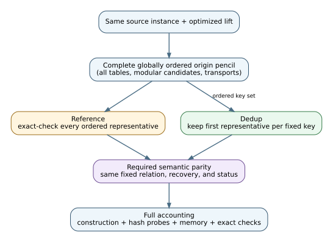

# Fixed-coordinate deduplication of the Xedni origin pencil

Date: 2026-11-18

Status: implementation and deterministic controls in progress; no natural row
has been generated. All statements are producer assertions pending independent
PCC standing. [pcc:unverified]

This successor implements the cost optimization specified prospectively in
[`PROTOCOL.md`](PROTOCOL.md). It retains every origin table, modular candidate,
transport, and hash probe, but exact-checks only the first globally ordered
representative of each fixed-coordinate vector. The full-pencil reference is
reconstructed independently and must have the exact frozen candidate digest.
[pcc:unverified]

The optimization is valid only if every row selects the same fixed relation,
success status, and recovered target as the full pencil. A separate
baseline-chart exact check remains mandatory. Fewer exact checks are a stage
optimization only; modular construction and memory must still be charged, and
the parent pencil must separately show a natural recovery gain before this can
matter to an ECDLP pipeline. [pcc:unverified]

The paired construction and evidence flow are shown in editable
[`pipeline.dot`](pipeline.dot) and rendered [`pipeline.svg`](pipeline.svg).

The natural 1,600-row comparison remains blocked by the mandatory checkpoint
upload gate. [pcc:unverified]

## Deterministic controls

The ordinary control removes 73,928 duplicate representations, retains 25,694
fixed-coordinate vectors from 99,622 origin-local candidates, and selects the
same fixed relation and target scalar 9 as the full pencil. Both arms find the
winning exact relation on their first exact check, so this control demonstrates
semantic parity but no realized early-stopping savings. [pcc:unverified]

The exhaustive alias audit exact-checked all 99,622 representatives using four
fixed worker processes. They partitioned into exactly 25,694 classes and no
class mixed exact and non-exact representatives. The retained host diagnostic
was 490,828,323,274 ns; it is not isolated benchmark evidence and is excluded
from optimized-arm work. A prior serial attempt was interrupted after 20
minutes with exit 130 and no mismatch, motivating the work-preserving parallel
audit. Exact output is retained in [`CONTROL.json`](CONTROL.json).
[pcc:unverified]

## Formal boundary

[`formal/Dedup.lean`](formal/Dedup.lean) proves that exactness and recovery are
constant when they factor through an equal fixed-coordinate key. The pinned
Lean 4.35.0-rc4/Mathlib build completed all 9,040 jobs and reports no axioms for
the three declarations. This proof is conditional: the concrete geometric
claim that exact origin-local group relations factor through the transported
key remains an external bridge, exercised by the exhaustive control rather
than formalized. [pcc:unverified]
