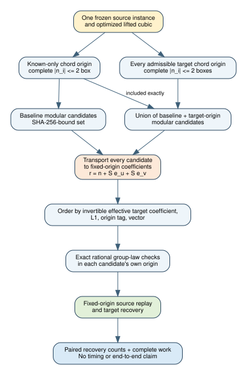

# Target-origin-pencil Xedni relation search

Date: 2026-11-18

Status: paired search implemented and deterministic controls checked; natural
fresh-seed panel not run because its mandatory resume checkpoint cannot be
uploaded. All statements below are producer assertions pending independent PCC
standing. [pcc:unverified]

## Question and correction

Does the union of bounded coefficient boxes over every admissible chord origin
through the target find exact target-bearing relations missed by the same
bounded search at one deterministic known-only origin? The paired experiment is
fixed in [`PROTOCOL.md`](PROTOCOL.md). [pcc:unverified]

Changing the origin does not create relation information. If an origin-local
relation has coefficients `n`, coefficient sum `S`, and chord endpoints `u,v`,
then its fixed-flex-origin coefficients are

```text
r = n + S e_u + S e_v,       sum(r) = 3S.
```

For a target endpoint, the effective target coefficient is `n_target + S`.
A fixed-origin zero target coefficient therefore remains zero under coordinate
transport. The possible gain is only bounded-search coverage: a local box
`|n_i| <= B` can expose endpoint coefficients as large as `(d+1)B` after
transport. [pcc:unverified]

## Paired implementation

[`runner.py`](runner.py) reuses the frozen November 17 lift construction and
compares two arms on the same optimized cubic, points, source multipliers,
coefficient bound, and auxiliary prime. [pcc:unverified]

- The baseline constructs the deterministic known-only chord origin, enumerates
  its complete auxiliary-field zero set, prioritizes invertible effective target
  coefficients, and exact-checks candidates in `(invertibility, L1, vector)`
  order.
- The candidate independently reconstructs that complete baseline set plus one
  box for every admissible target/non-target chord origin. It globally orders
  candidates by `(invertibility, L1, origin tag, vector)`.
- Every modular candidate is transported to fixed-origin coefficients. The
  selected exact relation is checked in its own group law, replayed against the
  independently reconstructed source multipliers, transported to the baseline
  chart, and checked again by the frozen runner.
- Per arm, each row records admitted origins, table entries, modular candidates,
  distinct transported fixed-coordinate candidates, duplicate transported
  representations, transports, exact checks, source replays, candidate-set
  digests, selected coefficients, and diagnostic wall nanoseconds. Duplicate
  representations remain charged and exact-checked; this diagnostic does not
  alter the frozen ordering. The wall values are ordinary host diagnostics,
  not isolated timing evidence.

The candidate's baseline-origin subset is checked by SHA-256 against the
independently constructed baseline arm, rather than accepted from a shared
count. [`analyze.py`](analyze.py) rejects lost baseline relations or recoveries,
changed baseline candidate digests, and nonzero source residues.
[pcc:unverified]

## Checked deterministic controls

The fixed nine-point rational control admits nine origins. Its known-only box
contains 21,322 modular candidates and the full pencil contains 99,622. After
transport, however, the pencil has only 25,694 distinct fixed-coordinate
vectors: 73,928 origin-local candidates (74.2%) duplicate a fixed vector. Thus
this control buys 4,372 new fixed vectors (20.5% over baseline) for 4.67 times
the modular candidates. This is a coverage/cost warning, not a natural
frequency result. The zero-explicit-target relation

```text
(-2,-1,0,0,0,0,2,0,0)
```

at the target/first-point origin transports to fixed coefficients
`(-3,-1,0,0,0,0,2,0,-1)`, then to the baseline-origin coefficients
`(-2,0,0,0,0,0,2,0,-1)`. Both exact group checks pass and the fixed relation
recovers target scalar 9 modulo 73. A separate zero-fixed-target control remains
zero after target-origin transport. These are deterministic implementation
controls, not natural-frequency measurements. [pcc:unverified]

The pre-existing focused Rust suite passed 13/13 release tests, and strict
release Clippy for `ca-icx` passed. The Python sources compile, the runner
self-test passes, and `git diff --check` is clean. [pcc:unverified]

## Formal proof boundary

[`formal/OriginPencil.lean`](formal/OriginPencil.lean) proves the scalar
relation transport identity, forward and inverse coefficient-sum formulas,
effective endpoint coefficient, preservation of a zero fixed target
coefficient, and the `(d+1)B` endpoint bound. The pinned Lean 4.35.0-rc4 and
Mathlib build reports only standard foundations and no `sorryAx`.
[pcc:unverified]

The exact producer-side command and output are retained in
[`formal/BUILD.txt`](formal/BUILD.txt). [pcc:unverified]

This is an algebraic proof. The concrete theorem that good reduction maps each
computed chord residual to the negative sum of its source endpoint scalars
remains open. Existing exact Rust/Python controls exercise that bridge but do
not machine-prove it. [pcc:unverified]

## Execution status and requirements

| Requirement | Status | Evidence or gap |
|---|---|---|
| Preserve the frozen lift and source-instance law | Implemented, unverified | Imports the immutable November 17 runner and independently replays its RNG prefix |
| Compare complete known-origin and target-origin-pencil searches | Implemented, unverified | Paired runner, exact transports, candidate digests, and analyzer |
| Prove coefficient transport and endpoint bound | Implemented, unverified | Pinned Lean module and axiom output |
| Freeze source, seed, binary, and commands before outcomes | In progress | `FREEZE.json` follows the implementation commit |
| Run all 1,600 fresh paired rows | Blocked | No checkpoint upload token/profile; no natural row generated |
| Establish a stage recovery improvement | Unknown | Requires the complete frozen panel and invariant-clean analyzer result |
| Establish end-to-end ECDLP improvement | Not attempted | Complete one-target pipeline, all costs, matched rho, and independent replay remain required |

The access blocker and checkable exit condition remain in
[`problems/xedni-affine-cvp-checkpoint-access.md`](../../problems/xedni-affine-cvp-checkpoint-access.md).
[pcc:unverified]

## Diagram and report artifact

The paired data and certificate flow is in the editable
[`pipeline.dot`](pipeline.dot) and rendered [`pipeline.svg`](pipeline.svg).
The PDF can be rendered from this Markdown and the SVG, but repository policy
requires binary reports to use the artifact store. No authorized artifact-store
or checkpoint upload route is present in this environment. The local Pandoc
attempt also stopped because `rsvg-convert` is absent, while headless Chromium
did not produce a PDF after DBus errors. The complete Markdown, DOT, and SVG
sources are retained; no PDF is committed. [pcc:unverified]



## Sources checked

- Jacobson, Koblitz, Silverman, Stein, and Teske, “Analysis of the xedni
  calculus attack,” *Designs, Codes and Cryptography* 20 (2000), 41–64.
- Fisher, “The invariants of a genus one curve,” *Proceedings of the London
  Mathematical Society* 97 (2008), 753–782.
- The November 17 arbitrary-origin implementation and frozen panel in
  [`../xedni_plane_group_20261117/`](../xedni_plane_group_20261117/).
- The exact target-dependent recovery derivation and control in
  [`../xedni_target_origin_20261118/`](../xedni_target_origin_20261118/).
- Lead records `LEAD-ICP-char0-lifting-xedni-smoothness`,
  `LEAD-TRF-global-lift-small-height`, `LEAD-EXO-global-lift-height`, and
  known-result record `KR-IC-cd159a` in `crypto-autoresearcher`.
- The shared research-KB wrapper was invoked but no executable was installed.
  The shared lab contract is an encrypted `VLT1` object in this runtime, so the
  root repository rules and cited lead records are the available fallbacks.
  [pcc:unverified]
