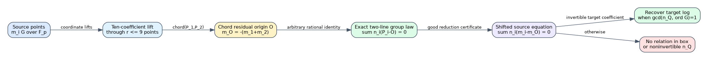

# Xedni plane-cubic group law with a source-faithful chord origin

Date: 2026-11-17

Status: implemented, covered by deterministic release-mode controls, and
exercised by the complete frozen 1,600-row local panel.  No claim is
independently PCC-verified. [pcc:unverified]

## Outcome

The ten-coefficient Xedni path no longer needs a rational flex or a birational
Weierstrass conversion in order to perform exact group arithmetic on a smooth
lifted plane cubic.  The implementation uses two chord/tangent intersections
for addition with any rational origin and arbitrary-precision projective
integer coordinates. [pcc:unverified]

The source-identity problem is handled by choosing the residual intersection
of the chord through two known lifted points as the lifted origin.  If those
points reduce to `m1 G` and `m2 G` on the source Weierstrass curve, the chosen
origin reduces to `-(m1+m2)G`.  It is normally distinct from the selected
relation points, so all nine selected points remain active inputs rather than
losing one point to the identity. [pcc:unverified]

For an exact lifted relation with coefficients `n_i`, source multipliers
`m_i`, and chord-origin multiplier `m_O`, reduction gives the checkable
equation below.  If exactly one `m_i` is the target logarithm and its
coefficient is invertible modulo the subgroup order, the implementation also
solves this equation for that logarithm. [pcc:unverified]

```text
sum_i n_i (m_i - m_O) = 0 mod ord(G)
```

This closes the group-arithmetic and source-reduction seam that previously
blocked relation verification for `r=7..9`.  It does not make rational
dependencies more frequent, establish an ECDLP speedup, or evade the
conditional `O(1/p)` success obstruction in the classical analysis.
[pcc:unverified]

## Frozen-panel result

The exact preregistered command completed all 1,600 rows locally in 660.4
seconds.  Among 1,205 eligible rows it certified 67 exact lifted relations
and recovered 23 planted target logarithms.  The new `r=7,8,9` regimes each
produced certified relations and correct recoveries; `r=9` produced 24/281
relations and 7/281 recoveries.  No certificate or group-arithmetic failure
occurred.  Full cell counts, exclusions, digests, and claim boundaries are in
[`RESULTS.md`](RESULTS.md). [pcc:unverified]

The strongest post-outcome lead is relation selection: 44/67 certified
relations had zero target coefficient, while all 23 relations with nonzero
target coefficient recovered the target.  A separately frozen fresh-seed
panel must test whether enumerating a target-bearing relation improves
end-to-end recovery without changing the lift-success denominator.
[pcc:unverified]

## Derivation

Let `C` be a smooth plane cubic and choose any rational point `O`.  For points
`P,Q`, let their chord or tangent have residual intersection `R`, and let the
line through `R,O` have residual intersection `S`.  Both lines cut a
hyperplane divisor, so `P+Q+R ~ H ~ R+O+S`; hence
`[S-O]=[P-O]+[Q-O]` in `Pic^0(C)`.  This gives the group operation with
identity `O` without assuming that `O` is a flex. [pcc:unverified]

The residual point of a rational line is rational because restricting a
cubic to the line leaves a binary cubic with two known roots.  The code
computes the remaining linear factor exactly; tangent doubling uses the same
calculation after constructing an independent rational point on the tangent
line. [pcc:unverified]

Choosing the residual chord point of two selected lifts as `O` avoids an
extra point-incidence constraint.  Reduction commutes with the chord
construction at good reduction, and on the source Weierstrass embedding the
third intersection of `m1 G` and `m2 G` is `-(m1+m2)G`.  Translating the
identity from the source flex to this known point yields the shifted relation
equation above. [pcc:unverified]

## Implemented boundary

The implementation in `suite/src/cryptanalysis/xedni_lift.rs` adds canonical
primitive projective points, exact cubic evaluation and gradient evaluation,
binary-cubic line restriction, chord and tangent residual intersections,
addition, negation, scalar multiplication, relation summation, chord-origin
construction, shifted source-relation evaluation, and one-unknown discrete
log recovery. [pcc:unverified]

Release-mode controls use `y^2=x^3-x+1` and its first nine known rational
multiples.  They check all nine scalar multiples, group arithmetic with a
non-flex origin, an exact integer relation, the chord-origin source shift,
target-log recovery, and rejection of singular models and off-curve origins.
The focused release-mode commands passed after the final chord-origin control
was added; the complete suite remains a separate required gate.
[pcc:unverified]

The data and claim flow are shown in the [editable diagram](pipeline.dot) and
its [SVG rendering](pipeline.svg). [pcc:unverified]



## Remaining proof and experiment obligations

The completed panel remains immutable.  A new confirmatory experiment must
freeze a fresh instance law before generating outcomes, retain all failed
lifts, distinguish target-independent lift success from target-aware relation
selection, verify every reported relation exactly on the lifted cubic, and
check the shifted finite-field equation.  Neither the existing `r=3..6`
sweep nor this `r=6..9` panel may be retrofitted. [pcc:unverified]

The abstract identity translation, chord-origin scalar equation, and
one-unknown recovery formula are kernel-checked in
`formal/ChordOrigin.lean`; the pinned build and axiom audit are retained in
`formal/build-output.txt`.  The remaining mathematical proof obligation is a
machine-checked geometric bridge from good reduction of a concrete cubic and
its chord construction to the premise that the residual source scalar is
`-(m_j+m_k)`.  The Rust controls are executable evidence, not a formal proof
of that geometric bridge. [pcc:unverified]

## Sources

1. M. J. Jacobson Jr., N. Koblitz, J. H. Silverman, A. Stein, and E. Teske,
   “Analysis of the xedni calculus attack,” *Designs, Codes and Cryptography*
   20 (2000), 41–64, DOI 10.1023/A:1008312401197. [pcc:unverified]
2. T. Fisher, “The invariants of a genus one curve,” *Proceedings of the
   London Mathematical Society* 97 (2008), 753–782,
   DOI 10.1112/plms/pdn021. [pcc:unverified]
3. H. Wu, “Direct Group Laws on Classical Genus-One Models,”
   arXiv:2610.00029v1 (2026), especially the plane-cubic residual-line law and
   its treatment of intersection multiplicity. [pcc:unverified]

