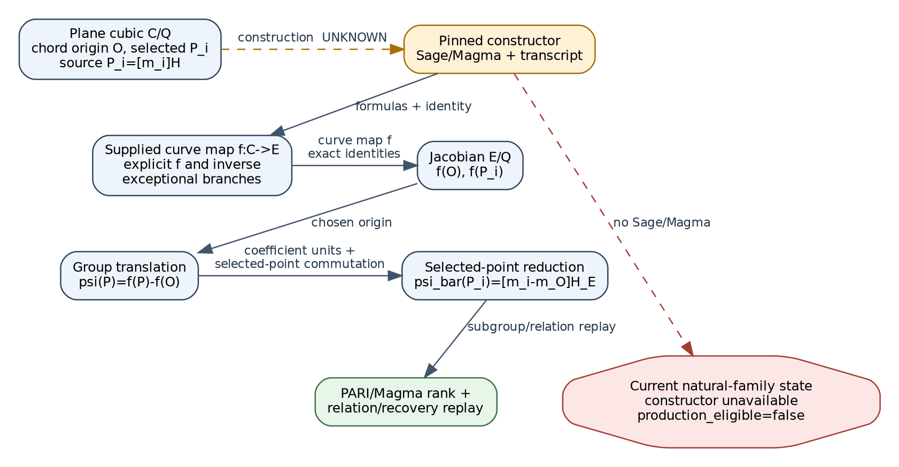

# `r=7..9` cubic-to-Jacobian transfer assessment

Date: 2026-11-19

Status: exact verifier controls implemented; general construction unavailable;
no natural row, rank measurement, relation-yield measurement, or speedup is
reported. [pcc:unverified]

## Question and scope

The higher-point Xedni arm represents `r=7..9` selected points on a plane
cubic `C/Q`. A rank computation is relevant only after the chosen chord origin
and every selected point are mapped to the actual Jacobian elliptic curve. A
Jacobian equation alone is not a selected-point correspondence.

This assessment covers exact supplied-map certificates and deterministic
non-natural `p=101`, `r=7,8,9` projective-Weierstrass controls. The natural
16--32-bit family remains outside the completed scope. The structured draft is
[`CUBIC_TRANSFER_ASSESSMENT.json`](CUBIC_TRANSFER_ASSESSMENT.json), and the
verifier is [`cubic_jacobian_map.py`](cubic_jacobian_map.py).
The printable rendering is
[`CUBIC_TRANSFER_REPORT_20261119.pdf`](CUBIC_TRANSFER_REPORT_20261119.pdf).
[pcc:unverified]

## Typed correspondence

Let `f:C --> E` be a supplied birational curve map over `Q`, let `O` be the
chosen chord origin, and let the source points satisfy `P_i=[m_i]H` in the
named finite-field subgroup. The elliptic group map used for rank and relation
transport is

```text
psi(P) = f(P) - f(O),
psi(O) = O_E,
psi_bar(P_i) = [m_i-m_O] H_E.
```

The curve map `f` and group map `psi` are different typed edges. For a supplied
certificate the verifier checks homogeneous map components, the defining
polynomial identities, inverse compositions on the named domain, exceptional
points, origin translation, selected-point images, coefficient-unit reduction,
exact source-scalar replay, and relation replay. General non-linear maps receive
only `SELECTED_POINTS_ONLY`; exceptional-locus completeness and global smooth
extension remain open. [pcc:unverified]



Editable source: [`cubic_transfer.dot`](cubic_transfer.dot); vector rendering:
[`cubic_transfer.svg`](cubic_transfer.svg).

## Obligation table

| Obligation | State | Evidence and exact scope |
| --- | --- | --- |
| Existence | Supported in controls | Degree-one projective-Weierstrass controls for `r=7,8,9` |
| Executable construction | Unknown | No Sage/eclib or Magma runtime; PARI `ellfromeqn` returns coefficients, not point maps |
| Map correctness | Supported for supplied controls | Exact polynomial, inverse, point, origin, reduction, and mutation checks |
| Subgroup preservation | Supported for supplied controls | `f(P_i)`, `f(O)`, `psi(P_i)=[m_i-m_O]H_E`, and relation replay |
| Computational advantage | Unknown | No natural construction, rank, recovery, or matched cost measurement |
| Scaling support | Unknown | No 16--32-bit natural rows or constructor timing |

The cubic implementation-control suite passed 34 tests. This is producer evidence;
it is not an independently signed execution receipt. [pcc:unverified]

## Positive control and failure cases

The positive controls use the homogeneous short-Weierstrass cubic
`Y^2 Z = X^3 - X Z^2 + Z^3`, a nonidentity chosen origin, and selected points
given by deterministic multiples. The supplied degree-one projective map and
inverse replay exactly over `Q` and modulo `101`.

Mutation controls reject nonhomogeneous components, wrong multiplier degrees,
off-curve or duplicate points, origin errors, inverse-composition errors,
unlisted selected exceptional points, fake exceptional entries, empty or
rehashed construction identities, subgroup-order errors, relation errors,
bad Jacobian reduction, and orders outside the Hasse interval. General
exceptional-locus completeness is not inferred from these bounded checks.
[pcc:unverified]

Certificate parsing is bounded before symbolic work: JSON depth/node count,
polynomial term/exponent/coefficient size, map degree and composition growth,
relation count and coefficients, and source-scalar size all have explicit
ceilings. These are denial-of-service bounds, not construction or scaling
evidence. [pcc:unverified]

## Cost and benefit boundary

The proposed benefit is semantic rather than measured: it permits rank tools
to classify the same selected points used by the cubic lift. The complete cost
identity is

```text
C_new = C_construction + C_transfer + C_rank
      + C_relation + C_recovery + C_verification.
```

| Cost component | Measured value |
| --- | --- |
| Natural map construction | Unknown |
| Map and inverse evaluation | Unknown |
| Exceptional/reduction verification | Unknown |
| PARI/Magma rank cascade | Unknown |
| Relation transport and recovery | Unknown |
| Failed constructors and duplicates | Unknown |

No quantitative performance graph is included because no matched natural cost
or yield measurement exists. Adding one would imply data that were not run.

The existing Xedni pipeline graph and candidate catalog were checked. No
canonical curve graph was changed because this assessment produced neither a
natural map nor a new curve identity.

## Open obligations and next discriminating control

1. Pin a Sage/eclib runtime or licensed Magma constructor.
2. Generate one excluded `r=7` calibration cubic with explicit `f`, inverse,
   exceptional branches, and construction transcript.
3. Require the current verifier to replay the map before any rank call.
4. Bind the adapter, raw evidence, and map identities into `runner.py`, row
   provenance, and a new clean freeze.
5. Run matched PARI/Magma controls and charge construction, failed attempts,
   verification, rank, relation, and recovery costs.

Passing that control would establish an executable selected-point transfer for
the excluded calibration row. It would not establish slower decay or an ECDLP
advantage. [pcc:unverified]

## Sources checked

- [`AMENDMENT.md`](AMENDMENT.md), frozen M4 obligations.
- [`../xedni_plane_group_20261117/README.md`](../xedni_plane_group_20261117/README.md), prior bounded cubic controls.
- Sage `EllipticCurve_from_cubic(..., morphism=True)` implementation at
  [commit `8de8dad7`](https://github.com/sagemath/sage/blob/8de8dad7bcb38e1baa43508cbe944bf04a2d0401/src/sage/schemes/elliptic_curves/constructor.py).
- PARI/GP `ellfromeqn`, used only as an independent Jacobian-coefficient route;
  it does not supply the selected-point map.
