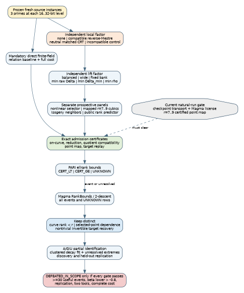

# Xedni rank-decay falsification program

Date: 2026-11-18

Status: prospective protocol and executable controls implemented; the natural
rank-decay panel has not run. The finite-range decay heuristic is therefore
**neither defeated nor reproduced**. Bounded controls now cover the runner
boundary, nested mixed censoring, supplied `r=7..9` maps, conditional complete
relation lattices, signed receipt verification, and exact prospective exposure
arithmetic. Every path remains non-production. Checkpoint transport, licensed
Magma, a trusted execution verifier, a clean authorizing freeze, a natural
general-cubic constructor, a proven full saturated basis, and committed
discovery/replication resources remain open. [pcc:unverified]

On 2026-11-19 the user explicitly authorized execution. The exact pushed-head
checkpoint retry still failed for absent upload transport, so zero natural
rows started. Post-authorization public-boundary, resumable-executor,
provenance, and mixed-censoring scaffolds were implemented and adversarially
tested but deliberately remain outside the authorizing freeze; see
[`AUTHORIZED_IMPLEMENTATION_REVIEW_20261119.md`](AUTHORIZED_IMPLEMENTATION_REVIEW_20261119.md).
[pcc:unverified]

The next continuation implemented and adversarially reviewed all six remaining
locally actionable control gates without starting a row; see
[`CONTINUATION_RESULTS_20261119.md`](CONTINUATION_RESULTS_20261119.md).
The scoped producer statement is `PCC-20261119-0bba90`, currently unverified.
[pcc:unverified]

## Result boundary

The requested question is whether public characteristic-zero lifts of fresh
elliptic-curve configurations produce certified low-rank/dependent/useful
configurations at a rate decaying meaningfully more slowly than `1/p` from
16 through 32 bits. [`PROTOCOL.md`](PROTOCOL.md) freezes the factorial design
before natural outcomes; [`AMENDMENT.md`](AMENDMENT.md) freezes the six
mechanism panels before outcomes. [pcc:unverified]

Three endpoints remain separate:

1. a certified upper bound `rank(E(Q)) < r`;
2. certified dependence of the selected lifted points;
3. a nontrivial relation whose target coefficient is invertible and whose
   recovered scalar replays exactly.

The first endpoint is sufficient for the second, but neither automatically
gives the third. The experiment does not count a bounded-box relation, a
trivial line relation, an unresolved rank, or a low-rank curve with no useful
target coefficient as a Xedni success. [pcc:unverified]

## What is implemented

- **Prospective protocol and six-mechanism amendment — complete,
  producer-authored.** Frozen before new natural rows; no result implied.
- **Prime manifest — implemented; controls pass.** Three deterministic primes
  at each even bit size 16--32; see [`PRIMES.json`](PRIMES.json).
- **Scalable finite-field source generation — implemented; controls pass.**
  Miller--Rabin, Tonelli--Shanks, PARI `ellcard`, and prime-order subgroup
  projection, with no `O(p)` table or scan.
- **Exact local-condition layer — implemented; producer controls pass.**
  No-local, strict/weak reverse-Mestre, neutral matched CRT, incompatible
  control, incidence, and quotient certificates.
- **Seven-coefficient rational lift — implemented; producer controls pass.**
  Exact CRT/incidence/reduction certificates for `r=2..6`; `r>=7` fails closed.
- **PARI rank adapter — implemented; controls pass.** `ellrank` lower/upper
  intervals only, with transcripts and failures retained.
- **Magma adapter — implemented and syntax checked; local execution blocked.**
  The `RankBounds`/2-descent script has no licensed local executable.
- **Minimal-discriminant/height invariant adapter — implemented; producer
  container controls pass.** Exact minimal-model maps, discriminants, and
  conductor; numerical canonical heights/Gram determinant with two-precision
  stability; no rigorous global minimum-height lower bound.
- **Relation proposal and replay — implemented for controls; not integrated
  into a natural executor.** Bounded PARI height-pairing/LLL proposals receive
  exact rational/source replay, but no exhaustive independence certificate.
- **Conditional complete relation-lattice verifier — implemented; producer
  controls pass.** Exact free/torsion decompositions, primitive kernel, point
  replay, and target arithmetic are checked, but a proven full saturated
  Mordell--Weil basis and trusted basis receipt are unavailable.
- **Supplied cubic-to-Jacobian map verifier — implemented; producer controls
  pass.** Degree-one `r=7..9` controls check polynomial identities, inverse,
  origin translation, selected points, reduction, subgroup, and relation
  replay. No pinned natural-family constructor or global nonlinear exceptional
  certificate exists.
- **Strict analyzer — implemented; producer controls pass.** Separate
  rank/dependence/useful endpoints, `A/G/U`, partial identification,
  clustered-factor cells, signed profile slopes, and a fail-closed decision.
- **Exact bounded mixed-censoring controls — implemented.** Aggregate and
  row-level nested cluster paths exhaust admitted allocation boxes within
  explicit state/fit/plan/row-visit ceilings. Strict inputs use a bounded
  plain-JSON boundary; the module remains outside the freeze.
- **Deterministic runner — roster planner plus zero-row diagnostic.**
  Calibration has 1,080 executable plus 648 blocked rows; sentinel has 12,150
  executable plus 7,290 blocked rows. `validate-executor` binds nine committed
  components and retains exact blockers, but no natural-row command exists.
- **Signed verifier-receipt interface — implemented; trust not covered.**
  Receipt payload, key, verifier, checkpoint, base, keyring, purpose, and time
  bindings replay, but the repository has no trusted execution-verifier digest.
- **Prospective power/cost arithmetic — implemented; unallocated.**
  [`POWER_ALLOCATION_20261119.json`](POWER_ALLOCATION_20261119.json) is exactly
  regenerable, binds discovery primes, reserves fresh replication identities,
  and deliberately makes no powered or resource-commitment claim.
- **Blocked freeze manifest — committed as non-authorizing.**
  [`FREEZE.json`](FREEZE.json) binds the implementation, rosters, analysis
  parameters, and available tool identity while setting
  `natural_rows_authorized=false`.
- **Lean decision proof — built and axiom-audited.** Core Lean 4.34.1; four
  theorems, no nonstandard axioms.
- **Natural calibration/sentinel/discovery/replication — not run.** The
  mandatory checkpoint gate has not passed.

All “controls pass” entries are producer-side assertions until independent PCC
standing exists. [pcc:unverified]

## The two leads most worth testing

### 1. Minimize normalized minimal discriminant

The strongest non-circular lead is to choose, from a constant-size public
candidate bank, the lift minimizing

```text
log(abs(Delta_min)) / max_i hhat(P_i).
```

This directly attacks the height/discriminant premise used in JKSST Lemma 4.1.
The controls compare a random bank member, balanced lift, minimum equation
discriminant, minimum global-minimal discriminant, and minimum normalized
ratio. Candidate-bank size is fixed across `p`, Q-isomorphic models are
deduplicated without erasing construction cost, and a permuted-score selector
tests leakage. A falling ratio is only a mechanism signal; it must still yield
replicated nontrivial target recovery. [pcc:unverified]

### 2. Enforce quotient-compatible reverse-Mestre data

The second lead corrects a concrete confound in prior CRT experiments. Local
images must be compatible in every common quotient; otherwise the auxiliary
conditions can force rational independence. The paired arms are no local
condition, compatible reverse-Mestre, compatible neutral CRT at the same
modulus cost, and a deliberately incompatible known-negative control. Exact
`+1` and `+2` variants are secondary arms. [pcc:unverified]

The two leads are crossed prospectively because reverse-Mestre conditions may
increase local dependence while their CRT coefficient growth worsens the
height ratio. [pcc:unverified]

The implemented relation proposer is useful only as a candidate generator. A
successful candidate counts after exact rational-relation and source-scalar
replay. A failed, trivial, or noninvertible candidate does **not** certify that
no other useful relation exists; those ranked rows stay unresolved until a
complete relation-lattice or independence certificate exists. [pcc:unverified]

## Fixed implementation-control observations

[`CONTROL_RESULTS.json`](CONTROL_RESULTS.json) preserves a fixed `p=101`
control outside the natural manifest. At `r=4`, the optimized lift reduced the
construction-discriminant size from 495 bits for the balanced lift (789 for the
wide lift) to 177 bits. The minimal-model ratio
`log(abs(Delta_min))/max hhat(P_i)` moved only from about `13.7088` to
`13.5781`; moreover, the height inputs are numerical and no rigorous global
minimum-height lower bound or saturated Mordell--Weil regulator is available.
[pcc:unverified]

The control record is registered as `PCC-20261119-f7f325`. Its current standing
is **unverified**: the producer attestation is deliberately not an independent
or signed execution proof. [pcc:unverified]

On the same control, PARI returned exact rank bounds `[2,2]`, `[6,6]`, `[5,5]`,
and `[7,7]` for optimized `r=2,3,4,5`, respectively, while `r=6` timed out at
60 seconds. The bounded relation proposer found no exact rational relation for
`r=2..6`; that is a bounded no-hit, not an independence certificate. Separate
planted controls for every `r=2..6` were recovered and passed exact rational
and source replay. These observations suggest that equation-size optimization
helps tool feasibility, but they neither measure a decay rate nor establish a
useful Xedni relation. [pcc:unverified]

## Six mechanism panels

The amendment also retains four lower-priority avenues rather than silently
discarding them:

- a coefficient-independent nonlinear coordinate/Diophantine selector;
- a fixed-size bank of genuinely nonisomorphic `r=7..9` plane cubics;
- small-degree isogeny neighbors with explicit dual/subgroup/recovery maps;
- nonisomorphic rank-one families selected by a frozen public pre-rank
  predictor on disjoint holdout seeds.

Each panel has random and leakage controls, fixed candidate count, complete
work accounting, and a fail-closed certificate boundary. A panel can end only
as `BLOCKED`, `NULL_IN_SCOPE`, `MECHANISM_ONLY`, or
`REPLICATED_USEFUL_SIGNAL`; none of those labels alone defeats the primary
decay model. [pcc:unverified]

## Prior evidence that sets the bar

The frozen November 12 toy sweep scheduled 504,304 trials and reported 572
bounded-relation hits. Of those, 476 (83 percent) were line relations; only 13
non-line hits occurred at `p>=127`, and the pooled signed slope estimate was
`-1.174`. The largest cell, `p=65521`, reported zero hits in 150,057 trials.
Those are retained producer results for a bounded relation detector, not full
rank or selected-subgroup classifications. [pcc:unverified]

The November 17 plane-cubic panel reported increasing toy relation rates with
`r`—2.80, 5.16, 6.16, and 8.54 percent for `r=6,7,8,9`—but its rate fell from
32/197 at `p=31` to 3/363 at `p=251`, and 44/67 relations had zero target
coefficient. This justifies implementing the higher-`r` rank panel, but does
not establish slower asymptotic decay. [pcc:unverified]

Two auxiliary-quotient audits certified independence in every tested selected
pair: 20/20 in a small p=47 population and 9,688/9,688 in the optimized CRT
population. These are strong negative controls for those incompatible or
uncontrolled CRT laws, not a test of the new compatibility-engineered arm.
[pcc:unverified]

The integral-slope shift increased exact `(1,2)` rational hits from 2 to 6 on
30,008 ordered queries, while the nonisomorphic rank-one holdout found 40
distinct rational-relation queries across 9,875,576 queries; in every holdout
field the directly testable finite-field relation appeared earlier. These
finite panels motivate M3 and M6 controls but do not demonstrate a useful
online advantage. [pcc:unverified]

## Power boundary

At the top bit size, direct rare-event exposure dominates every rank-tool
optimization:

| Assumed rate at `p=2^32` | Trials for 30 expected events per cell |
| --- | ---: |
| `p^-1` | 128,849,018,880 |
| `p^-0.75` | 503,316,480 |
| `p^-0.5` | 1,966,080 |

Those are one-cell expected-count references, not the protocol's global rule
of 30 *observed* high-bit useful events and not a power calculation. The
optional stronger 16--24-bit, 90-cell, two-stage reference matrix totals
20,112,998,400, 362,947,860, and 7,142,400 rows at exponents `-1`, `-0.75`,
and `-0.5`, respectively. Discovery prime identities are bound; fresh
replication primes and every compute resource remain `UNALLOCATED`. See
[`POWER_ALLOCATION_20261119.json`](POWER_ALLOCATION_20261119.json).
[pcc:unverified]

With a `p^-0.75` rate, 50,260,046 zero-event trials are required before the
binomial zero probability drops below 0.05. A small 26--32-bit sentinel can
detect a gross departure; it cannot distinguish exponent `1` from `0.75`.
The analyzer therefore refuses a decay victory without at least 30 doubly
certified nontrivial useful events at or above the prospectively fixed 20-bit
cutoff, useful events at 20, 22, and 24 bits in each stage, simultaneous signed
`beta` lower bound above `-0.8` under adversarial unresolved allocations,
fresh replication, and complete work. The full joint roster has 4,320
profiles, so the frozen hierarchical bootstrap requires at least 172,800
replicates at familywise alpha 0.05. [pcc:unverified]

## Formal proof boundary

[`formal/XedniRankClassification/Decision.lean`](formal/XedniRankClassification/Decision.lean)
proves that valid certified bounds imply the advertised `CERT_LT` and
`CERT_GE` conclusions, the two classes are disjoint, and curve-rank deficiency
implies selected-subgroup rank deficiency when the subgroup rank is at most the
curve rank. The registered core-Lean gate built the module and reported no
axioms for all four theorems. Claims `PCC-20261118-d1a1d6` and
`PCC-20261118-9d53e3` currently have **unverified** standing because no signed
CI verdict has landed. [pcc:unverified]

The proof deliberately does not derive useful recovery from rank deficiency.
It also does not prove that a PARI/Magma transcript is a valid Mordell--Weil
certificate; those remain computational and independent-review obligations.
[pcc:unverified]

## Current blockers and exact next run

The natural panel remains stopped before its first row for independently
checkable reasons:

The mandatory checkpoint attempt at pushed head `cd0e9e91c` failed because no
authorized AWS profile, upload token, or token file exists; the exact transcript
is retained in [`CHECKPOINT_GATE.md`](CHECKPOINT_GATE.md). No bypass was used
and no natural row was generated. [pcc:unverified]

1. [`scripts/checkpoint.sh gate`](../../scripts/checkpoint.sh) must upload the
   current resume capsule and return zero without bypass.
2. A licensed pinned Magma must pass known-rank and PARI-agreement controls.
3. A producer-independent trusted execution verifier, immutable keyring/base
   pin, and signed receipts must be configured.
4. A natural runner command must compose the existing public/private,
   executor, provenance, map, relation, censoring, rank, and work-accounting
   controls, including the required process boundary and complete inventories.
5. A new clean freeze must bind those exact implementations and explicitly
   authorize the next stage; the committed freeze still refuses rows.
6. `r=7..9` needs a pinned natural general-cubic constructor plus a complete
   global exceptional-locus/reduction certificate, not only supplied-map
   controls.
7. Negative relation labels need a trusted proof of a full saturated
   Mordell--Weil basis; the conditional lattice verifier does not find one.
8. The exact mixed-censoring path needs a freeze-bound compute allocation, and
   discovery/replication needs a powered resource commitment with fresh
   replication primes rather than the prospective scale manifest.

The access issue is tracked in
[`problems/xedni-affine-cvp-checkpoint-access.md`](../../problems/xedni-affine-cvp-checkpoint-access.md);
the tool/map/power gaps are tracked in
[`problems/xedni-rank-decay-tool-map-and-power.md`](../../problems/xedni-rank-decay-tool-map-and-power.md).
Once all executor, evidence, gate, and tool prerequisites are available, the
next allowed natural work is the excluded two-row-per-cell 16/18-bit
calibration, followed by a separately committed resource allocation. It is not
the discovery result. [pcc:unverified]

## Reproduce the implemented controls

From this directory:

```sh
python3 -m unittest -v test_source_generator.py
python3 prime_manifest.py check PRIMES.json
python3 -m unittest -v test_local_conditions.py
python3 -m unittest -v test_rank_tools.py
docker build --pull -f Dockerfile.pari -t xedni-pari-rank:2.17.2 .
docker run --rm --network=none -v "$PWD:/work:ro" --entrypoint python3 \
  xedni-pari-rank:2.17.2 /work/tool_controls.py --gp gp --real-timeout 60
python3 -m unittest -v test_lift_builder.py test_invariants_pari.py \
  test_relation_certificate.py test_relation_pari.py test_mechanism_panels.py \
  test_analyze.py test_runner.py
python3 -m unittest -v test_mixed_censoring.py test_cubic_jacobian_map.py \
  test_relation_lattice.py test_verifier_receipts.py test_allocation_planner.py
python3 allocation_planner.py --check POWER_ALLOCATION_20261119.json
python3 runner.py validate-executor --output /tmp/xedni-executor-validation.json
(cd formal && lake build && lake env lean XedniRankClassification/Decision.lean)
```

The runner diagnostic intentionally exits 2 with `BLOCKED_NON_PRODUCTION` and
zero rows. These are implementation controls, not the natural factorial
experiment.
[pcc:unverified]

## Diagram and sources

The editable flow is [`pipeline.dot`](pipeline.dot), rendered as
[`pipeline.svg`](pipeline.svg).



The supplied-map transfer flow and its source-linked assessment are
[`cubic_transfer.svg`](cubic_transfer.svg) and
[`CUBIC_TRANSFER_REPORT_20261119.pdf`](CUBIC_TRANSFER_REPORT_20261119.pdf).

Primary source: M. J. Jacobson Jr., N. Koblitz, J. H. Silverman, A. Stein,
and E. Teske, “Analysis of the Xedni Calculus Attack,” *Designs, Codes and
Cryptography* 20 (2000), 41--64, DOI `10.1023/A:1008312401197`, especially
Sections 3.2, 4, 5.1, 5.2, and 5.4. The original algorithm is J. H. Silverman,
“The Xedni Calculus and the Elliptic Curve Discrete Logarithm Problem,” in the
same volume, pages 5--40. [pcc:unverified]

A planned, blocked, or underpowered stage is not a completed decay experiment.
