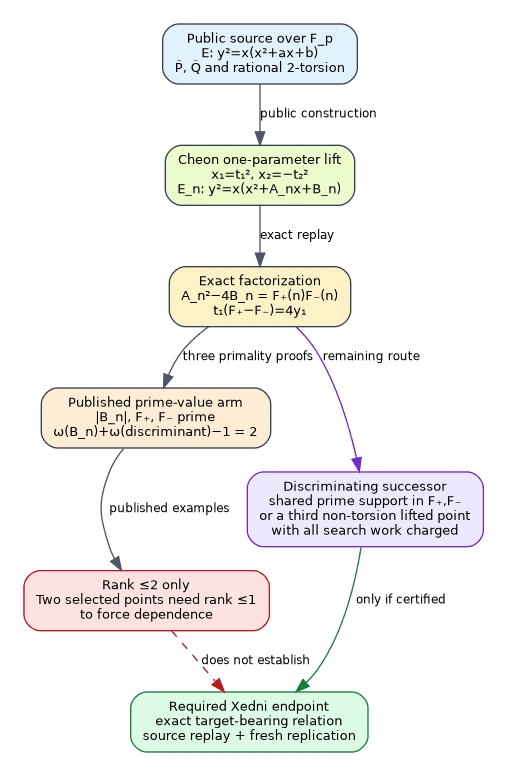

# Two-torsion Xedni boundary audit

Date: 2026-11-20

Status: exact implementation and fixed-example replay complete; no natural
16--32-bit row, Mordell--Weil rank result, or useful discrete-log recovery was
generated. The Xedni decay heuristic remains undisproved. [pcc:unverified]

## Question and acceptance boundary

The question is whether the public two-torsion lifting construction of Cheon,
Lee, Hahn, and Chee can turn two selected finite-field points into a forced
rational dependence, thereby avoiding the roughly `1/p` useful-relation decay
in the 2000 Jacobson--Koblitz--Silverman--Stein--Teske analysis. A useful result
must recover a nontrivial target coefficient after exact reduction, charge the
complete lift search, and replicate on fresh sources. A low ambient rank bound
alone does not meet that endpoint. [pcc:unverified]

Primary sources:

- Cheon, Lee, Hahn, and Chee, [*Elliptic Curve Discrete Logarithms and
  Wieferich Primes*](https://www.math.snu.ac.kr/~jhcheon/publications/2000/JWISC00_CLH.pdf),
  section 4. [pcc:unverified]
- Jacobson, Koblitz, Silverman, Stein, and Teske, [*Analysis of the Xedni
  Calculus Attack*](https://cspages.ucalgary.ca/~jacobs/PDF/xedni.pdf),
  especially theorem 4.1 and the relation-height analysis. [pcc:unverified]

The shared research-KB wrapper was invoked but no executable was installed.
The lead-atlas object and its Cheon report are encrypted `VLT1` objects in this
runtime, so the existing repository summaries and the primary papers supplied
the documented fallback. The checked lead is
`LEAD-ICP-char0-lifting-xedni-smoothness`; its revisit condition is a certified
bounded dependent lift, already supplied by the retained earlier Xedni work.
[pcc:unverified]

## Exact construction

For

```text
Ebar: y^2 = x(x^2 + a*x + b) over F_p,
Pbar = (t1^2, t1*b1),
Qbar = (-t2^2, t2*b2),
D = t1^2 + t2^2,
```

the paper chooses modular inverses `gamma_i=(t_i*p)^(-1) mod D`, integers
`delta_i=(1-gamma_i*t_i*p)/D`, and `s_i=b_i*delta_i`. Its one-parameter
integral curve is `y^2=x(x^2+A_n*x+B_n)`. The implementation in
[`two_torsion_lift.py`](two_torsion_lift.py) replays the two integral points,
their reduction, the curve reduction, nonsingularity, and the exact identity

```text
A_n^2 - 4*B_n = F_plus(n)*F_minus(n).
```

It also checks the boundary identity

```text
t1*(F_plus(n)-F_minus(n)) = 4*y1(n).
```

Thus a nonzero first lifted ordinate makes the two displayed factors distinct.
The three structural boundary theorems are formalized in
[`CheonTwoTorsion.lean`](formal/XedniRankClassification/CheonTwoTorsion.lean).
Lean 4.34.1 builds them without `sorryAx`; the reported foundations are
`propext`, `Classical.choice`, and `Quot.sound`. The complete expanded
discriminant factorization remains checked by exact Python arithmetic rather
than formalized in Lean. [pcc:unverified]

## Fixed published example

The source is `p=353`, `a=-1`, `b=16`, `Pbar=(9,63)`, and
`Qbar=(17,183)`, with `t1=703`, `t2=439`, `b1=-21`, and `b2=154`. Exact replay
reproduced the paper's coefficient polynomials and both named parameter
values. [pcc:unverified]

| Quantity | `n=-1793` | `n=181` |
| --- | ---: | ---: |
| `A_n` | 8697422826248745145 | 8698021425756814477 |
| `B_n` | -1793727297677166359919097 | -1792472369211529197803773 |
| `F_plus` | 8697425991446308729 | 8698024591934109793 |
| `F_minus` | 8697419661053158397 | 8698018259581495997 |
| `gcd(F_plus,F_minus)` | 1 | 1 |

Pinned GP/PARI 2.17.2 `isprime` returned `[1,1,1]` for
`(|B_n|,F_plus,F_minus)` in each row. The first version-query command used the
invalid GP default name `pariversion`; the corrected command used `version()`
and returned `[2,17,2]`. This is a fixed-example primality and algebra replay,
not a natural-frequency or rank experiment. [pcc:unverified]

## What the rank theorem does and does not give

The cited descent bound is

```text
rank E(Q) <= omega(B_n) + omega(A_n^2-4*B_n) - 1,
```

where `omega` counts distinct prime divisors. For either published row,
`|B_n|`, `F_plus`, and `F_minus` are three distinct prime supports, so the
right side is `1+2-1=2`. This certifies at most rank two under the cited
theorem. Two selected non-torsion points require rank at most one to force a
dependence. Actual rank one remains possible, but it is not established by
this bound or by the fixed replay. [pcc:unverified]

This identifies a precise successor rather than a counterexample: within this
family, the displayed descent can force rank at most one only through a unit
exception or by making the two nonunit discriminant factors share one prime
support; otherwise a stronger descent is required. Distinct equal-prime
powers are not excluded by the ordinate identity, but they require
`gcd(F_plus,F_minus)>1`. A different successor is to lift a third independently
selected non-torsion source point; rank at most two would then force a selected
dependence, provided its target coefficient survives exact source replay.
[pcc:unverified]



Editable source: [`two_torsion_boundary.dot`](two_torsion_boundary.dot).

## Next discriminating experiment

After the existing checkpoint and scientific-tool gates pass, freeze a
special-family arm before seeing outcomes. Cross source prime, square-lift
representative, parameter-search rule, local-condition profile, and selected
point count. Retain every rejected `t_i` and `n`, primality/factor-support
test, duplicate curve, rank interval, relation attempt, and source replay.
Compare these three prospective arms on identical sources: the paper's
three-prime arm; a public shared-radical selector using no target scalar or
relation result; and a three-point extension. Direct finite-field relation
search is the mandatory baseline. [pcc:unverified]

The first success gate is a certified rank-at-most-one two-point lift or a
rank-at-most-two three-point lift with an exact invertible target-bearing
relation. The decay claim still requires fresh discovery and replication over
the frozen 16--32-bit range, the signed-slope criterion, and full cost. A null
bounded search closes only its stated selector and budget. [pcc:unverified]

## Validation and graph scope

Commands run from `research/xedni_rank_decay_20261118/`:

```text
python3 -m unittest discover -v
# 387 tests completed; 6 host-GP controls skipped because gp is not on PATH
# (the 5 new two-torsion tests passed)

cd formal && lake build
# 7 total theorems built; the 3 new boundary theorems have no sorryAx

docker run --rm -i --network=none --entrypoint gp \
  xedni-pari-rank:2.17.2 -q -f
# version [2,17,2]; both primality triples [1,1,1]
```

No benchmark, timing comparison, natural panel, or rank tool was run. The
canonical curve registry and isogeny/volcano graph set were checked and remain
unchanged because this audit adds no cryptographic curve identity, isogeny,
map, or measured route. The diagram records the mechanism boundary only.
[pcc:unverified]
