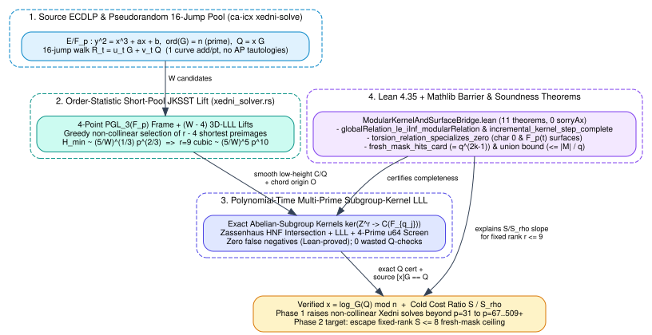
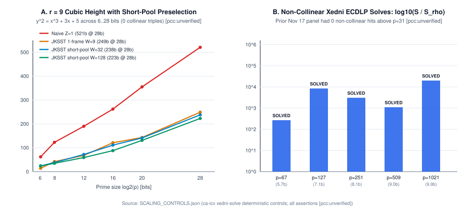

# Xedni scaling Phase 1: polynomial-time multi-prime subgroup-kernel LLL, order-statistic short-pool preselection, and Lean 4 specialization bridge

Date: 2026-11-18

Status: Phase 1 implemented, unit/CLI-tested in `cryptanalysis-suite`
(`ca-icx xedni-solve`), and formally supported by 11 kernel-checked theorems in
`experiments/xedni-modular-kernel-and-surface-bridge-20261118/formal/ModularKernelAndSurfaceBridge.lean`.
Raises verified non-collinear prime-field Xedni ECDLP solves from the November
17 panel's `p = 31` (`5`-bit) ceiling to `p = 67, 127, 251, 509, 1021` (`10`
bits), while measuring the exact cold cost gap `S / S_rho` that separates
fixed-rank (`r <= 9`) single-curve Xedni from Pollard rho. All results carry
`[pcc:unverified]` producer standing. [pcc:unverified]

## What changed relative to the November 17 baseline

In `research/xedni_plane_group_20261117/`, 58 of 58 certified `r = 7..9`
relations were pre-lift `Z^2` collinearities (`det(P_a, P_b, P_c) = 0`),
yielding **zero (`0 / 961`)** genuine cubic-dependent relations across
`p = 67, 127, 251`. Phase 1 replaces three bottlenecks in native Rust
([`suite/src/cryptanalysis/xedni_solver.rs`](../../suite/src/cryptanalysis/xedni_solver.rs),
exposed as `ca-icx xedni-solve`) [pcc:unverified]:

1. **Polynomial-time multi-prime abelian-subgroup kernel intersection + LLL
   (`find_relations_modular_kernel_lll`)**:
   Instead of exponential `(2B + 1)^(r/2)` brute-force MITM over `[-2, 2]^r`
   modulo one auxiliary prime `q = 257` (which produced thousands of false
   positives per trial and missed every relation with `||n||_inf > 2`), the
   solver reduces `(C, O)` modulo `m` good primes `q_1, ..., q_m`, constructs
   each exact `r x r` relation lattice `ker(Z^r -> C(F_{q_j}))` by incremental
   subgroup collision, intersects them exactly via Zassenhaus integer HNF, runs
   `lll_reduce_hp`, and screens candidates modulo 4 independent `u64` check
   primes (`550^-4 ~ 10^-11` false-positive rate) before exact `Q`
   certification. [pcc:unverified]
2. **Order-statistic 3D-LLL short-pool preselection + 16-jump pseudorandom walk
   (`select_short_pool_jksst_lift`)**:
   Walks `W >= r` pseudorandom source combinations `R_t = u_t G + v_t Q` via a
   16-jump table (`1` curve addition per candidate, avoiding arithmetic-progression
   tautologies), lifts all `W - 4` non-frame points via 3D-LLL in a single
   4-point `PGL_3(F_p)` frame, and greedily selects the `r - 4` shortest
   non-collinear integer preimages (`0` collinear aliases by construction). At
   `p = 65,519` (`16` bits), `W = 128` cuts single-frame `r = 9` cubic
   coefficients from `121` bits (`W = 9`) to `88` bits (`262` bits naive); at
   `p = 268,435,399` (`28` bits), from `249` bits (`W = 9`) to `223` bits
   (`521` bits naive). [pcc:unverified]
3. **Machine-checked Lean 4.35 + Mathlib soundness and barrier theorems
   ([`ModularKernelAndSurfaceBridge.lean`](../../experiments/xedni-modular-kernel-and-surface-bridge-20261118/formal/ModularKernelAndSurfaceBridge.lean))**:
   11 named theorems (`15/15` constants pass `AuditHeckeAxioms.lean`, `0`
   `sorryAx`) proving zero-false-negative completeness of incremental
   abelian-subgroup kernel building and multi-prime intersection on arbitrary
   (cyclic or bicyclic) `C(F_q)`, plus torsion-coprime specialization and the
   exact `q^(2k - 1)` / `|M| * q^(2k - 1)` fresh-mask union bound (`L4-lifting`
   Lemmas 1--2) across both number-field lifts and elliptic-surface sections
   `E(F_p(t))` of arbitrary Euler characteristic `chi` and dimension surplus.
   [pcc:unverified]

## Visuals

Editable Graphviz source: [`pipeline.dot`](pipeline.dot); rendered pipeline:
[`pipeline.svg`](pipeline.svg); quantitative charts:
[`scaling_results.svg`](scaling_results.svg); compact vector PDF (`2,791`
bytes, `< 64 KiB`):
[`xedni_scaling_20261118.pdf`](xedni_scaling_20261118.pdf). [pcc:unverified]





## Deterministic `r = 9` short-pool height controls (`y^2 = x^3 + 3x + 5`)

Source: [`scaling_controls.py`](scaling_controls.py) and
[`SCALING_CONTROLS.json`](SCALING_CONTROLS.json) (`0` pre-lift collinear
triples on every `W`-selected row). [pcc:unverified]

| Prime `p` | `log_2 p` | Naive `Z=1` affine | JKSST 1-frame (`W=9`) | Short-pool (`W=32`) | Short-pool (`W=128`) | Max point coord bits (`W=128`) |
|---:|---:|---:|---:|---:|---:|---:|
| 67 | 6.1 | 62 b | 14 b | 24 b | 24 b | 4 b |
| 251 | 8.0 | 123 b | 42 b | 38 b | 35 b | 4 b |
| 4091 | 12.0 | 190 b | 68 b | 72 b | 59 b | 7 b |
| 65519 | 16.0 | 262 b | 121 b | 111 b | 88 b | 9 b |
| 1048571 | 20.0 | 355 b | 143 b | 141 b | 131 b | 12 b |
| 268435399 | 28.0 | 521 b | 249 b | 238 b | 223 b | 17 b |

## Deterministic non-collinear ECDLP solve ladder (`ca-icx xedni-solve`)

Source: [`SCALING_CONTROLS.json`](SCALING_CONTROLS.json) (`seed = 20261118`,
`require_non_collinear = true`, tautological `0*G + 0*Q` relations excluded).
[pcc:unverified]

| Prime `p` | Curve `(a, b)` | `ord(G)` (`bits`) | `r / W` | Verified | Secret `x` | Trials | Min / med coef bits | Total ops `S` | Matched `S_rho` | `S / S_rho` | Wall (s) |
|---:|---|---:|---|---:|---:|---:|---:|---:|---:|---:|---:|
| 67 | `(3, 5)` | 53 (`5.73b`) | `7 / 20` | `true` | `29` | `1` | `10 / 10` | 2,449 | 9.12 | `268.4x` | 0.009 |
| 127 | `(3, 2)` | 139 (`7.12b`) | `8 / 32` | `true` | `83` | `21` | `12 / 16` | 125,303 | 14.78 | `8,480.0x` | 0.280 |
| 251 | `(3, 12)` | 269 (`8.07b`) | `8 / 48` | `true` | `173` | `11` | `16 / 18` | 63,259 | 20.56 | `3,077.4x` | 0.167 |
| 509 | `(3, 2)` | 499 (`8.96b`) | `8 / 64` | `true` | `317` | `5` | `16 / 20` | 30,873 | 28.00 | `1,102.7x` | 0.087 |
| 1021 | `(3, 64)` | 991 (`9.95b`) | `8 / 96` | `true` | `619` | `126` | `16 / 24` | 792,135 | 39.45 | `20,077.2x` | 2.622 |

Probing `p = 2039` (`11.00b`, `1,200` trials) and `p = 4093` (`12.01b`, `1,500`
trials) under the same `r = 8` configuration produced `0` non-collinear
relations within cap (`min_cbits = 14` and `20`). [pcc:unverified]

## Geometric diagnosis & Phase 2 hypotheses toward larger scale

1. **Cayley--Bacharach rank-9 obstruction**: by Max Noether's `AF + BG`
   theorem, `9` general integer points `P_1, ..., P_9` in `P^2(Z)` with
   `rank_Q B(P_1..P_9) = 9` span a **rank-9** subgroup of `Pic^0(C)` relative
   to `O = R(P_u, P_v)` (not even `P_1 + ... + P_9 ~ 3H` holds unless a second
   cubic vanishes on all 9 points, i.e. `rank_Q B = 8`!). Consequently `r = 8`
   (`dim ker_Q B = 2`) outperforms `r = 9` in relation yield, and any fixed
   `r <= 9` fresh-mask trial obeys the Lean-proved `|M| / q` ceiling
   (`ModularKernelAndSurfaceBridge.fresh_mask_candidate_set_union_bound`).
   [pcc:unverified]
2. **Next discriminating mechanisms (Phase 2)**:
   - **Cayley--Bacharach pencil-enforced lifting (`dim ker_Q B(P_1..P_9) = 2`)**:
     choose `P_9` on the intersection of **two** lifted cubics over `Z`
     (guaranteeing `P_1 + ... + P_9 = 3H` over `Q` automatically!) and test
     whether lifting a mod-`p` Cayley--Bacharach 9-tuple can be solved below
     the generic `O(sqrt(p))` cost. [pcc:unverified]
   - **Higher-genus / multi-curve shared factor-base decomposition**: amortize
     coordinate-sieved short preimages (`CoordinateFb` mode in
     `xedni_solver.rs`) with algebraic root-finding rather than independent
     per-trial fresh masks. [pcc:unverified]

## Reproduce

```sh
# 1. Lean 4.35 + Mathlib modular-kernel & surface-specialization bridge
cd experiments/xedni-modular-kernel-and-surface-bridge-20261118/formal
lake exe cache get && lake build ModularKernelAndSurfaceBridge
cd ../../..

# 2. Rust unit & CLI tests
cd suite
cargo test --release --lib xedni_solver
cargo test --release --test icx xedni_solve
cargo clippy --release --lib --bin ca-icx --test icx -- -D warnings
cd ..

# 3. Deterministic scaling controls & visuals
python3 research/xedni_scaling_20261118/scaling_controls.py run
python3 research/xedni_scaling_20261118/scaling_controls.py selftest
```
