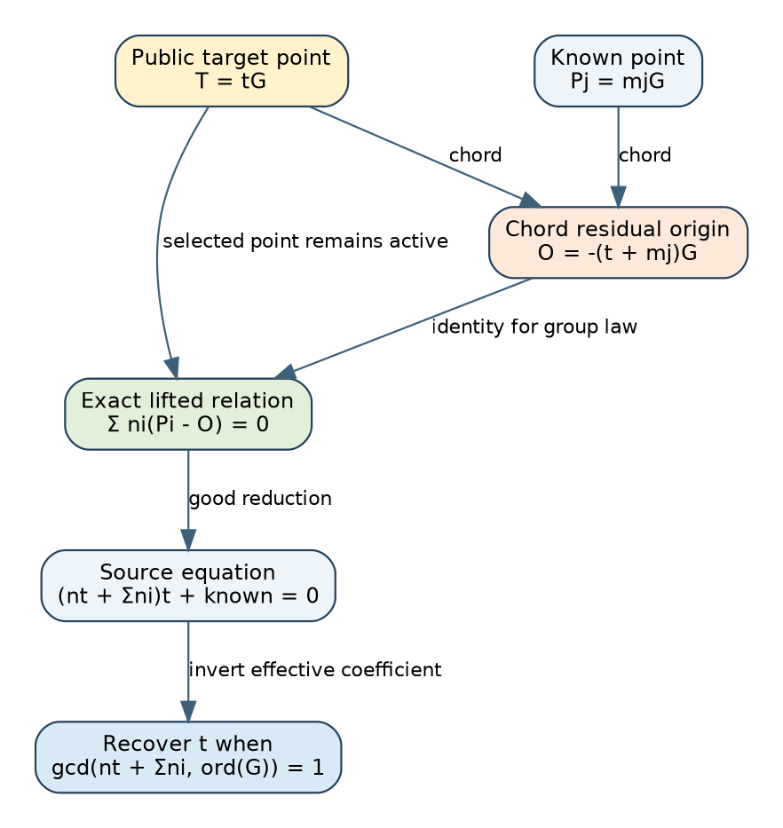

# Target-dependent chord origins for Xedni recovery

Date: 2026-11-18

Status: derived, implemented in Rust, kernel-checked algebraically, and covered
by fixed exact Rust and independent-language controls.  Natural-lift frequency
has not been measured because the mandatory checkpoint transport is unavailable.
[pcc:unverified]

Provenance records: algebraic recovery theorem
[`PCC-20261118-959f5a`](../../pcc/claims/PCC-20261118-959f5a.json) and fixed
control [`PCC-20261118-868127`](../../pcc/claims/PCC-20261118-868127.json).
Both remain unverified pending an independent signed verdict. [pcc:unverified]

## Question

Can the arbitrary rational origin added to the nine-point plane-cubic Xedni
path carry the unknown target scalar, instead of requiring the selected exact
relation to contain the target with a nonzero explicit coefficient?
[pcc:unverified]

## Derived recovery channel

Let the public target be `T=tG`, choose a known point `P_j=m_jG`, and use the
residual intersection of their chord as the lifted group origin.  At good
reduction its source scalar is `m_O=-(t+m_j)`.  For an exact relation with
coefficients `n_i` and `S=sum_i n_i`, reduction gives

```text
sum_i n_i(m_i-m_O) = 0
(n_t + S)t + sum_{i != t} n_i m_i + S m_j = 0  (mod ord(G)).
```

Thus the effective target coefficient is `n_t+S`.  The relation can recover
the logarithm when this value is invertible even if the explicit target
coefficient `n_t` is zero.  Constructing the origin needs only the public point
coordinates, not the unknown scalar. [pcc:unverified]

The Rust implementation adds a source-residue certificate and recovery routine
for this case.  It retains the arbitrary-origin exact group law and does not
assume the target scalar in the recovery path. [pcc:unverified]

## Exact fixed control

On `y^2=x^3-x+1` over the rationals, use the first nine multiples of the
infinite-order point `G`, target `9G`, known chord partner `G`, and chord origin
`-10G`.  The exact relation

```text
-2(P1-O) - (P2-O) + 2(P7-O) = 0
```

has explicit target coefficient zero, coefficient sum `-1`, effective target
coefficient `-1`, source residue zero modulo 73, and recovers target scalar 9.
The same coefficient vector is rejected under the old known-only chord origin,
and a one-coefficient mutation is rejected.  Rust and Python controls check the
exact projective relation independently of each other's recovery code.
[pcc:unverified]

## Formal proof boundary

[`formal/TargetChordOrigin.lean`](formal/TargetChordOrigin.lean) proves the
source-equation expansion, recovery with an explicit inverse, and the
zero-explicit-coefficient specialization over commutative rings.  This is the
algebraic bridge.  As in the prior chord-origin work, a full machine-checked
geometric theorem that concrete good reduction maps the residual chord point
to `-(t+m_j)G` remains open. [pcc:unverified]

## Evidence and limits

The fixed control establishes a new exact recovery mechanism and executable
path.  It does not establish its frequency on natural optimized lifts, change
the classical conditional `O(1/p)` lift-success obstruction, or establish a
timing or end-to-end ECDLP advantage.  The frozen fresh-seed selector panel in
the sibling research directory remains blocked before its first natural row by
the checkpoint upload gate. [pcc:unverified]

## Requirement status

| Requirement | Status | Evidence or gap |
|---|---|---|
| Derive target-dependent origin equation | Implemented but unverified | Lean module and readable derivation; no signed PCC verdict |
| Recover with zero explicit target coefficient | Implemented but unverified | Exact Rust and Python fixed control recover scalar 9 |
| Reject origin and coefficient mutations | Implemented but unverified | Known-only origin and one-coefficient mutation are rejected |
| Preserve existing Xedni controls | Implemented but unverified | All 13 focused release tests pass |
| Measure natural-lift recovery rate | Blocked | Mandatory checkpoint `PutObject` returns `AllAccessDisabled` before row one |
| Establish end-to-end ECDLP improvement | Not attempted | Fresh targets, complete work, matched rho and independent replay remain required |

Every row describes the narrower deliverable; none promotes the mechanism to a
natural-frequency, timing, asymptotic, or complete-pipeline claim.
[pcc:unverified]

The mechanism and claim boundary are shown in the [editable Graphviz source](pipeline.dot)
and [SVG rendering](pipeline.svg). [pcc:unverified]



## Sources checked

- Xedni lead record `LEAD-ICP-char0-lifting-xedni-smoothness` in
  `crypto-autoresearcher`, whose revisit condition is a certified bounded
  dependent lift. [pcc:unverified]
- Known-result record `KR-IC-cd159a` in `crypto-autoresearcher`, the classical
  negligible-probability obstruction that this recovery mechanism does not
  remove. [pcc:unverified]
- Jacobson, Koblitz, Silverman, Stein, and Teske, “Analysis of the xedni
  calculus attack,” *Designs, Codes and Cryptography* 20 (2000), 41–64.
  [pcc:unverified]
- The shared research-KB executable was unavailable; the lead atlas and its
  cited repository records supplied the documented fallback. [pcc:unverified]
