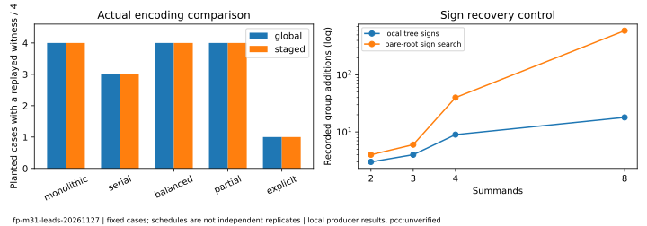
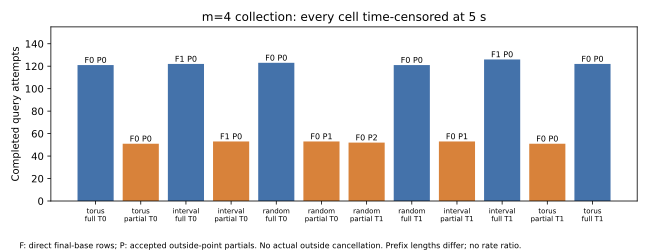

# Actual M31 relation-lead comparisons - 2026-11-27

This run implements and tests the proposed components themselves. The previous 56-cell native auxiliary-IC run was a baseline only and did not evaluate these changes. Both historical runs remain separate. The coordinate field is Fp, p=2147483647=2^31-1; the curve is y^2=x^3+2x+14, N=2147505293, G=(1,814455902). [pcc:unverified]

## Observed outcomes

All 146 planned native processes emitted reports: 120 polynomial encoding/schedule cells, 24 real collection cells and two target/cancellation controls. No process was excluded or killed. Native correctness tests passed 6/6; the deliberate failed transport call did not skip the next successful call. Extra native replay is validation, not a new comparison cell. [pcc:unverified]

On the four fixed planted cases, balanced S3, monolithic S4/S5 and partial S4/S3 each returned group-replayed witnesses under both schedules. Serial S3 returned witnesses on three cases under each schedule and hit its cap on k=4,m=4. Guarded explicit addition returned a witness only on k=2,m=3 under either schedule. These are bounded native F4 plus finite-domain substitution outcomes, not pure-F4 completion or an end-to-end IC speedup. [pcc:unverified]

The mixed-lift control numerically evaluates S5 to zero on x=(1,0,5,1650294539), target G. The implemented salvage procedure consumes supplied signed Fp2 lifts, classifies rational terms, and checks the doubled relation: four terms become one rational projected term. This constructed example has T=O, as expected for this odd-order curve; it does not test a nonzero rational 2-torsion contribution or establish salvage frequency. [pcc:unverified]

Actual sampled collection accepted four one/two-outside-point partials. Their outside coefficient matrices produced zero dependencies and zero combined final rows within the cap. Separate synthetic signed-cancellation controls returned 52 replayed nonidentity combined targets from 64 rows and outside rank12; these are excluded from generation yield. The all-positive triangle has rank3 modulo101 and was not accepted as a dependency. [pcc:unverified]

## Frozen design and accounting

Protocol/input/seed freeze: commit 4fff25b. Worker source: `91e9ea5c1ec0e604ad28dfdf12cf87f47b396eae`; encoding implementation a5c1354, native replay implementation 8006bf2. Exact binary hashes and all commands are in manifest.json. All solver input files contain public coordinates; no generating scalar reaches these workers. Native sampler/base seeds and bounded deterministic root splitting are frozen in seeds.json. [pcc:unverified]

Encoding panel: first k=2 or4 rational interval lifts, m=3 or4; one planted sum plus two ordinary targets per (k,m). Five encodings crossed with global/incremental-staged solving, grevlex degree cap8, one shared 2-s engine/recovery budget and a separate construction budget10s. Worker guard:20s/2GiB. Monolithic S4/S5 are actual Sylvester resultants; all encodings use common leaf-domain quotient reduction. Staging retains original equations and carries derived bases. Explicit addition has identity, inverse, doubling and distinct-x guarded branches, with canonical infinity coordinates and inactive slopes. [pcc:unverified]

Collection panel: ambient71 signed columns and final53 columns, outside18, on torus, interval and ordinary random bases with equal column counts. The same direct decomposition backend isolates base selection. Each cell requests256 coefficient-walk targets with a5-s soft cap. Full and partial methods share identical native query streams and exact same bases; only a common completed prefix can support a paired comparison. Partial acceptance uses the first found witness and rejects witnesses with more than two outside terms; it does not prove another admissible witness is absent. [pcc:unverified]

Host: shared AMD EPYC9V74 container, five logical CPUs; no isolation tier earned. Workers are debug builds. Reports separate construction, F4, bounded root recovery, local group validation, preparation and enclosing process time. The JSON field named independent_group_validation_ns refers to a local computational pass, not a signed independent verifier. No uncertainty interval, cold pipeline cost, timing ratio or admitted performance tier is supplied. [pcc:unverified]

## Encoding and scheduling results

| Encoding | Schedule | Planted witnesses /4 | Ordinary refuted /8 | Ordinary degree-capped /8 | Ordinary time-capped /8 |
|---|---|---:|---:|---:|---:|
| monolithic | global | 4 | 4 | 4 | 0 |
| monolithic | staged | 4 | 4 | 4 | 0 |
| serial | global | 3 | 8 | 0 | 0 |
| serial | staged | 3 | 8 | 0 | 0 |
| balanced | global | 4 | 8 | 0 | 0 |
| balanced | staged | 4 | 8 | 0 | 0 |
| partial | global | 4 | 4 | 4 | 0 |
| partial | staged | 4 | 4 | 4 | 0 |
| explicit | global | 1 | 6 | 0 | 2 |
| explicit | staged | 1 | 2 | 0 | 6 |

Each schedule uses the same four planted cases; these are not eight independent samples. Witness assignments include permutations: the 270 replayed assignments represent one distinct signed coefficient row per successful planted case. They are not270 independent relations. All eight ordinary (k,m,target) domains have zero exact-m decompositions under the separate exhaustive native oracle. This is a fixed finite-base fact, not an ECDLP or asymptotic negative result. [pcc:unverified]

Affine serial/balanced/partial systems can lose identity-intermediate cases. Their encoded refutations alone do not establish unrestricted exact-m or shorter-length nonexistence. The independent code path for the finite-domain group oracle corroborates all56 reported refutations in this panel; no signed independent verdict is supplied. Monolithic S4/S5 with these rational leaf domains has no affine intermediate chart restriction. Timeouts and degree-capped results remain unresolved by the solver, even when the separate oracle knows the answer. [pcc:unverified]

For k=4,m=4 planted, the global-run work below shows the actual variable/equation and matrix tradeoff. Initial degree is after the shared membership quotient reduction; degree cap8 does not erase higher-degree input equations. Counts are recorded maxima; timings are descriptive native milliseconds, no performance ratio. [pcc:unverified]

| Encoding | Vars | Eqs | Input max degree | Matrix max rows | Matrix max cols | Construction ms | F4 ms | Root ms | Outcome |
|---|---:|---:|---:|---:|---:|---:|---:|---:|---|
| monolithic | 4 | 5 | 12 | 0 | 0 | 363.508 | 1.942 | 7.701 | witness |
| serial | 6 | 7 | 4 | 8809 | 2855 | 0.561 | 2471.396 | 0.001 | time cap |
| balanced | 6 | 7 | 4 | 5184 | 2750 | 0.432 | 1449.826 | 21.642 | witness |
| partial | 5 | 6 | 10 | 181 | 144 | 5.285 | 24.288 | 69.749 | witness |
| explicit | 35 | 114 | 4 | 7370 | 8500 | 2.507 | 2031.327 | 0.001 | time cap |

The monolithic global k=4,m=4 run processes zero F4 critical-pair steps at this degree cap, then recovers witnesses by bounded finite-domain root substitution. Its witness result must not be presented as a successful Gröbner solve or proof that monolithic S5 scales better. A zero finite_domain_fallback_branches counter still permits branching on roots of finite-domain univariate constraints. Partial splitting also retains input degree10 above the pair cap; its recovered witnesses use the combined F4/substitution procedure. [pcc:unverified]

## Separate degree-16 diagnostic

After observing that the degree8 monolithic cell did no critical-pair work, a separate four-cell protocol was frozen at2fd6c60. It reruns only k4,m4,planted with monolithic/partial and global/staged, using the identical saved worker binary and public input; degree16 is the only solver change. The original146-cell budget and results are untouched. This is a deliberately selected diagnostic, not an independent replicate or a replacement panel. [pcc:unverified]

All four cells now process actual F4 critical pairs, report zero pairs above the degree bound, and return locally replayed witnesses. The separate native checker replays96 assignments representing the same one signed coefficient row. Increasing the pair cap changes the observed work tradeoff: partial splitting has lower input degree yet reaches a higher processed degree and larger matrices on this fixed case. This illustrates why low input degree alone does not price solving. No timing ratio or general encoding ranking follows from one shared-host case. [pcc:unverified]

| Encoding | Schedule | F4 steps | Degree reached | Max matrix rows | Max matrix cols | Construction ms | F4 ms | Root ms |
|---|---|---:|---:|---:|---:|---:|---:|---:|
| monolithic | global | 22 | 13 | 1263 | 1275 | 386.777 | 578.357 | 6.320 |
| monolithic | staged | 23 | 13 | 1263 | 1275 | 385.162 | 638.599 | 7.778 |
| partial | global | 48 | 14 | 5003 | 5015 | 6.683 | 1849.290 | 18.809 |
| partial | staged | 55 | 14 | 4846 | 4802 | 5.800 | 1720.234 | 29.184 |

Supplemental flow:4 planned/attempted/reported,4 with actual critical-pair work and group witnesses,0 kills or missing reports. Construction, F4 and root extraction remain separately recorded; root extraction still branches finite domains. The separate benchmark record is unqualified for performance admission. Evidence: degree16/PROTOCOL.md, manifest.json, raw/, native-replay.json. [pcc:unverified]

Supplemental implementation a11dce2 adds optional --up-to-m dispatch: direct identity/single-point checks, then lengths2..m under one shared construction/F4/recovery deadline. It retains chart qualifications and returns incomplete rather than global absence on nonpositive outcomes. Four added finite-field controls cover cancellation, a genuine two-point target, identity/zero budget and conservative refutation; final source tests pass10/10. This optional dispatcher was not used to rerun or alter either frozen M31 panel. [pcc:unverified]

## Target salvage, signs and cache

| Summands | Tree sign additions | Bare-root sign patterns | Bare-root additions | Actual x-cache miss/hit |
|---:|---:|---:|---:|---|
| 2 | 3 | 2 | 4 | 1/1 |
| 3 | 4 | 2 | 6 | 1/1 |
| 4 | 9 | 10 | 40 | 1/1 |
| 8 | 18 | 74 | 592 | 1/1 |

Tree counters include local sign reconstruction only. They exclude witness construction, square-root/lift work and final replay. Bare-root search tests actual sign patterns. Each first cache request performs a real search and stores its result by target x in the fixed domain; -R reuses it and reverses signs. This is an isolated sign/cache component test, not an integrated F4 target-cache or full pipeline speedup. Salvage requires signed lifts/witnesses; it does not solve bare-root sign recovery. [pcc:unverified]

## Actual partial generation and base selection

| Target | m | Base | Method | Queries | Full rows | Accepted partials | Outside rank | Combined final rows |
|---|---:|---|---|---:|---:|---:|---:|---:|
| 0 | 3 | torus | full | 256 | 0 | 0 | 0 | 0 |
| 0 | 3 | torus | partial | 256 | 0 | 0 | 0 | 0 |
| 0 | 3 | interval | full | 256 | 0 | 0 | 0 | 0 |
| 0 | 3 | interval | partial | 256 | 0 | 0 | 0 | 0 |
| 0 | 3 | random | full | 256 | 0 | 0 | 0 | 0 |
| 0 | 3 | random | partial | 256 | 0 | 0 | 0 | 0 |
| 0 | 4 | torus | full | 121 | 0 | 0 | 0 | 0 |
| 0 | 4 | torus | partial | 51 | 0 | 0 | 0 | 0 |
| 0 | 4 | interval | full | 122 | 1 | 0 | 0 | 0 |
| 0 | 4 | interval | partial | 53 | 1 | 0 | 0 | 0 |
| 0 | 4 | random | full | 123 | 0 | 0 | 0 | 0 |
| 0 | 4 | random | partial | 53 | 0 | 1 | 1 | 0 |
| 1 | 3 | random | partial | 256 | 0 | 0 | 0 | 0 |
| 1 | 3 | random | full | 256 | 0 | 0 | 0 | 0 |
| 1 | 3 | interval | partial | 256 | 0 | 0 | 0 | 0 |
| 1 | 3 | interval | full | 256 | 0 | 0 | 0 | 0 |
| 1 | 3 | torus | partial | 256 | 0 | 0 | 0 | 0 |
| 1 | 3 | torus | full | 256 | 0 | 0 | 0 | 0 |
| 1 | 4 | random | partial | 52 | 0 | 2 | 2 | 0 |
| 1 | 4 | random | full | 121 | 0 | 0 | 0 | 0 |
| 1 | 4 | interval | partial | 53 | 0 | 1 | 1 | 0 |
| 1 | 4 | interval | full | 126 | 1 | 0 | 0 | 0 |
| 1 | 4 | torus | partial | 51 | 0 | 0 | 0 | 0 |
| 1 | 4 | torus | full | 122 | 0 | 0 | 0 | 0 |

All12 m3 cells finish256 queries with zero rows. All12 m4 cells are time-censored. The m4 partial methods finish51-53 queries versus121-126 for full methods; unequal prefixes prevent a yield or timing gain claim. Seven raw decompositions are replayed across all cells: three already-full row observations (including a paired-arm repeat) and four accepted partials. The four partials include three on random bases and one on interval, zero on torus. With no combined outside dependency, generation cost and cancellation yield do not demonstrate an improvement. Zero-acceptance costs remain null; no uniform outside-point model or sparse collision threshold is fitted. [pcc:unverified]

The outside coefficient eliminator retains original-row weights and accepted-query mapping, classifies trivial/duplicate final coefficient rows, records rank separately and replays group equations. The synthetic control demonstrates this machinery; actual rows did not reach its cancellation stage. Native subgroup checks cover every ambient point. The torus is the explicit larger algebraic-pool candidate; no cheaper structured generation has been established. [pcc:unverified]

Over this prime field, Frobenius fixes rational points and offers no nontrivial Koblitz orbit reduction. Binary trace-zero hyperplanes and binary quadratic-descent degree claims were not applied to Fp. The real prime-field factor-base comparison is the same-size torus/interval/random panel above. [pcc:unverified]

## Correctness, flow and remaining scope

Native tests cover S3/S4/S5 against a finite signed-group oracle, all five guarded addition branches including 2-torsion and identity, finite serial/balanced/partial witnesses, actual F4/root recovery and bounded M31 root factoring. A second native arithmetic implementation replayed270 assignments and4120 coefficient targets, checked seven collected rows, corroborated56 finite-domain refutations, rejected a wrong-sign mutation and checked the salvage projection. Local producer checks do not establish independent signed verification. [pcc:unverified]

Flow:146 planned/attempted/reported,0 exclusions,0 missing reports,0 watchdog kills. Polynomial outcomes:32 witness cells,56 encoded refutations,16 degree-capped,16 engine-capped. Collection outcomes:12 complete,12 time-censored. Two native component controls pass; the failed transport check and subsequent successful check are separate and retained. No follow-up benchmark is running. [pcc:unverified]

The requested five leads now have concrete prime-field implementations, applicability dispositions and bounded measurements. This does not establish full-size factor-base performance, asymptotics, complete low-degree solving, a new end-to-end IC recovery or a gain over rho. The prior strong rho references remain baseline context. The next discriminating experiment is a separately frozen larger-domain comparison with finite-domain branching disabled or fully charged, carrying partial splitting and balanced topology forward, followed by structured accepted-partial generation that yields enough signed dependencies to measure cancellation. No budget or threshold in this run was relaxed. [pcc:unverified]

Reproduce: build suite examples m31_encoding_pilot, m31_relation_leads and m31_relation_replay with Rust1.88.0; run the six tests with `cargo +1.88.0 test --example m31_encoding_pilot`; run.py invokes native workers under the workspace watcher and refuses an existing raw directory. The native oracle/replay is supplemental validation after the frozen matrix. Full commands, coordinate inputs, seeds, source/binary hashes, all logs, matrix counters and replay results are in the delivery archive. analyze.py only validates hashes and lays out recorded values. PDF renderer: Typst0.15.1. [pcc:unverified]

All evidence remains locally stored under the user authorization. Canonical experiment-protocol tools/schema could not be read, so no canonical admission is claimed. No new PCC ID is minted for these known synthetic targets. The inherited whole-checkout benchmark artifact gate remains unresolved; source research gate and prose lint are checked separately. PRs remain draft; no gate, lock or independent-verification requirement was weakened. Canonical scoreboard/timeline/catalog paths are absent from this checkout; no qualified result or new curve/isogeny fact warrants changing them. [pcc:unverified]
