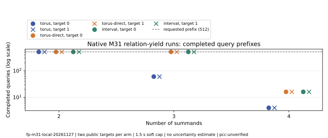

# Native M31 local diagnostic - 2026-11-27

The native code returned and locally replayed all 18 planted decomposition controls. None of the 18 bounded IC searches recovered an ordinary target. Two searches collected one row each (rank 1); the remaining IC searches collected none. Native Pollard rho recovered both ordinary targets and replayed their scalars. These are unsigned producer observations, not independently verified results. [pcc:unverified]

The requested coordinate field is **Fp, p=2147483647=2^31-1**. The summand counts are 2, 3, 4. Earlier binary-field/31-summand artifacts are separate and provide no evidence for this run. The native reference curve is y^2=x^3+2x+14, scalar order N=2147505293, G=(1,814455902); p and N differ. [pcc:unverified]

## Execution and evidence

Source: `94c0b5d8fac0207d21f2e972d80909d29a2c1dd9`; CLI SHA256 `dca496dbd496bdf055a50180b55260f0b0217704bb57f77aa7e59fbc8c4b9622`. Native fixture SHA256 `86dc7b80b3fa823a0c1ed3fddd0a3cdeac6582bbe750aa4809c0413d23ee2614`. Frozen protocol commit: `9846fad`; runner commit: `94c0b5d`. The protocol and seed file were committed before outcomes. The richer experiment.protocol/v1 JSON preregistration was not filed; this is a descriptive diagnostic, with no qualified A/B or speedup claim. [pcc:unverified]

Host: AMD EPYC 9V74, shared container, five available logical CPUs; no isolation tier earned. Debug native CLI, release native fixture helper, native C rho reference. Do not compare fixture timing with solver timing. User authorized local CPU execution and local storage. Raw artifacts have not been uploaded to S3. [pcc:unverified]

Controls: 19 existing native release tests passed (3 multi_summands, 11 pipeline, 5 random_control). The helper checks [N]G=O and valid points. Solver processes receive public coordinates only; evaluator scalars stay in a separate file. The frozen factor-base child stream is reserved but unused because bases are deterministic. [pcc:unverified]

The torus and direct-torus arms use identical 71-column bases; the interval arm uses 75 columns from x=0..127. Actual paired column hashes, public input hashes and sampler seeds match. Torus uses auto/AVX2; direct arms use scalar. This is the declared arm comparison, not an isolated encoding or SIMD comparison. [pcc:unverified]

Flow: planned 56, attempted 56, native reports 56, excluded 0. PDP: 18 found rows, all locally replayed, including 9 repeated mathematical outputs. Yield: 10 complete 512-query prefixes, 8 time-censored prefixes. Solve: 18 incomplete IC searches. Rho: 2 recovered references (the enclosing one-query IC status remains incomplete). No watchdog kill or missing native report occurred. [pcc:unverified]

The CLI returns exit 1 for relation_found/incomplete in this revision. Raw exit codes are preserved; those reports are classified by native status rather than treated as process crashes. TimeBudget is checked between batches, so m4 torus exceeds its 1.5/2 s soft budget; the independent 20 s watchdog remained in force. [pcc:unverified]

## Relation-yield observations

Each row below is one target and one arm. Query counts and online seconds are native recorded values; all rows found zero relations. Only completed equal prefixes support a paired yield comparison. No timing uncertainty interval or performance ratio is asserted. [pcc:unverified]

| Target | m | Arm | Queries | Native status | Online s |
|---|---:|---|---:|---|---:|
| 0 | 2 | torus | 512 | complete | 0.174145 |
| 0 | 2 | torus-direct | 512 | complete | 0.016786 |
| 0 | 2 | interval | 512 | complete | 0.018315 |
| 0 | 3 | torus | 60 | incomplete | 1.608852 |
| 0 | 3 | torus-direct | 512 | complete | 1.187744 |
| 0 | 3 | interval | 512 | complete | 1.203691 |
| 0 | 4 | torus | 4 | incomplete | 5.390753 |
| 0 | 4 | torus-direct | 16 | incomplete | 1.664963 |
| 0 | 4 | interval | 16 | incomplete | 1.950638 |
| 1 | 2 | interval | 512 | complete | 0.016272 |
| 1 | 2 | torus-direct | 512 | complete | 0.016740 |
| 1 | 2 | torus | 512 | complete | 0.156362 |
| 1 | 3 | interval | 512 | complete | 1.224781 |
| 1 | 3 | torus-direct | 512 | complete | 1.071187 |
| 1 | 3 | torus | 60 | incomplete | 1.528223 |
| 1 | 4 | interval | 16 | incomplete | 1.834415 |
| 1 | 4 | torus-direct | 16 | incomplete | 1.524834 |
| 1 | 4 | torus | 4 | incomplete | 5.140417 |

## Bounded recovery observations

IC: max_queries=65536, max_millis=2000, four walk lanes. Every run stopped incomplete. One m3 direct-torus run found 1 relation after 996 queries and one m4 direct-torus run found 1 after 24 queries, both on target 0. Both had matrix rank 1 against 71 unknown columns. This is not sufficient for recovery and does not prove that recovery is impossible. [pcc:unverified]

| Target | Rho group operations | Rho online s including local replay | Native scalar replay |
|---|---:|---:|---|
| 0 | 66611 | 0.005134823 | passed |
| 1 | 25860 | 0.001055505 | passed |

The rho cap was 200000 operations. Counts exclude Rust scalar replay; online wall time includes that replay. Native CLI setup/online/reporting costs are separate in raw JSON; watcher wall time includes process lifetime. Compilation, public-fixture generation, report rendering, upstream construction and signed independent replay are outside the online interval. Complete cold cost remains unknown. IC searches did not solve, so no finite solve-time ratio to rho is reported. [pcc:unverified]

## Coverage of the original leads

| Requirement | Status in this M31 experiment | Remaining work |
|---|---|---|
| Target-point relations and signs | Existing public-coordinate relation search, signed planted rows and native replay exercised | Non-rational-root salvage and x(R) target-cache comparison not implemented here |
| Low-degree chains and scheduling | Existing m3/m4 outer-shift plus inner-S3 split search exercised | Monolithic S4/S5, simultaneous serial/balanced systems, partial splitting and staged solver comparisons remain unimplemented in this CLI |
| Explicit addition | Direct batched subtraction comparator exercised, with existing exceptional arithmetic handling | This is arithmetic search, not x,y,slope polynomial constraint solving; that encoding remains open |
| Partial relations/collisions | Not run | An outside-point pool, signed coefficient elimination and generation-cost instrumentation are missing |
| Factor-base constraints | Torus versus same-base direct and interval controls exercised | The binary trace constraint and Koblitz Frobenius reduction do not transfer to this prime-field experiment; broader prime-field base selection remains open |

Torus depth is membership-circuit depth, not addition-network topology. The present experiment does not discharge all five original research leads. The first next implementation comparison is a fixed-m shared-input serial/balanced/S4 system against guarded explicit addition, with a prospective protocol and equal completed prefixes. Current observed bottleneck: the existing structured m3/m4 search completes substantially shorter prefixes within its cap; test smaller flushed batches or per-query circuit work before another bounded run. Neither optimization has been measured here. [pcc:unverified]

## Reproduction and standing

The source research gate and report prose lint pass locally, and the new closed benchmark record passes its local schema/hash checks. The whole-checkout benchrec gate still reports 468 missing-artifact/report problems in historical records, with zero failures naming this new run. Remote artifact custody is unverified because this task uses authorized local storage. The PR remains a draft; no benchmark admission is inferred. [pcc:unverified]

`cargo +1.88.0 test --release --test multi_summands --test random_control --test pipeline` in `crates/prime-field-auxiliary-ic`; build `m31_public_fixture` there with `cargo +1.88.0 build --release --example m31_public_fixture`; build `ca-ic` in `suite` with `cargo +1.88.0 build --locked --bin ca-ic`. Execute `run_local.py` only in a fresh output directory; it refuses existing raw/input directories. Exact per-cell arguments, statuses, inputs and binary/source hashes are in `manifest.json`. `analyze.py` checks recorded files and renders this report. [pcc:unverified]

Local evidence: `raw/*.json`, `raw/*.txt`, `inputs/*.json`, `evaluator/scalars.json`, `manifest.json`, `summary.json`, seed/protocol files and native-control log in the delivery archive. Expected scalars are synthetic evaluator custody, never solver inputs. No new PCC IDs, execution attestation, independent signed verdict, admitted timing tier or registry promotion is supplied. [pcc:unverified]

Sources checked: native `src/circuit.rs` (direct_control and decompose_multi), `src/solve.rs` (GainGraph versus SparseSystem, row/certificate replay), `src/field.rs` (addition exceptions), `examples/cdclt_ct186_audit.rs` (reference parameters), `tests/multi_summands.rs`, `tests/pipeline.rs`, `tests/random_control.rs`, and `suite/src/cli/tools/ic/auxiliary.rs`. Research KB services were unavailable in this local checkout; source inspection is the evidence for implementation coverage. [pcc:unverified]

Canonical graph lookup: `docs/index-calculus-scoreboard.html`, `docs/ic/progress-timeline.json`, `docs/performance-gains/` and `experiments/ic-candidate-catalog/curves.yaml` are absent from this checkout; no existing prime-field auxiliary SVG was found. No qualified performance or new isogeny fact was established, so no canonical graph or leaderboard is changed. See the existing `problems/prime-field-auxiliary-ic-validation.md` for independent validation and measurement qualification. [pcc:unverified]
