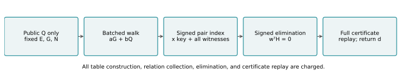
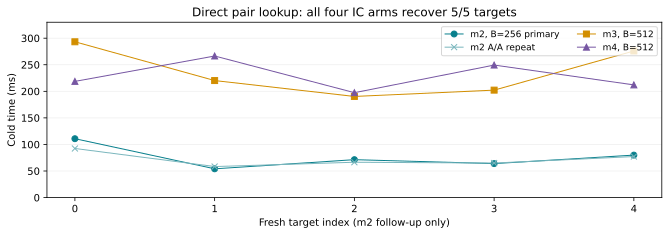
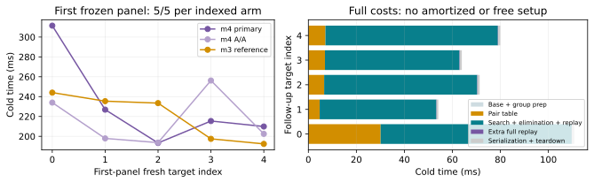

# M31 coordinate-input recovery, end to end

The integrated native pipeline recovered all five fresh follow-up targets. The selected configuration is a 256-column interval base with direct signed two-point lookup. Median cold time was **71.355946 ms**, range **54.148371–110.804362 ms**. On the same five targets, geometric-mean cost was 0.316790 times the fixed 512-column m3 reference and 0.324465 times the m4 reference. These are exploratory producer observations on a shared CPU host; no admitted performance tier or signed independent verification is claimed. [pcc:unverified]

The field is **Fp, p=2147483647=2^31−1**, not F2^31. The fixed lab curve is **y²=x³+2x+14**, order **N=2147505293**, generator **G=(1,814455902)**. The executable receives Q by coordinates only. Evaluator scalars are stored separately and never appear in worker arguments. No rho fallback, planted decomposition, or relaxed certificate threshold is used. [pcc:unverified]



## Run it

From the cryptanalysis repository, with Rust 1.88 installed:

```sh
cargo +1.88.0 build --locked --release \
  --manifest-path crates/prime-field-auxiliary-ic/Cargo.toml --example m31_e2e
scripts/m31-fast 2144058214 807222724 --seed 1
```

The wrapper selects m2, 256 interval-base columns, scalar signed lookup, 64 walk lanes, chunk 64, four million queries and a five-second soft online cap. It returns JSON containing the scalar if recovered, a complete signed relation certificate, exact base points, costs, counters and an explicit status. A bounded incomplete result is possible for other inputs/seeds. This wrapper is fixed to the stated public lab curve. The ordinary CLI also supports `ca-ic auxiliary --pair-index --summands 2 --without-auxiliary --input public.json`; provide the intended factor-base roots in that input. Existing direct/circuit defaults remain available. [pcc:unverified]

## What was tied together

| Lead | Integration and measured choice |
|---|---|
| Target relations and sign recovery | The shared sampler constructs aG+bQ. Pair entries retain every signed witness for each canonical x class. Q and −Q can share a successful cached x witness with signs reversed; fresh hits undergo a full signed group replay. |
| Chains and staged solving | The same target-independent table supports direct m2, staged m3 and balanced pair/pair m4. The comparison selected cheap m2 lookup even though it needs millions of walk queries. Previous F4 monolithic, serial, balanced and partially split encodings remain diagnostic competitors, not hidden work in this path. |
| Explicit addition | Native complete numerical addition handles doubling, inverses and identity intermediates; batched inversions reduce pair construction/probe costs. Binary-descent quadratic claims do not apply to this prime field. |
| Signed partial relations | The existing sparse coefficient system eliminates signed columns modulo N and emits the full dependency. A diagnostic split of the ambient base confirms outside coefficients cancel; all ambient columns are still priced and eliminated. No free reduction of unknown count or large-prime speedup is claimed. |
| Factor base | Interval, random and explicitly selected torus subsets were compared in the first development panel. Interval was selected; the follow-up tuned interval sizes 128/256/512. Binary trace and Koblitz Frobenius shortcuts are inapplicable here. |

The implementation reuses the existing native sampler, Mersenne arithmetic, sparse elimination and strict verifier. The suite already contains a batched MITM m2/m3 implementation (`suite/src/cryptanalysis/ic_framework/prime_batch_mitm.rs`); this work integrates reusable signed witnesses and m4 into the dependency-free recovery crate and ordinary CLI. It is engineering integration, not a new MITM algorithm. [pcc:unverified]

## Two separately frozen panels

The first protocol, seeds and native worker were committed before development. Two old public targets selected B=512, m4; selection and analysis were committed before five new target coordinates were generated. Twenty development/base cells, twenty held-out IC cells, five matched rho calls and one separate phase profile were completed: planned 46, attempted 46, reports 46, excluded 0. All selected primary/A/A and optimized m3 targets recovered (5/5 each); the same-base old direct search recovered 0/5 within its soft budget. Those incomplete traces are retained, not converted into a finite speed ratio. [pcc:unverified]

First-panel selected median cold time was 215.426156 ms (193.337495–311.479621). The selected/m3 paired geometric mean was 1.039258, conditional 95% bootstrap interval [0.902952,1.169314]; this panel does not establish a gain over optimized m3. A/A repeat ratios ranged 0.751249–1.189347. The initial development sweep overlapped a two-job CLI build; this nuisance is recorded in the manifest and limits selection interpretation. The build finished before held-out timing. [pcc:unverified]

That panel's separate profile attributed 160.729 ms of 169.731 ms online to decomposition. Before follow-up timing, a new protocol and distinct seeds froze m2 development at B=128/256/512 on the two old targets. B128 failed to recover one target within four million queries; B256 and B512 recovered both, and geometric-mean cold cost selected B256. Selection and analysis were committed before generating the follow-up's five new targets. The identical release worker binary was reused. [pcc:unverified]

Follow-up flow: planned 32, attempted 32, reports 32, excluded 0. This includes six development cells, twenty held-out IC cells (m2 primary and A/A, fixed B512 m3/m4), five same-target rho references and one separate profile. All four held-out IC arms recovered 5/5. Panels are not pooled. [pcc:unverified]



| Follow-up target | m2 primary ms | m2 A/A ms | m3 ms | m4 ms | m2 queries | sampled peak RSS MiB |
|---:|---:|---:|---:|---:|---:|---:|
| 0 | 110.804362 | 92.379937 | 293.205179 | 218.688830 | 2744789 | 14.336 |
| 1 | 54.148371 | 58.413870 | 220.240305 | 266.458279 | 1774359 | 26.522 |
| 2 | 71.355946 | 66.510122 | 190.329365 | 197.440588 | 1978990 | 26.931 |
| 3 | 63.934578 | 64.998962 | 202.224044 | 249.394929 | 1961482 | 36.864 |
| 4 | 79.943919 | 77.211729 | 275.947648 | 212.068138 | 2509943 | 37.478 |

Values are native recorded cold clocks; RSS is watchdog sampled and rounded, not an allocation bound. The paired selected/reference ratios are 0.316790 for m3, family-adjusted conditional bootstrap [0.267169,0.364080], and 0.324465 for m4, [0.238859,0.446374]. A/A ratios ranged 0.833721–1.078774. The derived inverses are 3.157x and 3.082x on this five-target panel. Resampling uses 10000 draws, seed1729, per-comparison 1.25/98.75 percentiles; it is conditional on these inputs and does not account for host allocation uncertainty. [pcc:unverified]

Follow-up matched native C rho recovered 5/5; median reference-call time was 1.934125 ms. The geometric-mean selected cold/reference-call ratio was 44.703210. Rho uses the existing optimized batched negation implementation with Rust scalar replay. The wrapper's reference call boundary differs from IC cold construction; actual rho search/replay fields and process wall times are retained separately. This experiment does not establish rho parity. [pcc:unverified]

## Cost boundary, correctness and failures



Native cold timing starts at main entry and includes argument parsing, base construction, group preparation, pair-table construction, walk and decomposition, signed sparse elimination, normal certificate verification, an additional full replay, proof serialization preparation and math object teardown. Runtime startup and final stdout emission are excluded; watchdog process wall times include them. There is no table reuse across timed target processes. Building binaries is separate. B256 constructs exactly 65536 signed pair witnesses before lookup; memory reservation is checked before allocation and every collision witness is retained. [pcc:unverified]

Separate instrumented profiles are not timing rows. The m2 profile performs 5454343 clock reads and takes 243.030 ms, versus its uninstrumented old-target development measurement of 85.382 ms with the same mathematical work. Its phase clock overhead is material; do not infer an uninstrumented phase percentage or speedup from it. Native PMU/Callgrind captures were unavailable because perf/valgrind were not installed. [pcc:unverified]

Native release tests cover all 108 nonzero coordinate targets on the finite control E/F127, a=2,b=51,N=109,G=(3,46), for m2/m3/m4; exhaustive decomposition checks include exceptional additions and identity pair intermediates. Resource limits, foreign scratch, wrong-base, signed x-cache and M31 witnesses are checked. Existing pipeline/multi tests remain in force. CLI controls cover indexed recovery/setup accounting, legacy m2 JSONL round-trip, reservation/conflict rejection and solved/replayed exit status. [pcc:unverified]

A second native arithmetic code path (`ic_boundary::PrimeCurve`) replayed all ten primary held-out certificates: first-panel 2372 rows and follow-up 637 rows, all signed row equations, scalar equations and column cancellations; wrong-scalar and wrong-weight mutations were rejected. This is supplemental producer replay, not an independent signed verdict. [pcc:unverified]

The first evaluation launcher paused after its first rho call because its stdout parser mistook numeric lines in pretty JSON arrays for reports. The complete native `--out` report and every raw byte were preserved; parsing was corrected and remaining frozen cells resumed without repeating a completed native process. The failed launcher exit1 remains in its benchmark record. The first two CLI test attempts exposed a misplaced test and then a sparse-checkout fixture absence; after correcting placement and restoring the exact tracked fixture blobs, all twelve auxiliary tests passed. The m2 replay compatibility test and exit-status control passed separately. No verifier was weakened or test skipped. [pcc:unverified]

The one-query IC shell surrounding each rho call remains incomplete and exits1, so the watchdog labels those processes `crashed`; their native rho subreports are solved and locally replayed. This is a nonzero report status, not evidence of an OS crash. Direct search soft deadlines are checked between batches, giving first-panel incomplete cold times about5.95–7.82s despite a5s online cap; no process hit its independent20s/2GiB watchdog limit. All capped/null observations remain present. [pcc:unverified]

## Reproduction and scope

Run `python3 .../run.py dev`, commit its selection, then `python3 .../run.py evaluate` only in a fresh copy of the output directory; original raw files are create-once. The follow-up has its own `m2/run.py` and precommitted `m2/analyze.py`. Run `suite/target/debug/examples/m31_e2e_replay <manifest.json>` for supplemental arithmetic replay. Use `analyze.py` in each original directory to check hashes and regenerate statistics without curve arithmetic. [pcc:unverified]

Execution worker source is local commit `bfa695d0c5963a2bbdb6a59766683188a40df8f4`, binary SHA256 `ee67b81916a6a762af01e781a4ae72af6faee98c7e5715663444c60138f1d067`. First selection/analysis commit `a52ce2f`; follow-up protocol `c94c0b7`, runner `0f5ec2d`, selection/analysis `67f5e90`. Original local commits are preserved in the delivery bundle; publication may use an equivalent Git tree with a separate connector commit. `RESULTS.json` binds both manifests, both full summaries and both replay receipts by SHA256. [pcc:unverified]

Host: AMD EPYC9V74, x86-64 Linux container, five allowed logical CPUs, taskset to the lowest allowed CPU, portable native scalar backend, no GPU. Physical RAM type/speed and physical-host exclusivity are unknown. `hardware.json` captures observable topology/cgroup limits after evaluation; per-process CPU time, PMU counters, enforced NUMA placement and provider allocation receipts were not captured. No isolation tier is earned. Tiny instances, two tuning targets, five held-out targets and shared-host noise limit generality. [pcc:unverified]

The user authorized local CPU execution and local storage. Raw outputs, evaluator custody, original failure logs, inputs, binaries and source history are retained in `/workspace/isogeny-m31-e2e.zip`; no S3 upload is asserted. Benchmark records keep `uploaded:false` and therefore cannot clear the global artifact admission gate. The source research gate adds zero PCC claims. This work is a usable local implementation and exploratory evaluation; signed independent admission and cryptographic-scale performance remain unestablished. [pcc:unverified]

| Requested item | Status and evidence |
|---|---|
| Use Isogeny Labs over Fp M31 | Implemented, locally exercised on the stated exact curve; native crate and suite CLI. |
| Tie the leads into end-to-end recovery | Implemented and locally replayed: public coordinates to scalar and complete dependency; inapplicable binary shortcuts explicitly scoped out. |
| Make it fast | Measured on the separate fresh five-target panel; selected criterion met, 71.356ms median fully charged cold cost. |
| Correctness and retention | Finite exhaustive target control, ten supplemental primary certificate replays and negative mutations; all78 native reports retained. |
| Independent/general performance claim | Unverified; no signed verdict or admitted timing tier, no claim of beating rho or scaling to large curves. |

Canonical scoreboard, progress timeline, curve routes and catalogue were checked; exploratory results do not satisfy their admission rules, so those graphs remain unchanged. Only these study figures and the unqualified benchmark progress/metrics series change. The next measured optimization would be a separate gain-graph m2 elimination comparison or packed table representation; neither is included in the present timings. [pcc:unverified]


Final publication check: `pcc ledger verify --base origin/main` fails at
entry3583 (seq3535). This branch makes no change to pcc/; the HEAD ledger
has exactly the parent b4e8b ledger bytes. The global artifact gate also
retains missing/unuploaded historical and local raw objects. No push,
ready-for-review transition, merge or ledger repair is attempted past
these gates. The completed implementation, measurements and original
commits are delivered locally; PRs remain tracking drafts. These concrete
publication failures do not invalidate or independently verify the local
mathematical outputs. [pcc:unverified]
