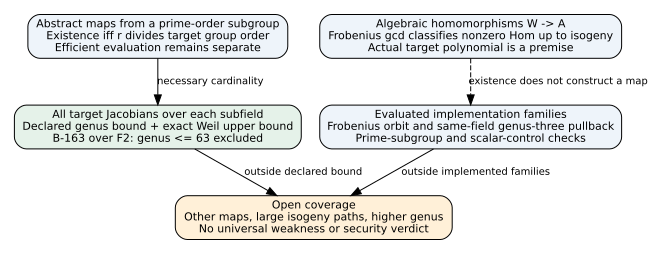
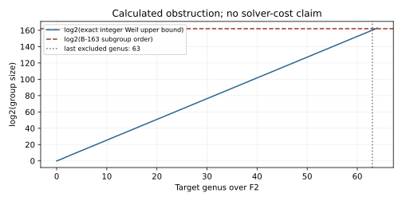

# Binary transfer classification and obstruction audit

Date: 2026-10-30. Status: implemented bounded audit and written scoped theorems;
geometric formalization and universal efficient-transfer classification remain partial.

## Question and actual deliverable

The user requested a classification/trust theorem and obstruction, with a Rust
CLI whose coverage certificates make clear whether an input curve and its
isogeny class have been exhausted. The result is a replayable tool with three
different scopes: abstract finite-group maps, algebraic homomorphisms of abelian
varieties, and evaluated maps in a specified implementation family. They must
not be conflated. None is an exhaustive classification of all useful ECDLP
algorithms. No new weak family or solver-speed claim is made.

The implementation is based on main ae8994ab14e942c774818704dc19402f6671d848,
on branch codex/transfer-audit-classification; main 82eb1eac was subsequently
integrated without changing the imported native sources or tool implementation.
Native cover/arithmetic sources
are imported unchanged by path from suite/src/binary_ecc. The old GHS research
files, source snapshots, PDFs and manifests are untouched.

## Results and theorem scope

For an abstract cyclic group of prime order r and finite abelian group H,
Hom(C_r,H) is parameterized by H[r], and a nonzero map is injective. Existence
is equivalent to r dividing |H|. This says nothing about efficient evaluation:
the abstract formula may require the discrete logarithm one hopes to solve.

For actual abelian varieties over a finite field, a nonzero algebraic
homomorphism exists up to isogeny exactly when their Frobenius polynomials
share an irreducible factor. Coprimeness excludes every algebraic homomorphism
between the specified classes, not only maps generated by GHS. The CLI tests
this with exact polynomial gcds, conditional on the supplied target polynomial
being its actual Frobenius polynomial. It does not construct an arbitrary
Jacobian, verify that polynomial geometrically, or prove nonzero action on
the selected r-subgroup. The written proof also states the dimension obstruction
under a separately established irreducibility hypothesis; the tool does not
silently assert simplicity.

For all Jacobians over F_q of genus at most G, the exact Weil bound gives
the family-independent obstruction r>floor((sqrt(q)+1)^(2G)). This applies
uniformly to every source curve connected by subgroup-preserving isogenies.
It needs no restriction on hyperellipticity, cover degree or automorphisms.

The full statements, written proofs, prior sources and proof map are in
[THEOREMS.md](THEOREMS.md). They are applications of known theory, not claims
of a new published classification theorem.

## B-163 fixed-fixture correctness checks

The public SEC 2 section 3.2.3 parameters are frozen in fixtures/b163.json.
The field is defined by z^163+z^7+z^6+z^3+1; a=1, and b, G and r are retained
as exact strings. This is B-163/sect163r2, not K-163/sect163k1. The fixture is
an audit input, not a new EC1/IC1 curve or weak-curve catalogue entry.

Native tests verify the field, recursive Pocklington prime certificate,
nonzero generator and rG=O. The source order is recovered as the unique
multiple of r in the Hasse interval. The two divisor fields are enumerated:
F2 and the original F_(2^163). The complete coefficient Frobenius orbit has
163 members, with evaluated point images. This is not the full isogeny class.

Over F2 the exact genus-63 upper bound is
1697213011467681896483704108875603013010097288197, below the certified prime
5846006549323611672814742442876390689256843201587. At genus 64 the bound is
9892082352510403757550172975146702122837936996353. Thus genus<=63 is excluded
for every target in this scope. Passing the genus-64 size test supplies no
target or attack. The earlier outline's m~30 at degree 163 is corrected:
classical GHS m=163 here; 30 is the minimum for degree 233.

The existing same-field genus-three family is constructed through the native
backend. Tests check the reduced Mumford generator image, exact order, the
degree-three pull/push identity, and the public known-answer relation at 37G.
This is a checked transfer over F_(2^163), not a descent to F2. No unknown
logarithm was solved, and no construction/transfer/solve timings are reported.
The native module still lacks a general arbitrary-divisor norm. No new
cryptanalytic experiment or research sweep was launched; these are deterministic
implementation/proof/fixed-fixture correctness checks.

## Coverage, validation and failures

Small-field exhaustive classification is implemented only through degree eight.
It enumerates both canonical twists for every nonzero b and filters by exact
order. Equal trace gives isogeny-class membership; paths between all members
are not invented. Independent x,y counts through degree four control the trace
counter. Tests cover compatible/incompatible spectral polynomials, malformed
fields and inputs, altered prime proofs, deleted coverage rows, forged
certificates and overwrite attempts. Koblitz b=1 remains a degenerate classical
GHS control, while the existing same-field cover can still be valid there.

The certificate replay compares every field with a fresh deterministic
calculation. It binds source, manifest, lockfile and imported native-module
hashes. This is source-bound replay, not an independent implementation or
authentication. `all_possible_transfers_ruled_out` remains false and open
coverage is retained even after a successful run.

Lean 4.34.1 verifies eleven named theorems plus one generated equation theorem;
the transitive audit accepts only propext, Classical.choice and Quot.sound.
No sorry, custom claim axiom, native_decide or bypass is used in the final
proof. The geometry, finite-group classification, Tate theorem and complete
Rust refinement remain written/unformalized bridges. This module is tool
verification under tools/lean, checked by its own CI gate; no historical
corpus receipt is regenerated.

All attempts are preserved under evidence, including the initial offline
dependency failure, Lean syntax/reduction failures and strict-Clippy findings.
The native-module lint policy is inherited narrowly from suite/Cargo.toml;
no new-code lint is disabled. The existing slow native curve-order test stays
ignored as it was upstream; the new B-163 test explicitly checks its own
generator's exact order. The final check receipt reports the actual checks.

The checkpoint gate first failed at incompatible BSD/GNU stat output. A
one-line portable file-size query fixes it; the subsequent upload fails for
missing runtime credentials/token. Those outputs are preserved. This blocks
research sweeps, not the implementation and fixed-fixture correctness tests.
The local LMFDB NAS/cache paths were absent; no remote catalogue was substituted.
The lead atlas and existing GHS studies supply prior-work context, not novelty.

## Requirement status and next discriminating work

| Requirement | Status | Remaining gap |
|---|---|---|
| Rust CLI and replayable scope certificate | implemented and locally checked | hosted exact-head CI remains a separate gate |
| All subfields and exact genus obstruction | checked for the fixed fixtures | larger supported inputs require their own certificate replay |
| Source isogeny-class applicability | complete only for requested degree<=8 enumeration; Frobenius orbit evaluated | arbitrary large-class paths and maps remain open |
| Classification/trust/obstruction theorem | scoped written proofs and partial Lean verification | full geometric and computational classification is not established |
| B-163 transfer | same-field fixed-family pullback checked | no smaller-field target or useful solver established |
| New affected family or lower-cost descent | unresolved | evaluated new route, source subgroup/log transfer, novelty and cost evidence |

The next implementation step is an independently verified isogeny-path provider
beyond Frobenius, starting from the complete small-field classes. Its inclusion
must extend the declared universe explicitly. The open requirements are tracked
in problems/transfer-audit-completeness.md, independently of PR completion.

Graphs checked: the existing GHS quartic-cubic transfer-scope graph and the
candidate-catalogue curve/route definitions. They remain unchanged because no
new curve identity, isogeny edge or weak family is certified here. These new
figures describe proof scope and calculated bounds only.
